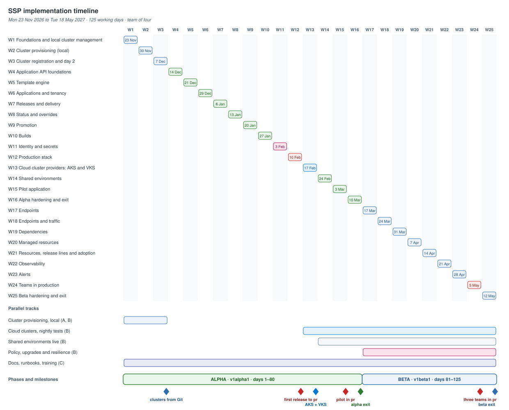

# Implementation Plan: Self-Service Platform on OCM

A day-by-day plan, with [one folder per week and one file per day](#weeks), to build [SSP-0001](../enhancements/0001-self-service-platform-on-ocm/README.md) from an empty repository to the beta exit review. It follows the KEP's phases and graduation criteria, and the [requirements](../Proposal/Requirements.md).

## Weeks

| Week | Dates | Theme | Phase |
|---|---|---|---|
| [1](Week-01-Foundations-and-local-cluster-management/README.md) | Mon 23 Nov – Fri 27 Nov | Foundations and local cluster management | Alpha |
| [2](Week-02-Cluster-provisioning-local/README.md) | Mon 30 Nov – Fri 4 Dec | Cluster provisioning (local) | Alpha |
| [3](Week-03-Cluster-registration-and-day-2/README.md) | Mon 7 Dec – Fri 11 Dec | Cluster registration and day 2 | Alpha |
| [4](Week-04-Application-API-foundations/README.md) | Mon 14 Dec – Fri 18 Dec | Application API foundations | Alpha |
| [5](Week-05-Template-engine/README.md) | Mon 21 Dec – Mon 28 Dec | Template engine | Alpha |
| [6](Week-06-Applications-and-tenancy/README.md) | Tue 29 Dec – Tue 5 Jan | Applications and tenancy | Alpha |
| [7](Week-07-Releases-and-delivery/README.md) | Wed 6 Jan – Tue 12 Jan | Releases and delivery | Alpha |
| [8](Week-08-Status-and-overrides/README.md) | Wed 13 Jan – Tue 19 Jan | Status and overrides | Alpha |
| [9](Week-09-Promotion/README.md) | Wed 20 Jan – Tue 26 Jan | Promotion | Alpha |
| [10](Week-10-Builds/README.md) | Wed 27 Jan – Tue 2 Feb | Builds | Alpha |
| [11](Week-11-Identity-and-secrets/README.md) | Wed 3 Feb – Tue 9 Feb | Identity and secrets | Alpha |
| [12](Week-12-Production-stack/README.md) | Wed 10 Feb – Tue 16 Feb | Production stack | Alpha |
| [13](Week-13-Cloud-cluster-providers-AKS-and-VKS/README.md) | Wed 17 Feb – Tue 23 Feb | Cloud cluster providers: AKS and VKS | Alpha |
| [14](Week-14-Shared-environments/README.md) | Wed 24 Feb – Tue 2 Mar | Shared environments | Alpha |
| [15](Week-15-Pilot-application/README.md) | Wed 3 Mar – Tue 9 Mar | Pilot application | Alpha |
| [16](Week-16-Alpha-hardening-and-exit/README.md) | Wed 10 Mar – Tue 16 Mar | Alpha hardening and exit | Alpha |
| [17](Week-17-Endpoints/README.md) | Wed 17 Mar – Tue 23 Mar | Endpoints | Beta |
| [18](Week-18-Endpoints-and-traffic/README.md) | Wed 24 Mar – Tue 30 Mar | Endpoints and traffic | Beta |
| [19](Week-19-Dependencies/README.md) | Wed 31 Mar – Tue 6 Apr | Dependencies | Beta |
| [20](Week-20-Managed-resources/README.md) | Wed 7 Apr – Tue 13 Apr | Managed resources | Beta |
| [21](Week-21-Resources-release-lines-and-adoption/README.md) | Wed 14 Apr – Tue 20 Apr | Resources, release lines and adoption | Beta |
| [22](Week-22-Observability/README.md) | Wed 21 Apr – Tue 27 Apr | Observability | Beta |
| [23](Week-23-Alerts/README.md) | Wed 28 Apr – Tue 4 May | Alerts | Beta |
| [24](Week-24-Teams-in-production/README.md) | Wed 5 May – Tue 11 May | Teams in production | Beta |
| [25](Week-25-Beta-hardening-and-exit/README.md) | Wed 12 May – Tue 18 May | Beta hardening and exit | Beta |

## Assumptions

Change these and the dates move; the order of work does not.

| Assumption | Value |
|---|---|
| Start date | Mon 23 Nov 2026 |
| Working days | Monday to Friday. Not scheduled: Christmas Day (Fri 25 Dec 2026), New Year's Day (Fri 1 Jan 2027). Add local holidays as needed. |
| Team | Four engineers in three workstreams (below), plus a product owner and part-time support from security, the Operators and the pilot team |
| Language | Java 25 with Quarkus, the Java Operator SDK and the Fabric8 client for all of SSP, including `kubectl ssp` (GraalVM native). TypeScript for the Backstage plugins. OCM is used as released, with no changes. See the KEP's [Implementation Language](../enhancements/0001-self-service-platform-on-ocm/README.md#implementation-language). |
| Clusters | In scope and built first. SSP provisions every cluster except the two hubs: local clusters (Cluster API Docker provider) from week 1, AKS and VKS from week 13. |
| Environments | Local clusters on laptops and in CI until week 13; the shared VKS and AKS clusters from the [reference design](../Proposal/Reference-Deployment-Design.md) from week 14, created by SSP |
| Scope | Daily detail through the beta exit (day 125). GA needs six months on beta, so it is planned by month. |

## Workstreams

| Workstream | People | Owns |
|---|---|---|
| **A · Controllers** | 2 | SSP in Java: cluster controller and providers, API types, controllers, admission webhooks, template engine, status, release export and import, observer API |
| **B · Platform** | 1 | Hubs, Cluster API and its providers, OCM, Flux, SPIRE, add-ons, Git repositories and protection, CI and end-to-end tests, shared environments, OCM upgrades |
| **C · Experience** | 1 | `kubectl ssp` (Java, Picocli), the Backstage plugins (TypeScript), documentation, runbooks, training |

## Milestones

| Day | Date | Milestone | Requirements shown |
|---|---|---|---|
| 5 | Fri 27 Nov 2026 | Local cluster created with Cluster API and imported into OCM | SR-6 |
| 10 | Fri 4 Dec 2026 | First local cluster provisioned from a pull request | SR-1 |
| 15 | Fri 11 Dec 2026 | Clusters registered, add-ons placed; scale, upgrade, delete from Git | SR-1, SR-6, SR-8 |
| 20 | Fri 18 Dec 2026 | Hand-made fan-out to SSP-provisioned clusters | SR-6 |
| 30 | Tue 5 Jan 2027 | Application onboarding from Git | SR-6, SR-7 |
| 35 | Tue 12 Jan 2027 | First component delivered to dv by SSP | SR-6 |
| 45 | Tue 26 Jan 2027 | dv → te promotion enforced at admission | SR-3 |
| 55 | Tue 9 Feb 2027 | SPIFFE identities and no stored secrets in application paths | SR-4, SR-5 |
| 60 | Tue 16 Feb 2027 | te → pr through an Operator-approved pull request (local) | SR-2, SR-3, SR-9 |
| 65 | Tue 23 Feb 2027 | AKS and VKS clusters provisioned from pull requests | SR-1 |
| 70 | Tue 2 Mar 2027 | Both stacks on shared VKS and AKS clusters, all created by SSP | SR-1, SR-2 |
| 74 | Mon 8 Mar 2027 | Pilot application in production | SR-1 to SR-9 |
| 80 | Tue 16 Mar 2027 | **Alpha exit**: `v0.1.0`, `v1alpha1` | KEP alpha criteria |
| 95 | Tue 6 Apr 2027 | Dependencies between components | SR-7, SR-8 |
| 115 | Tue 4 May 2027 | Alerts from teams reach SRE channels | SR-5 |
| 120 | Tue 11 May 2027 | Three teams in production, one shared cluster | SR-7, SR-8, SR-9 |
| 125 | Tue 18 May 2027 | **Beta exit**: `v0.2.0`, `v1beta1` | KEP beta criteria |

## Decisions Needed

The KEP's open questions, with the day each must be answered so that the plan does not slip.

| Open question | Needed by | Blocks |
|---|---|---|
| OQ 8 · API group name (decided 21 Nov 2026: keep `ssp.io`) | Day 2 · Tue 24 Nov 2026 | The first CRDs (cluster kinds) |
| OQ 10 · Who approves cluster requests in non-production (decided 21 Nov 2026: a platform engineer, every request) | Day 9 · Thu 3 Dec 2026 | `fleet-np` protection for `clusters/` |
| OQ 9 · Cluster API kubeconfig Secrets and SR-5 (decided 21 Nov 2026: keep the Secret, importer reads only it) | Day 11 · Mon 7 Dec 2026 | Cluster registration (week 3) |
| OQ 3 · Template engine in Java: is cel-java enough for OpenChoreo's syntax (decided 21 Nov 2026: yes, cel-java) | Day 22 · Tue 22 Dec 2026 | Week 5 onwards |
| OQ 5 · Production rebuild or approved copy | Day 50 · Tue 2 Feb 2027 | Production stack (week 12) |
| OQ 1 · Git host authentication without stored secrets (decided 22 Nov 2026: Entra-federated Git host; GitHub App key in Key Vault only if GitHub is required) | Day 51 · Wed 3 Feb 2027 | Flux in shared environments (week 14) |
| OQ 6 · SR-9 scope for platform changes (decided 22 Nov 2026: SR-9 covers `fleet-pr` and `platform` tag changes) | Day 53 · Fri 5 Feb 2027 | `fleet-pr` protection (week 12) |
| OQ 2 · VKS bootstrap token (decided 22 Nov 2026: no join token; clusters attest with their OCM add-on certificate) | Day 55 · Tue 9 Feb 2027 | VKS provider (week 13) |
| OQ 4 · Image pulls on VKS (decided 22 Nov 2026: kubelet service-account-token credential provider with Entra federation) | Day 55 · Tue 9 Feb 2027 | VKS provider (week 13) |
| OQ 7 · Shared clusters in production | Day 116 · Wed 5 May 2027 | Week 24 onboarding |

## Daily Routine

- **Every day:** a 15-minute stand-up per workstream; the end-to-end suite runs on every pull request.
- **Last day of each plan week** (usually a Friday; holidays shift it): demo of the week's exit check, then planning for the next week. A missed exit check becomes the next day's first task.
- **Every second plan week:** retro on its last day.
- **Definition of done for a task:** merged with tests, documented, and shown in the end-to-end suite where it changes behaviour.

## Phase 1 · Alpha (days 1–80)

Goal: the KEP's alpha criteria. Clusters come first: local clusters from week 1, AKS and VKS in week 13, all requested from Git. Then the core kinds work end to end in non-production, the Backstage plugins create applications and show status, one application reaches production through Operator approval, and SPIRE runs in both stacks.

### [Week 1](Week-01-Foundations-and-local-cluster-management/README.md) · Foundations and local cluster management · Mon 23 Nov to Fri 27 Nov

**Goal:** A hub that can create local clusters with Cluster API and import them into OCM, and the empty SSP repository.

| Day | Date | A · Controllers | B · Platform | C · Experience |
|---|---|---|---|---|
| [1](Week-01-Foundations-and-local-cluster-management/Day-001-2026-11-23.md) | Mon 23 Nov | Create the `ssp` repository: Java 25, Quarkus, Java Operator SDK, Maven; lint and unit-test CI. | Script the local hub: one kind cluster running the OCM hub (with `ClusterImporter`), Cluster API and the Docker provider. | Set up the docs site skeleton and a glossary of SSP terms, clusters first. |
| [2](Week-01-Foundations-and-local-cluster-management/Day-002-2026-11-24.md) | Tue 24 Nov | Write `ClusterType` and `KubernetesCluster` types; generate CRDs. | Add the CAPD `ClusterClass` `ssp-docker`; create one local cluster by hand with `clusterctl`. | Scaffold the `kubectl ssp` plugin (Picocli, GraalVM native binary) with `version` and contexts. |
| [3](Week-01-Foundations-and-local-cluster-management/Day-003-2026-11-25.md) | Wed 25 Nov | Status model for `KubernetesCluster`: phases, conditions, printer columns. | Import the hand-made cluster with OCM's `ClusterImporter`; document the naming rule. | Scaffold the Backstage frontend and backend plugins; read the hub through the Kubernetes API. |
| [4](Week-01-Foundations-and-local-cluster-management/Day-004-2026-11-26.md) | Thu 26 Nov | Provider interface in Java: `local` now, `aks` and `vks` later. | Install Flux on the hub and run the Gitea fixture with `platform` and `fleet-np` (with a `clusters/` folder). | Design portal sign-in: Entra ID in shared environments, a local OIDC provider in kind. |
| [5](Week-01-Foundations-and-local-cluster-management/Day-005-2026-11-27.md) | Fri 27 Nov | Cluster API review with the whole team; write ADR-001 (cluster provisioning). | Write ADR-002 (hub layout: OCM, Cluster API, Flux on one hub); demo prep. | Write ADR-003 (interfaces); demo prep. |

**Exit check (day 5):** A local cluster created by hand with Cluster API is imported into OCM automatically and becomes `Available`.

### [Week 2](Week-02-Cluster-provisioning-local/README.md) · Cluster provisioning (local) · Mon 30 Nov to Fri 4 Dec

**Goal:** A `KubernetesCluster` in Git becomes a running local cluster.

| Day | Date | A · Controllers | B · Platform | C · Experience |
|---|---|---|---|---|
| [6](Week-02-Cluster-provisioning-local/Day-006-2026-11-30.md) | Mon 30 Nov | Cluster controller: `KubernetesCluster` → namespace and Cluster API `Cluster` with the type's `ClusterClass` topology. | `ClusterType`s `local-small` and `local-medium` in the `platform` fixture. | `kubectl ssp cluster list` and `get`. |
| [7](Week-02-Cluster-provisioning-local/Day-007-2026-12-01.md) | Tue 1 Dec | Admission webhook for `KubernetesCluster`: type, environment, version, team, names. | End-to-end harness (JUnit 5, Fabric8 client, kind); first test: request a cluster. | Backstage clusters list from `KubernetesCluster`. |
| [8](Week-02-Cluster-provisioning-local/Day-008-2026-12-02.md) | Wed 2 Dec | Map Cluster API conditions to phases and conditions. | Run the end-to-end suite in CI with kind and the Docker provider. | `kubectl ssp cluster create` writes the request to a `fleet-np` branch and opens a pull request. |
| [9](Week-02-Cluster-provisioning-local/Day-009-2026-12-03.md) | Thu 3 Dec | Labels on Cluster API objects (team, environment, stack, type); requests only from Git. | `fleet-np` `clusters/` folder with code owners for platform engineers. | Backstage cluster page: phase, version, nodes, conditions. |
| [10](Week-02-Cluster-provisioning-local/Day-010-2026-12-04.md) | Fri 4 Dec | Fix-ups; unit test coverage for the cluster controller. | End-to-end: request through Git reaches ready nodes in under ten minutes. | Demo. |

**Exit check (day 10):** A pull request to `fleet-np` creates a local cluster that reaches the `Registering` phase with ready nodes.

### [Week 3](Week-03-Cluster-registration-and-day-2/README.md) · Cluster registration and day 2 · Mon 7 Dec to Fri 11 Dec

**Goal:** Provisioned clusters join OCM, get their add-ons, and can be scaled, upgraded and deleted from Git.

| Day | Date | A · Controllers | B · Platform | C · Experience |
|---|---|---|---|---|
| [11](Week-03-Cluster-registration-and-day-2/Day-011-2026-12-07.md) | Mon 7 Dec | Registration: create the `ManagedCluster` with labels and cluster set; OCM's importer joins it. | SSP creates cluster sets on demand: `team-<name>` and `shared-<env>`. | "Requesting a cluster" guide. |
| [12](Week-03-Cluster-registration-and-day-2/Day-012-2026-12-08.md) | Tue 8 Dec | Add-ons: platform `Placement`s over all SSP clusters; `Ready` only when the type's add-ons are healthy. | Add-on placements in `platform` (policy placeholder now; SPIRE and telemetry later). | Backstage "Request a cluster" template opens a pull request to `fleet-np`. |
| [13](Week-03-Cluster-registration-and-day-2/Day-013-2026-12-09.md) | Wed 9 Dec | Scale and upgrade: size and version changes update the Cluster API topology. | End-to-end: scale a local cluster, then upgrade its Kubernetes version. | `kubectl ssp cluster scale` and `upgrade` (write pull requests). |
| [14](Week-03-Cluster-registration-and-day-2/Day-014-2026-12-10.md) | Thu 10 Dec | Delete: finalizer removes the `ManagedCluster`, then the Cluster API `Cluster`, then the namespace. | End-to-end: deleting a cluster leaves no containers, objects or Secrets. | Cluster lifecycle guide. |
| [15](Week-03-Cluster-registration-and-day-2/Day-015-2026-12-11.md) | Fri 11 Dec | Fix-ups. | Request `team-dv`, `team-te` and `shared-te` through `fleet-np`; these are the development clusters for the following weeks. | Demo. |

**Exit check (day 15):** Three local clusters (`team-dv`, `team-te`, `shared-te`) requested by pull request are `Ready` in OCM with add-ons; one is scaled, upgraded and deleted with nothing left behind.

### [Week 4](Week-04-Application-API-foundations/README.md) · Application API foundations · Mon 14 Dec to Fri 18 Dec

**Goal:** Application kinds reviewed; delivery proven on SSP-provisioned clusters.

| Day | Date | A · Controllers | B · Platform | C · Experience |
|---|---|---|---|---|
| [16](Week-04-Application-API-foundations/Day-016-2026-12-14.md) | Mon 14 Dec | Write `Application`, `Environment` and `PromotionPath` types. | Enable the `ManifestWorkReplicaSet` feature gate; fan out a hand-written MWRS through a `Placement`. | Backstage: link clusters to their teams in the catalog. |
| [17](Week-04-Application-API-foundations/Day-017-2026-12-15.md) | Tue 15 Dec | Write `ClusterComponentType` and `ClusterTrait` types with CEL validation markers. | Cluster health dashboards on the hub: Cluster API and OCM conditions. | Backstage: per-cluster add-on health. |
| [18](Week-04-Application-API-foundations/Day-018-2026-12-16.md) | Wed 16 Dec | Write `Component`, `Workload`, `ComponentRelease` and `ReleaseBinding` types; generate CRDs. | Prove executor limits: a `ManifestWork` running as a namespaced ServiceAccount cannot write elsewhere. | Backstage: cluster request status, from pull request to `Ready`. |
| [19](Week-04-Application-API-foundations/Day-019-2026-12-17.md) | Thu 17 Dec | Application API review with the whole team; write ADR-004 (application API). | Write ADR-005: application delivery through `ManifestWorkReplicaSet` and executors. | Weekly summary for stakeholders. |
| [20](Week-04-Application-API-foundations/Day-020-2026-12-18.md) | Fri 18 Dec | Fix-ups across cluster and application code. | Demo prep. | Demo. |

**Exit check (day 20):** A hand-written `ManifestWorkReplicaSet`, applied by Flux, runs nginx on two SSP-provisioned clusters.

### [Week 5](Week-05-Template-engine/README.md) · Template engine · Mon 21 Dec to Mon 28 Dec

**Goal:** Render a component type with traits into Kubernetes manifests, offline.

| Day | Date | A · Controllers | B · Platform | C · Experience |
|---|---|---|---|---|
| [21](Week-05-Template-engine/Day-021-2026-12-21.md) | Mon 21 Dec | Spike: OpenChoreo's template syntax on `cel-java`; port its template tests as fixtures (OQ 3). | Lay out the Git fixture repositories as in the KEP. | Design `kubectl ssp scaffold` from type parameter schemas. |
| [22](Week-05-Template-engine/Day-022-2026-12-22.md) | Tue 22 Dec | Decide OQ 3; create the `template` module with the CEL environment and evaluation limits. | One Flux `Kustomization` per repository, each impersonating a scoped ServiceAccount. | Backstage entity provider: `Application` → System. |
| [23](Week-05-Template-engine/Day-023-2026-12-23.md) | Wed 23 Dec | Render resource templates: `${…}` expressions, `includeWhen`, `forEach`; table-driven tests. | Hub RBAC baseline for `app-*` namespaces; Entra structured authentication stub. | Implement `kubectl ssp scaffold component`. |
| [24](Week-05-Template-engine/Day-024-2026-12-24.md) | Thu 24 Dec | Traits: create and JSON-patch resources; embedded traits; trait schemas. | `ValidatingAdmissionPolicy`: only SSP may create `Placement` and MWRS in `app-*`. | Backstage entity provider: `Component` → Component. |
| [25](Week-05-Template-engine/Day-025-2026-12-28.md) | Mon 28 Dec | Code review and hardening of the engine; per-reconcile cost budget. | Policy tests for the admission policy. | Wire `kubectl ssp render`; demo. |

**Exit check (day 25):** `kubectl ssp render` turns a `web-service` component with an autoscaler trait into manifests.

### [Week 6](Week-06-Applications-and-tenancy/README.md) · Applications and tenancy · Tue 29 Dec to Tue 5 Jan

**Goal:** Onboarding an application creates its hub namespace, cluster set bindings and cluster namespaces.

| Day | Date | A · Controllers | B · Platform | C · Experience |
|---|---|---|---|---|
| [26](Week-06-Applications-and-tenancy/Day-026-2026-12-29.md) | Tue 29 Dec | Application controller: create `app-<name>`, labels, RoleBindings for the owner's groups. | Environments select SSP-provisioned clusters by label; check the sets SSP created. | Backstage Application page: owner, namespace, cluster sets. |
| [27](Week-06-Applications-and-tenancy/Day-027-2026-12-30.md) | Wed 30 Dec | Create a `ManagedClusterSetBinding` per allowed set; only SSP holds `managedclustersets/bind`. | Sample `Environment` and `PromotionPath` objects in `fleet-np`. | Onboarding guide (docs). |
| [28](Week-06-Applications-and-tenancy/Day-028-2026-12-31.md) | Thu 31 Dec | `ApplicationType` renders the `ns-<app>` ManifestWork: namespace, `ssp-app-<app>`, Role, quota, network policy, Pod Security labels. | Extend the end-to-end harness with application helpers; first test: onboard an application. | Backstage template "Onboard application" opens a pull request to `fleet-np`. |
| [29](Week-06-Applications-and-tenancy/Day-029-2027-01-04.md) | Mon 4 Jan | Application deletion: finalizers, removal of bindings and namespace works. | Split the end-to-end suites: cluster lifecycle (nightly) and applications (every pull request). | Review the template against the onboarding guide. |
| [30](Week-06-Applications-and-tenancy/Day-030-2027-01-05.md) | Tue 5 Jan | Fix-ups from review. | Flaky-test triage; cache kind images in CI. | Demo. |

**Exit check (day 30):** A pull request to `fleet-np` onboards `app-checkout`; its namespace appears on the dv clusters with quota and network policy.

### [Week 7](Week-07-Releases-and-delivery/README.md) · Releases and delivery · Wed 6 Jan to Tue 12 Jan

**Goal:** A `ReleaseBinding` to dv runs a component on the dv clusters.

| Day | Date | A · Controllers | B · Platform | C · Experience |
|---|---|---|---|---|
| [31](Week-07-Releases-and-delivery/Day-031-2027-01-06.md) | Wed 6 Jan | Release controller: `Component` + `Workload` → immutable `ComponentRelease` (content-hash name, immutability webhook). | Environment status: list the clusters each environment matches. | `kubectl ssp status <component>`. |
| [32](Week-07-Releases-and-delivery/Day-032-2027-01-07.md) | Thu 7 Jan | Releases pin type and trait versions (snapshot in the release spec). | Webhook serving certificates: short-lived, rotated by cert-manager. | Backstage Component page: list of releases. |
| [33](Week-07-Releases-and-delivery/Day-033-2027-01-08.md) | Fri 8 Jan | Binding controller: resolve the environment into a `Placement` in `app-<app>`. | Placement tests across team and shared cluster sets. | Component authoring guide (docs). |
| [34](Week-07-Releases-and-delivery/Day-034-2027-01-11.md) | Mon 11 Jan | Binding controller: render the bundle into a MWRS with executor and rollout strategy. | End-to-end: a dv binding runs pods on `team-dv`. | `kubectl ssp tree`: rendered resources of a binding. |
| [35](Week-07-Releases-and-delivery/Day-035-2027-01-12.md) | Tue 12 Jan | Fix-ups; idempotency tests (no update when the render is unchanged). | End-to-end: no update storm on re-sync. | Demo. |

**Exit check (day 35):** A merge in the application repository runs `checkout-api` on `team-dv`, delivered by `ManifestWork`.

### [Week 8](Week-08-Status-and-overrides/README.md) · Status and overrides · Wed 13 Jan to Tue 19 Jan

**Goal:** Teams see per-cluster health and can tune each environment.

| Day | Date | A · Controllers | B · Platform | C · Experience |
|---|---|---|---|---|
| [36](Week-08-Status-and-overrides/Day-036-2027-01-13.md) | Wed 13 Jan | Status feedback rules: Deployment availability and well-known status. | Scrape hub metrics: `ManagedCluster`, add-on and `ManifestWork` conditions. | Backstage per-cluster health view. |
| [37](Week-08-Status-and-overrides/Day-037-2027-01-14.md) | Thu 14 Jan | Aggregate the MWRS summary and per-cluster feedback into `ReleaseBinding.status`; `Ready` condition. | Flux `Kustomization` health checks wait on SSP `Ready`. | `kubectl ssp status` per cluster. |
| [38](Week-08-Status-and-overrides/Day-038-2027-01-15.md) | Fri 15 Jan | `state: Undeploy`; cascade deletion of the bundle. | End-to-end: undeploy, redeploy, delete. | Status reference (docs). |
| [39](Week-08-Status-and-overrides/Day-039-2027-01-18.md) | Mon 18 Jan | Overrides: parameters, environment variables, files; per-environment schema validation. | Performance baseline: 10 clusters × 50 components. | Backstage bindings tab with override diff. |
| [40](Week-08-Status-and-overrides/Day-040-2027-01-19.md) | Tue 19 Jan | Fix-ups. | Record baseline numbers in the repo. | Demo and retro. |

**Exit check (day 40):** `ReleaseBinding.status` shows health per cluster, and Flux waits for it.

### [Week 9](Week-09-Promotion/README.md) · Promotion · Wed 20 Jan to Tue 26 Jan

**Goal:** Promotion from dv to te is enforced at admission, Flux writes included.

| Day | Date | A · Controllers | B · Platform | C · Experience |
|---|---|---|---|---|
| [41](Week-09-Promotion/Day-041-2027-01-20.md) | Wed 20 Jan | Admission webhook: the target environment must be reachable by the `PromotionPath`. | Gitea: protected `main`, required review. | `kubectl ssp promote` (non-production) opens a pull request with the te binding. |
| [42](Week-09-Promotion/Day-042-2027-01-21.md) | Thu 21 Jan | Admission check: the release is `Ready` in the source environment. | End-to-end: promotion rejected while dv is unhealthy. | Backstage "Promote" button opens the pull request. |
| [43](Week-09-Promotion/Day-043-2027-01-22.md) | Fri 22 Jan | Prove the webhook applies to writes from Flux service accounts. | Webhook high availability; `failurePolicy: Fail`. | Promotion guide (docs). |
| [44](Week-09-Promotion/Day-044-2027-01-25.md) | Mon 25 Jan | Map binding rollout to OCM rollout strategies (`Progressive`, `maxConcurrency`). | End-to-end: progressive rollout across two te clusters. | `kubectl ssp history`. |
| [45](Week-09-Promotion/Day-045-2027-01-26.md) | Tue 26 Jan | Fix-ups. | CI time budget check. | Demo. |

**Exit check (day 45):** A te binding is rejected while the release is unhealthy in dv, and accepted once it is healthy.

### [Week 10](Week-10-Builds/README.md) · Builds · Wed 27 Jan to Tue 2 Feb

**Goal:** A push builds an image on the build cluster and deploys it to dv.

| Day | Date | A · Controllers | B · Platform | C · Experience |
|---|---|---|---|---|
| [46](Week-10-Builds/Day-046-2027-01-27.md) | Wed 27 Jan | `BuildTemplate` and `BuildRun` types. | Request the build cluster through SSP (`local-medium`, label `ssp.io/plane=build`); Argo Workflows as an add-on. | Design `kubectl ssp build run` and `build logs`. |
| [47](Week-10-Builds/Day-047-2027-01-28.md) | Thu 28 Jan | `BuildRun` → Argo `Workflow` delivered by `ManifestWork` to the build cluster, as the build ServiceAccount. | Registry in kind; plan ACR workload identity for shared environments. | Backstage builds tab. |
| [48](Week-10-Builds/Day-048-2027-01-29.md) | Fri 29 Jan | Status feedback: workflow phase and image digest (JSON path); write the digest to the `Workload`. | Flux `notification-controller` receiver for pushes; fallback to polling. | `kubectl ssp build logs` through `cluster-proxy` (non-production). |
| [49](Week-10-Builds/Day-049-2027-02-01.md) | Mon 1 Feb | Auto-build on push; a new digest creates a new release. | Dockerfile and buildpacks templates in the `platform` repository. | Builds guide (docs). |
| [50](Week-10-Builds/Day-050-2027-02-02.md) | Tue 2 Feb | Fix-ups. | Build cache on the build cluster. | Demo. |

**Exit check (day 50):** Push to `main` → build on the build cluster → digest back through status feedback → new release in dv.

### [Week 11](Week-11-Identity-and-secrets/README.md) · Identity and secrets · Wed 3 Feb to Tue 9 Feb

**Goal:** SPIFFE identities issued in the stack; no stored secrets in application paths.

| Day | Date | A · Controllers | B · Platform | C · Experience |
|---|---|---|---|---|
| [51](Week-11-Identity-and-secrets/Day-051-2027-02-03.md) | Wed 3 Feb | Spike: keyless image signing with the build's SVID. | SPIRE server on the hub; SPIRE agent as an OCM add-on (`AddOnTemplate`); trust domain `np.ssp.internal`. | Identity overview (docs). |
| [52](Week-11-Identity-and-secrets/Day-052-2027-02-04.md) | Thu 4 Feb | Signing step in the build templates. | CSR registration driver with one-hour client certificates; verify rotation. | SR-5 inventory: every remaining credential and its plan. |
| [53](Week-11-Identity-and-secrets/Day-053-2027-02-05.md) | Fri 5 Feb | Signature verification on every cluster, delivered as an add-on policy. | SPIRE OIDC discovery provider; Entra federated credential in a test tenant. | Backstage: show signature and provenance per release. |
| [54](Week-11-Identity-and-secrets/Day-054-2027-02-08.md) | Mon 8 Feb | End-to-end check: no Kubernetes Secret in `app-*` or application namespaces. | Secrets Store CSI driver add-on; workload identity on a dev AKS cluster. | Secrets guide (docs). |
| [55](Week-11-Identity-and-secrets/Day-055-2027-02-09.md) | Tue 9 Feb | Fix-ups. | Close OQ 2 (VKS bootstrap) or record the decision. | Demo. |

**Exit check (day 55):** SPIRE issues SVIDs on every cluster; a signed image is admitted and an unsigned one is rejected; no Kubernetes Secret in application namespaces.

### [Week 12](Week-12-Production-stack/README.md) · Production stack · Wed 10 Feb to Tue 16 Feb

**Goal:** A second, isolated stack and the only path into it.

| Day | Date | A · Controllers | B · Platform | C · Experience |
|---|---|---|---|---|
| [56](Week-12-Production-stack/Day-056-2027-02-10.md) | Wed 10 Feb | Release export format: frozen release, pr binding, evidence; schema version. | Second local hub `pr-hub` (OCM, Cluster API, Docker provider, Flux, SPIRE `pr.ssp.internal`); request `pr-build` and `team-pr` through `fleet-pr`. | `kubectl ssp release export --to pr`. |
| [57](Week-12-Production-stack/Day-057-2027-02-11.md) | Thu 11 Feb | pr-hub accepts exported releases (marked as exported); schema check. | `releases-pr`: `CODEOWNERS` for Operators, branch protection; Flux `spec.verify`. | Export opens the pull request with the developer's own Git login. |
| [58](Week-12-Production-stack/Day-058-2027-02-12.md) | Fri 12 Feb | Production rebuild: `BuildRun` from the recorded commit; bind after success. | pr-hub admission: only Flux service accounts write application kinds. | Pull request body with evidence: te health, provenance, target clusters. |
| [59](Week-12-Production-stack/Day-059-2027-02-15.md) | Mon 15 Feb | Change windows on the pr `Environment`; bindings stay `Pending` outside them. | End-to-end: unsigned commit not applied; a person's write rejected. | Backstage production view (read-only), with pending bindings. |
| [60](Week-12-Production-stack/Day-060-2027-02-16.md) | Tue 16 Feb | Fix-ups. | Isolation review: no route, trust or credential between stacks. | Demo. |

**Exit check (day 60):** te → `kubectl ssp release export` → Operator approval → signed merge → rebuild on pr-build → running in pr.

### [Week 13](Week-13-Cloud-cluster-providers-AKS-and-VKS/README.md) · Cloud cluster providers: AKS and VKS · Wed 17 Feb to Tue 23 Feb

**Goal:** The same cluster requests now create AKS and VKS clusters.

| Day | Date | A · Controllers | B · Platform | C · Experience |
|---|---|---|---|---|
| [61](Week-13-Cloud-cluster-providers-AKS-and-VKS/Day-061-2027-02-17.md) | Wed 17 Feb | `aks` provider: render a CAPZ managed cluster topology with workload identity and the OIDC issuer enabled. | Install CAPZ on a test hub with workload identity (no client secret). | Cluster types guide: local, AKS, VKS. |
| [62](Week-13-Cloud-cluster-providers-AKS-and-VKS/Day-062-2027-02-18.md) | Thu 18 Feb | `vks` provider: create the cluster on the vSphere Supervisor; SSP imports it into OCM once. | Supervisor access for the hub: a ServiceAccount in each team's vSphere Namespace; network path. | Backstage: provider shown per cluster. |
| [63](Week-13-Cloud-cluster-providers-AKS-and-VKS/Day-063-2027-02-19.md) | Fri 19 Feb | Provider status mapping for CAPZ and VKS conditions. | Private AKS API servers reachable from the hub over the hybrid connection. | `kubectl ssp cluster create --type aks-standard` and `vks-medium`. |
| [64](Week-13-Cloud-cluster-providers-AKS-and-VKS/Day-064-2027-02-22.md) | Mon 22 Feb | `ClusterType`s `aks-standard`, `aks-private`, `vks-small`, `vks-medium` in `platform`. | Nightly cloud test: request an AKS and a VKS cluster, wait for `Ready`, delete. | Backstage: cost estimate per type. |
| [65](Week-13-Cloud-cluster-providers-AKS-and-VKS/Day-065-2027-02-23.md) | Tue 23 Feb | Fix-ups. | Nightly results review. | Demo. |

**Exit check (day 65):** One AKS and one VKS cluster, requested by pull request, are provisioned, registered with OCM and `Ready`.

### [Week 14](Week-14-Shared-environments/README.md) · Shared environments · Wed 24 Feb to Tue 2 Mar

**Goal:** Both stacks running on real clusters.

| Day | Date | A · Controllers | B · Platform | C · Experience |
|---|---|---|---|---|
| [66](Week-14-Shared-environments/Day-066-2027-02-24.md) | Wed 24 Feb | Controller hardening: leader election, rate limits, requeue back-off. | Create `np-hub` once (outside SSP); install OCM, Cluster API with CAPZ, Flux, SPIRE and SSP from `fleet-np`. | Start the Operator runbook. |
| [67](Week-14-Shared-environments/Day-067-2027-02-25.md) | Thu 25 Feb | Controller metrics and events. | Request `np-build`, `np-observe`, `payments-dv`, `payments-te`, `shared-te` through SSP; they join OCM automatically. | Deploy the Backstage plugins to the non-production portal with Entra ID. |
| [68](Week-14-Shared-environments/Day-068-2027-02-26.md) | Fri 26 Feb | Fixes from bring-up. | Create `pr-hub` once; request `pr-build`, `pr-observe` and `payments-pr` through `fleet-pr` with Operator approval. | Operator runbook: approving a release. |
| [69](Week-14-Shared-environments/Day-069-2027-03-01.md) | Mon 1 Mar | Upgrade test: SSP vN → vN+1 re-renders only changed bindings. | Entra federation for Flux, ACR and Key Vault in both stacks. | Start the SRE runbook. |
| [70](Week-14-Shared-environments/Day-070-2027-03-02.md) | Tue 2 Mar | Fix-ups. | Bring-up retro; update the reference design if needed. | Demo. |

**Exit check (day 70):** The same demo as week 9, on VKS and AKS clusters instead of kind.

### [Week 15](Week-15-Pilot-application/README.md) · Pilot application · Wed 3 Mar to Tue 9 Mar

**Goal:** One real team takes one real application to production.

| Day | Date | A · Controllers | B · Platform | C · Experience |
|---|---|---|---|---|
| [71](Week-15-Pilot-application/Day-071-2027-03-03.md) | Wed 3 Mar | Pair with the pilot team: types and traits they need. | Onboard the pilot application in both fleet repositories. | Pilot team training session. |
| [72](Week-15-Pilot-application/Day-072-2027-03-04.md) | Thu 4 Mar | Pilot in dv: fix gaps found. | Pilot telemetry: minimal logs and metrics. | Collect pilot feedback daily. |
| [73](Week-15-Pilot-application/Day-073-2027-03-05.md) | Fri 5 Mar | Pilot promoted to te. | Capacity check on te clusters. | Fix portal issues found by the pilot. |
| [74](Week-15-Pilot-application/Day-074-2027-03-08.md) | Mon 8 Mar | Export to pr; Operator approval; production rebuild. | Watch the first production rollout with the Operators. | Record the walkthrough for other teams. |
| [75](Week-15-Pilot-application/Day-075-2027-03-09.md) | Tue 9 Mar | Pilot retro; triage findings into alpha or beta. | Pilot retro. | Pilot retro; update guides. |

**Exit check (day 75):** The pilot application runs in pr after an Operator-approved release.

### [Week 16](Week-16-Alpha-hardening-and-exit/README.md) · Alpha hardening and exit · Wed 10 Mar to Tue 16 Mar

**Goal:** Meet the alpha criteria in the KEP.

| Day | Date | A · Controllers | B · Platform | C · Experience |
|---|---|---|---|---|
| [76](Week-16-Alpha-hardening-and-exit/Day-076-2027-03-10.md) | Wed 10 Mar | Threat model review with security. | Scale test: 50 clusters, 2,000 `ManifestWork`s. | Alpha documentation pass. |
| [77](Week-16-Alpha-hardening-and-exit/Day-077-2027-03-11.md) | Thu 11 Mar | Fix security findings. | Fix scale findings. | Release notes draft. |
| [78](Week-16-Alpha-hardening-and-exit/Day-078-2027-03-12.md) | Fri 12 Mar | Fix remaining alpha bugs. | Backup and restore of hub state (Git plus SPIRE). | Portal polish. |
| [79](Week-16-Alpha-hardening-and-exit/Day-079-2027-03-15.md) | Mon 15 Mar | Release candidate; full end-to-end run. | Upgrade path from the release candidate. | Final docs review. |
| [80](Week-16-Alpha-hardening-and-exit/Day-080-2027-03-16.md) | Tue 16 Mar | Tag `v0.1.0`; alpha exit review. | Alpha exit review. | Alpha exit review. |

**Exit check (day 80):** Tag `v0.1.0` (`v1alpha1`) and hold the alpha exit review.

## Phase 2 · Beta (days 81–125)

Goal: the KEP's beta criteria. Endpoints, dependencies, resources, release lines, observability and alerts are in place; OCM's agents move to SPIFFE identity if the new OCM release is out; three teams run in production with one shared cluster.

### [Week 17](Week-17-Endpoints/README.md) · Endpoints · Wed 17 Mar to Tue 23 Mar

**Goal:** Components expose endpoints with a chosen visibility.

| Day | Date | A · Controllers | B · Platform | C · Experience |
|---|---|---|---|---|
| [81](Week-17-Endpoints/Day-081-2027-03-17.md) | Wed 17 Mar | `Endpoint` type and controller. | Track OCM releases: record what the release with SPIFFE agent identity must provide, and its expected date. | Endpoints guide outline. |
| [82](Week-17-Endpoints/Day-082-2027-03-18.md) | Thu 18 Mar | `ClusterEndpointType`: routes and network policy per visibility. | Baseline policy add-on on every cluster: Pod Security, required labels. | Backstage endpoints view. |
| [83](Week-17-Endpoints/Day-083-2027-03-19.md) | Fri 19 Mar | `project` and `namespace` visibility. | Gateway API CRDs and kgateway as an add-on. | `kubectl ssp endpoints`. |
| [84](Week-17-Endpoints/Day-084-2027-03-22.md) | Mon 22 Mar | `internal` visibility across clusters of an environment. | Internal gateway per environment. | Endpoints guide. |
| [85](Week-17-Endpoints/Day-085-2027-03-23.md) | Tue 23 Mar | Fix-ups. | Policy add-on tests in the end-to-end suite. | Demo. |

**Exit check (day 85):** An endpoint with `project` visibility is reachable inside the application only; `external` is reachable through the external gateway.

### [Week 18](Week-18-Endpoints-and-traffic/README.md) · Endpoints and traffic · Wed 24 Mar to Tue 30 Mar

**Goal:** Protocols, external exposure and traffic splitting.

| Day | Date | A · Controllers | B · Platform | C · Experience |
|---|---|---|---|---|
| [86](Week-18-Endpoints-and-traffic/Day-086-2027-03-24.md) | Wed 24 Mar | `external` visibility through the external gateway. | Flux commit status: report reconcile results back to Git commits. | Backstage: URLs per environment. |
| [87](Week-18-Endpoints-and-traffic/Day-087-2027-03-25.md) | Thu 25 Mar | Weighted backends. | Automated isolation check between the stacks in CI. | Canary guide. |
| [88](Week-18-Endpoints-and-traffic/Day-088-2027-03-26.md) | Fri 26 Mar | gRPC, TLS passthrough, WebSocket, TCP and UDP routes. | Automated version updates for platform components in `platform`. | Protocol examples in the docs. |
| [89](Week-18-Endpoints-and-traffic/Day-089-2027-03-29.md) | Mon 29 Mar | Endpoint release and promotion export. | Hub resilience: control plane spread and etcd backups. | Backstage: traffic split view. |
| [90](Week-18-Endpoints-and-traffic/Day-090-2027-03-30.md) | Tue 30 Mar | Fix-ups. | Resilience review. | Demo. |

**Exit check (day 90):** A canary takes 10 % of traffic through weighted backends.

### [Week 19](Week-19-Dependencies/README.md) · Dependencies · Wed 31 Mar to Tue 6 Apr

**Goal:** Components call each other by declared dependency.

| Day | Date | A · Controllers | B · Platform | C · Experience |
|---|---|---|---|---|
| [91](Week-19-Dependencies/Day-091-2027-03-31.md) | Wed 31 Mar | Resolve `dependencies.endpoints` from the target's `ReleaseBinding.status`. | OCM upgrade rehearsal in kind: hub and klusterlets upgraded with SSP running. | Dependencies guide outline. |
| [92](Week-19-Dependencies/Day-092-2027-04-01.md) | Thu 1 Apr | Inject resolved URLs into the caller's render. | End-to-end: a klusterlet registers with an SVID and no bootstrap token. | Backstage dependency graph. |
| [93](Week-19-Dependencies/Day-093-2027-04-02.md) | Fri 2 Apr | Allowed-callers check for dependencies across applications. | Cluster removal runbook: detach a cluster and clean up its hub namespace. | `kubectl ssp deps`. |
| [94](Week-19-Dependencies/Day-094-2027-04-05.md) | Mon 5 Apr | Report pending and resolved connections in status. | Network policy for allowed callers. | Dependencies guide. |
| [95](Week-19-Dependencies/Day-095-2027-04-06.md) | Tue 6 Apr | Fix-ups. | End-to-end: SSP survives an OCM upgrade without re-rendering. | Demo. |

**Exit check (day 95):** A caller receives the resolved URL of its dependency, and is refused when the target does not allow it.

### [Week 20](Week-20-Managed-resources/README.md) · Managed resources · Wed 7 Apr to Tue 13 Apr

**Goal:** Teams request infrastructure through resource types.

| Day | Date | A · Controllers | B · Platform | C · Experience |
|---|---|---|---|---|
| [96](Week-20-Managed-resources/Day-096-2027-04-07.md) | Wed 7 Apr | `Resource` and `ClusterResourceType` types. | ASO on the platform clusters reachable from the resource path. | Resources guide outline. |
| [97](Week-20-Managed-resources/Day-097-2027-04-08.md) | Thu 8 Apr | Render resources into `ManifestWork`; `readyWhen` through status feedback. | Postgres resource type in `platform` (Azure Database for PostgreSQL). | Backstage resources tab. |
| [98](Week-20-Managed-resources/Day-098-2027-04-09.md) | Fri 9 Apr | Outputs published to a ConfigMap; inject into workloads. | Entra passwordless sign-in for Postgres. | `kubectl ssp resources`. |
| [99](Week-20-Managed-resources/Day-099-2027-04-12.md) | Mon 12 Apr | Bindings wait for resources in the same environment. | Key Vault fallback through the CSI driver for password-only services. | Resources guide. |
| [100](Week-20-Managed-resources/Day-100-2027-04-13.md) | Tue 13 Apr | Fix-ups. | End-to-end on a real Azure subscription. | Demo. |

**Exit check (day 100):** A `Resource` of type `postgres` becomes ready, and the binding waits for it.

### [Week 21](Week-21-Resources-release-lines-and-adoption/README.md) · Resources, release lines and adoption · Wed 14 Apr to Tue 20 Apr

**Goal:** The rest of the developer model.

| Day | Date | A · Controllers | B · Platform | C · Experience |
|---|---|---|---|---|
| [101](Week-21-Resources-release-lines-and-adoption/Day-101-2027-04-14.md) | Wed 14 Apr | Resource release export and promotion to pr. | Retain and delete policies tested on real resources. | Release lines guide outline. |
| [102](Week-21-Resources-release-lines-and-adoption/Day-102-2027-04-15.md) | Thu 15 Apr | Release lines: several releases bound to one environment. | Cost labels and per-application cost dashboards. | Backstage: release lines view. |
| [103](Week-21-Resources-release-lines-and-adoption/Day-103-2027-04-16.md) | Fri 16 Apr | Adoption mode: read-only binding to an existing namespace (P6). | Adoption test on a real namespace. | Adoption guide. |
| [104](Week-21-Resources-release-lines-and-adoption/Day-104-2027-04-19.md) | Mon 19 Apr | Standalone workflows: `BuildTemplate` runs without a component. | Workflow templates: repository creation, report. | Workflows guide. |
| [105](Week-21-Resources-release-lines-and-adoption/Day-105-2027-04-20.md) | Tue 20 Apr | Fix-ups. | Cost dashboard review. | Demo. |

**Exit check (day 105):** Two release lines run side by side; an existing namespace is adopted in read-only mode.

### [Week 22](Week-22-Observability/README.md) · Observability · Wed 21 Apr to Tue 27 Apr

**Goal:** Teams see logs, metrics and traces by component.

| Day | Date | A · Controllers | B · Platform | C · Experience |
|---|---|---|---|---|
| [106](Week-22-Observability/Day-106-2027-04-21.md) | Wed 21 Apr | Namespace labels for application, component, environment and cluster. | `telemetry` add-on: OpenTelemetry collectors, mTLS with SVIDs. | Observability guide outline. |
| [107](Week-22-Observability/Day-107-2027-04-22.md) | Thu 22 Apr | Observer API: queries by application and component. | `np-observe`: OTel gateway, Prometheus, OpenSearch. | Backstage logs and metrics views. |
| [108](Week-22-Observability/Day-108-2027-04-23.md) | Fri 23 Apr | Observer API authorization from hub RBAC. | `pr-observe` mirrored. | `kubectl ssp logs` and `metrics` through the observer. |
| [109](Week-22-Observability/Day-109-2027-04-26.md) | Mon 26 Apr | Fleet health metrics exported from the hub. | Retention and sizing. | Observability guide. |
| [110](Week-22-Observability/Day-110-2027-04-27.md) | Tue 27 Apr | Fix-ups. | Check the OCM release status; if the SPIFFE release is out, try it in kind. | Demo. |

**Exit check (day 110):** `kubectl ssp logs` and the portal show a component's logs and metrics across every cluster it runs on.

### [Week 23](Week-23-Alerts/README.md) · Alerts · Wed 28 Apr to Tue 4 May

**Goal:** Alert rules from teams, channels from SREs.

| Day | Date | A · Controllers | B · Platform | C · Experience |
|---|---|---|---|---|
| [111](Week-23-Alerts/Day-111-2027-04-28.md) | Wed 28 Apr | `alert-rules` trait renders `PrometheusRule` and log rules. | Alertmanager per environment. | Alerts guide outline. |
| [112](Week-23-Alerts/Day-112-2027-04-29.md) | Thu 29 Apr | Deliver alert rules to the observability cluster by `ManifestWork`. | Notification channels read from Key Vault with workload identity. | Backstage alerts view. |
| [113](Week-23-Alerts/Day-113-2027-04-30.md) | Fri 30 Apr | Incidents opened from alerts (S3). | Channel configuration in the fleet repositories. | SRE runbook: alerts and incidents. |
| [114](Week-23-Alerts/Day-114-2027-05-03.md) | Mon 3 May | Per-environment switches for alerts and incidents. | Alert routing tests. | Alerts guide. |
| [115](Week-23-Alerts/Day-115-2027-05-04.md) | Tue 4 May | Fix-ups. | Record the OCM release status for the beta exit review. | Demo. |

**Exit check (day 115):** An alert from a team's trait reaches the SRE channel without anyone handling a credential.

### [Week 24](Week-24-Teams-in-production/README.md) · Teams in production · Wed 5 May to Tue 11 May

**Goal:** Three teams in production, one shared cluster.

| Day | Date | A · Controllers | B · Platform | C · Experience |
|---|---|---|---|---|
| [116](Week-24-Teams-in-production/Day-116-2027-05-05.md) | Wed 5 May | Support onboarding of teams two and three. | Onboard two more teams in both stacks. | Training sessions. |
| [117](Week-24-Teams-in-production/Day-117-2027-05-06.md) | Thu 6 May | Fix gaps found. | Shared cluster isolation test with two teams. | Collect feedback. |
| [118](Week-24-Teams-in-production/Day-118-2027-05-07.md) | Fri 7 May | Fix gaps found. | If the OCM release with SPIFFE agent identity is out, move non-production agents to it; otherwise record the gap. | Fix portal issues. |
| [119](Week-24-Teams-in-production/Day-119-2027-05-10.md) | Mon 10 May | Production releases for teams two and three. | Production capacity review with the Operators. | Update guides. |
| [120](Week-24-Teams-in-production/Day-120-2027-05-11.md) | Tue 11 May | Fix-ups. | Retro. | Retro. |

**Exit check (day 120):** Three teams run in pr; two of them share `shared-te`; klusterlets use SVIDs in kind and non-production.

### [Week 25](Week-25-Beta-hardening-and-exit/README.md) · Beta hardening and exit · Wed 12 May to Tue 18 May

**Goal:** Meet the beta criteria in the KEP.

| Day | Date | A · Controllers | B · Platform | C · Experience |
|---|---|---|---|---|
| [121](Week-25-Beta-hardening-and-exit/Day-121-2027-05-12.md) | Wed 12 May | `v1beta1` types and conversion webhooks. | Scale re-test with endpoints, resources and alerts. | Beta documentation pass. |
| [122](Week-25-Beta-hardening-and-exit/Day-122-2027-05-13.md) | Thu 13 May | Conversion tests from every alpha object. | Fix scale findings. | Release notes draft. |
| [123](Week-25-Beta-hardening-and-exit/Day-123-2027-05-14.md) | Fri 14 May | Fix remaining beta bugs. | Disaster recovery drill: rebuild a hub from Git. | Portal polish. |
| [124](Week-25-Beta-hardening-and-exit/Day-124-2027-05-17.md) | Mon 17 May | Release candidate; full end-to-end run. | Upgrade production from alpha to the release candidate (Operator approval). | Final docs review. |
| [125](Week-25-Beta-hardening-and-exit/Day-125-2027-05-18.md) | Tue 18 May | Tag `v0.2.0`; beta exit review. | Beta exit review. | Beta exit review. |

**Exit check (day 125):** Tag `v0.2.0` (`v1beta1`) with conversion from `v1alpha1`; beta exit review.

## Phase 3 · GA (after day 125)

The KEP requires six months on beta without breaking changes, so GA is planned by month from the beta exit.

| Month | Focus |
|---|---|
| June 2027 | Onboard further teams; close beta bugs; first MCP read-only tools in non-production. |
| July 2027 | Local development (D20) in non-production; DORA and cost queries (S5, S6). |
| August 2027 | Read-only analysis agent (S4) in non-production; LLM endpoint approved for production. |
| September 2027 | Second scale test at the expected size; hub sizing for the next year. |
| October 2027 | Runbooks complete for Operators and SREs; disaster recovery drill in production. |
| November 2027 | GA review: six months without breaking changes, scale targets met, open questions closed. Tag `v1.0.0`. |

## Risks to the Schedule

| Risk | Effect | Response |
|---|---|---|
| Cloud access (Azure subscription, Supervisor namespace) arrives late | Week 13 slips | Everything before week 13 runs on local clusters; start the access requests in week 1 |
| Cluster API kubeconfig Secrets are not accepted under SR-5 (OQ 9) | Registration design changes | Decide on day 11; options are tight access with short-lived certificates, or removing the admin credential after import |
| The OCM release with SPIFFE agent identity is late | SR-4 and SR-5 gap for OCM's agents stays open | Keep the CSR driver with one-hour certificates; adopt the release in a later upgrade with no SSP change |
| Shared-environment bring-up takes longer than a week | Pilot slips | Keep the pilot on kind-backed stacks for a week; the order of work stays the same |
| Open questions answered late | Blocked workstream | Each has a "needed by" day above; the product owner chases them at the Friday planning |
| Pilot team finds missing types or traits | Week 11 overruns | Week 12 has slack for fixes; non-blocking gaps move to beta |
| `cel-java` lacks functions OpenChoreo's templates use | Week 2 overruns | The day 6 spike lists the gaps; implement them as custom functions before porting types |
| JVM memory on the hubs is higher than planned | Hub sizing | Measure on day 46 and in the scale tests; native images for controllers if needed |
| One person per workstream for B and C | Single point of failure | Pair on every Friday demo; documented runbooks from week 10 |
