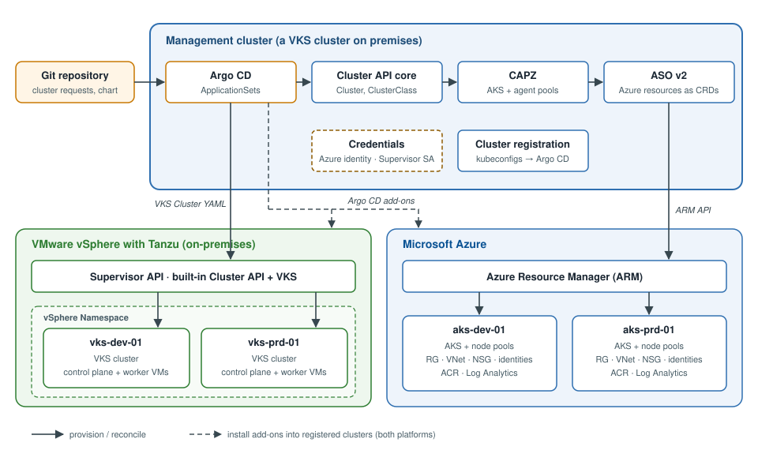
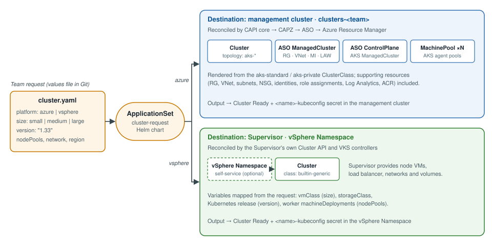
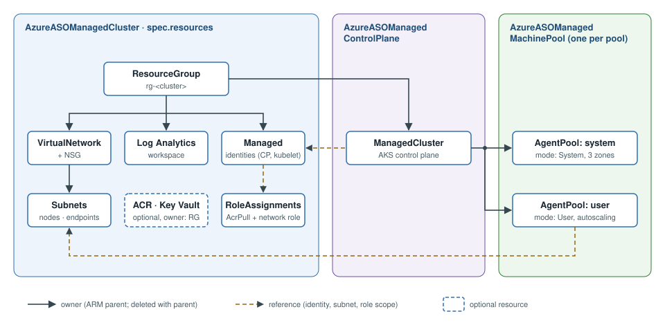
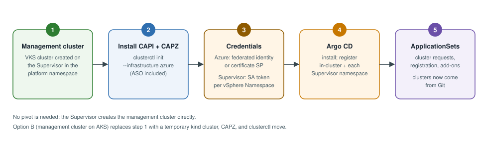

# Proposal: Multi-Platform Kubernetes Provisioning with Cluster API (Azure AKS and VMware Tanzu)

| | |
|---|---|
| **Status** | Draft |
| **Date** | 2026-11-19 |
| **Scope** | Kubernetes clusters and supporting resources on Microsoft Azure (AKS) and VMware vSphere with Tanzu (VKS), managed through Cluster API (CAPI) |
| **Related** | [Multi-Platform-Kubernetes-with-Crossplane-Proposal.md](Multi-Platform-Kubernetes-with-Crossplane-Proposal.md) (same scope, using Crossplane) |

---

## 1. Summary

This proposal describes how we will provide Kubernetes clusters on **two platforms**, Azure Kubernetes Service (AKS) in the cloud and **VMware vSphere with Tanzu** on premises, using **Cluster API (CAPI)** as the common cluster lifecycle API.

Both platforms already use CAPI:

- **Azure:** the Cluster API Provider for Azure (**CAPZ**), with Azure Service Operator (ASO), manages AKS clusters and the Azure resources they depend on.
- **vSphere with Tanzu:** the **Supervisor** is itself a CAPI management cluster. vSphere Kubernetes Service (VKS) clusters are CAPI `Cluster` objects built from VMware's ClusterClass.

A team asks for a cluster by committing a short `cluster.yaml` to Git. The file names the platform (`azure` or `vsphere`), a size, a Kubernetes version and node pools. **Argo CD** renders it with a shared Helm chart into the right CAPI objects and applies them where they belong:

- **Azure:** to our management cluster, which runs CAPZ.
- **vSphere:** to the Supervisor.

In both cases, Argo CD then registers the new cluster and installs the baseline add-ons.

Rather than deploying each cluster with a Bicep template from a pipeline, each cluster becomes a set of Kubernetes custom resources stored in Git. Controllers keep reconciling those resources against the platform, so creation, upgrades, scaling and deletion all go through the same Kubernetes-native workflow.

## 2. Goals and Non-Goals

### Goals

1. One request format that provisions a cluster on either Azure or vSphere with Tanzu.
2. Provision each cluster's supporting resources in the same request: networking, identity, registry access, monitoring and namespace placement.
3. Standardise cluster shape with ClusterClass on both platforms, so a request needs only a few parameters.
4. Support Day-2 operations: Kubernetes version upgrades, node pool scaling, adding and removing node pools.
5. Continuous reconciliation of cluster state, with GitOps-driven, auditable change through pull requests.
6. Install baseline add-ons (cert-manager, ingress, monitoring agents, GitOps agent) on every new cluster, whatever the platform.
7. Use credential-less or least-privilege authentication on both platforms.

### Non-Goals

- Installing or upgrading vSphere, vCenter, NSX, or enabling the Supervisor. The on-premises platform team owns these, and this proposal assumes they are already running.
- Shared Azure landing-zone resources (hub networks, firewalls, private DNS zones, policy). We consume these but do not own them.
- Deploying applications to the clusters. Application GitOps takes over once a cluster is ready.
- Tanzu Kubernetes Grid with a standalone management cluster (TKGm), and self-managed VM clusters on vSphere through CAPV in direct vCenter mode. This proposal targets the Supervisor-based model (vSphere 8 / VMware Cloud Foundation 9 with VKS).

## 3. Background

### 3.1 Why Cluster API for a hybrid estate

- **One lifecycle model on both platforms.** On Azure (CAPZ) and on vSphere (Supervisor), a cluster is a CAPI `Cluster` with a `topology` that references a ClusterClass. Upgrades, scaling and status conditions (`Ready`, `ControlPlaneReady`) mean the same thing on both.
- **No extra layer on vSphere.** VMware already runs CAPI inside the Supervisor. We apply `Cluster` objects to it directly and do not install anything on the Supervisor itself.
- **Built-in rolling upgrades.** CAPI orders upgrades (control plane first, then worker pools) and reports progress through standard conditions.
- **Supporting Azure resources in the same object.** CAPZ's ASO-based API embeds resource groups, networks, identities and role assignments next to the cluster definition.
- **Upstream and vendor-backed.** CAPI and CAPZ are Kubernetes SIG projects, and VKS is VMware's supported CAPI distribution.

### 3.2 Bicep compared with Cluster API

| Concern | Bicep per cluster | **Cluster API** |
|---|---|---|
| VMware vSphere with Tanzu | Not supported (Azure only) | Supported: the Supervisor is a CAPI management cluster |
| Drift detection and correction | Preview with `what-if`; corrected only on redeploy | Continuous reconciliation |
| State management | None (ARM is the state); deployment stacks track managed resources | Kubernetes objects in the management cluster and the Supervisor |
| Fleet-wide consistency | Modules and template specs | ClusterClass templates |
| Day-2 upgrades | Change a parameter and redeploy through a pipeline | Change a field; the controller rolls it out |
| Deletion of related resources | Deployment stacks with `deleteResources` | Owner references; deleting the cluster removes its resources |
| GitOps fit | Moderate (pipeline-driven push) | Native (pull-based Kubernetes YAML) |
| Support for new AKS features | Immediate (uses ARM API versions directly) | Immediate with the ASO-based API |
| Runtime dependency | None | The management cluster must be running |

**Where Bicep is stronger:**
- There is no management cluster to run.
- It is Azure-native, so new AKS features work as soon as the API version ships.
- Azure teams already know it.
- It is simpler for a handful of long-lived Azure clusters.

**Where CAPI is stronger:**
- It corrects drift continuously.
- Day-2 operations are just field changes.
- It supports fleet-scale self-service.
- It covers both Azure and vSphere with Tanzu, which Bicep cannot.

**Recommendation:** use Bicep for the Azure landing zone (hub network, DNS zones, policy, shared ACR), which rarely changes and must exist first. Use CAPI for the workload clusters on both platforms.

### 3.3 Cluster API compared with Crossplane

| Concern | **Cluster API** | Crossplane |
|---|---|---|
| Team-facing contract | `cluster.yaml` rendered by a Helm chart; CAPI objects differ by platform underneath | One `KubernetesCluster` XRD; platform hidden behind Compositions |
| Rolling upgrade orchestration | Built in | Delegated to AKS and the Supervisor |
| Non-cluster resources (databases, storage, DNS) | Out of scope (ASO can add Azure ones) | Same mechanism for everything |
| What runs on premises for vSphere | Nothing extra; we use the Supervisor's CAPI directly | Crossplane providers driving the Supervisor API |
| Validation of requests | Helm `values.schema.json` and CI checks | XRD OpenAPI and CEL, enforced by the API server |

**Summary:** CAPI gives deeper and more native cluster lifecycle management with fewer moving parts on vSphere. Crossplane gives a stronger single API and extends beyond clusters. See the companion proposal for the Crossplane design.

## 4. Proposed Architecture



There are **two CAPI management planes**, one per platform, behind **one GitOps front door**:

| Platform | Management plane | Who operates it |
|---|---|---|
| Azure | Our **management cluster**, running CAPI core, CAPZ and ASO | Platform team |
| vSphere with Tanzu | The **Supervisor** (built-in CAPI and VKS controllers) | VMware platform team; we only create objects in vSphere Namespaces |

### 4.1 Components

| Component | Purpose |
|---|---|
| **Management cluster** | A dedicated cluster that runs CAPI core, CAPZ, ASO and Argo CD. It is the source of truth for Azure clusters and the GitOps engine for both platforms. |
| **Cluster API core** | Generic cluster lifecycle API (`Cluster`, `MachinePool`, `ClusterClass`) for Azure clusters. |
| **CAPZ** | Azure infrastructure provider. Translates CAPI objects into AKS clusters and agent pools. |
| **Azure Service Operator v2 (ASO)** | Bundled with CAPZ. Manages Azure resources (VNets, identities, role assignments, ACR and so on) as CRDs. |
| **vSphere Supervisor** | VMware's CAPI management cluster. Builds VKS clusters from the `builtin-generic` ClusterClass, using VM Service, NSX or VDS networking and vSphere storage policies. |
| **Argo CD** | Renders team requests with the `cluster-request` Helm chart and applies them to the management cluster (Azure) or a Supervisor namespace (vSphere). Also installs add-ons on every registered cluster. |
| **Cluster registration job** | Reads each new cluster's kubeconfig secret, from the management cluster for AKS or from the Supervisor namespace for VKS, and creates the Argo CD cluster secret with platform labels. |

### 4.2 Where the management cluster runs

The management cluster needs to reach:

- **Azure Resource Manager**, which is a public endpoint.
- The **Supervisor API**, which is private and on premises.
- The **API servers of the clusters it creates**, so it can install add-ons.

| Option | Pros | Cons |
|---|---|---|
| **A. On premises, as a VKS cluster (recommended)** | Created directly by the Supervisor, so no bootstrap pivot is needed; direct access to the Supervisor; outbound HTTPS to Azure is easy to allow | Depends on vSphere availability; Azure authentication cannot use AKS-native Workload Identity |
| B. On AKS | Managed control plane; native Azure Workload Identity | Needs private connectivity (ExpressRoute or VPN) into the Supervisor; needs a kind bootstrap and `clusterctl move` pivot |

**Recommendation:** Option A, provided outbound access to Azure is permitted.

Workload clusters keep running if the management cluster is lost. All of its state is in Git, so it can be rebuilt and the existing clusters re-adopted (Section 9.1).

If AKS clusters use **private API servers**, the management cluster also needs network access to them for add-on installation. That access goes over the existing hybrid connectivity, or through the AKS GitOps extension instead (see Open Questions).

## 5. Team Request: `cluster.yaml`

### 5.1 Request schema

A team writes one values file per cluster. The `cluster-request` Helm chart validates it against `values.schema.json` and renders platform-specific CAPI objects.

| Field | Type | Applies to | Description |
|---|---|---|---|
| `name` | string | both | Cluster name. |
| `team` | string | both | Owning team; sets the target namespace on the management cluster. |
| `platform` | `azure` or `vsphere` | both | Chooses the destination and the templates used. |
| `version` | string, for example `"1.33"` | both | Kubernetes minor version. The chart maps it to the AKS version or the VKS Kubernetes release (VKr). |
| `size` | `small`, `medium` or `large` | both | Size of the control plane and system nodes (Section 5.2). |
| `nodePools[]` | list | both | `name`, `size`, `count`, optional `autoscale: {min, max}`. |
| `environment` | `dev`, `stg` or `prd` | both | Selects the ClusterClass (`aks-standard` or `aks-private`) and environment defaults. |
| `azure.location` | string | azure | Azure region. |
| `azure.vnetCidr` | CIDR | azure | Address space for the cluster's spoke VNet. |
| `vsphere.namespace` | string | vsphere | Target vSphere Namespace on the Supervisor. |
| `vsphere.storageClass` | string | vsphere | Storage policy for nodes and the default persistent volume class. |

### 5.2 Size mapping

| Size | Azure VM size | vSphere VM class (example) | vCPU / memory |
|---|---|---|---|
| `small` | `Standard_D2ds_v5` | `best-effort-medium` | 2 / 8 GiB |
| `medium` | `Standard_D4ds_v5` | `best-effort-large` | 4 / 16 GiB |
| `large` | `Standard_D8ds_v5` | `best-effort-2xlarge` | 8 / 32 GiB |

vSphere VM class names are defined per site and must be bound to the vSphere Namespace; the names above are placeholders. The mappings, and the version-to-release table, live in the chart's `platform-defaults.yaml`, so they can change in one place.

### 5.3 How a request flows



Both paths finish the same way:

1. The `Cluster` reports `Ready`.
2. A `<name>-kubeconfig` secret is written by CAPI. For Azure clusters it is in the management cluster; for vSphere clusters it is in the vSphere Namespace.
3. The registration job adds the cluster to Argo CD with the labels `platform`, `environment`, `team` and `addons.baseline: "true"`.
4. The add-on ApplicationSet installs the baseline charts.

## 6. Azure Implementation (AKS)

### 6.1 CAPZ API choice

CAPZ offers two ways to model AKS:

| API | Resources | Notes |
|---|---|---|
| **ASO-based (recommended)** | `AzureASOManagedCluster`, `AzureASOManagedControlPlane`, `AzureASOManagedMachinePool` | Embeds raw ASO resource specs, so every AKS feature the ARM API offers is available immediately. Supporting resources sit in the same object. This is the direction upstream CAPZ is investing in. |
| Classic managed | `AzureManagedCluster`, `AzureManagedControlPlane`, `AzureManagedMachinePool` | A curated subset of AKS fields. Simpler, but new AKS features arrive later. |

### 6.2 Resources per cluster

The diagram shows which CAPZ object declares each Azure resource, and how the resources own or reference one another.



| Azure resource | ASO kind | Purpose |
|---|---|---|
| Resource group | `resources.azure.com/ResourceGroup` | Lifecycle boundary for all cluster resources |
| Virtual network and subnets | `network.azure.com/VirtualNetwork`, `VirtualNetworksSubnet` | Node subnet and private-endpoint subnet |
| Network security group | `network.azure.com/NetworkSecurityGroup` | Subnet traffic rules |
| VNet peering to the hub (stg/prd) | `network.azure.com/VirtualNetworksVirtualNetworkPeering` | Connects the spoke to the landing-zone hub |
| User-assigned managed identities | `managedidentity.azure.com/UserAssignedIdentity` | Control-plane identity and kubelet identity |
| Role assignments | `authorization.azure.com/RoleAssignment` | Kubelet identity → `AcrPull`; control-plane identity → `Network Contributor` on the subnet |
| Log Analytics workspace | `operationalinsights.azure.com/Workspace` | Container Insights and diagnostics |
| Container registry (optional, or shared) | `containerregistry.azure.com/Registry` | Images |
| Key Vault (optional) | `keyvault.azure.com/Vault` | Workload secrets through the CSI Secrets Store driver |
| AKS managed cluster | `containerservice.azure.com/ManagedCluster` | The cluster, via `AzureASOManagedControlPlane` |
| AKS agent pools | `containerservice.azure.com/ManagedClustersAgentPool` | System and user node pools, via `AzureASOManagedMachinePool` |

### 6.3 AKS baseline configuration

- **Networking:** Azure CNI Overlay with the Cilium dataplane; outbound through the hub firewall (`userDefinedRouting`) for `stg` and `prd`.
- **Identity:** Entra ID integration with Azure RBAC for Kubernetes authorisation; local accounts disabled; OIDC issuer and Workload Identity enabled.
- **Node pools:** a `System` pool (3 nodes across zones 1, 2 and 3, tainted `CriticalAddonsOnly`) and one or more `User` pools with cluster autoscaler enabled.
- **Upgrades:** the `patch` auto-upgrade channel with a planned maintenance window; minor-version upgrades through `version` in the request.
- **Security:** private API server for `prd`; Azure Policy add-on; Defender for Containers; image cleaner.
- **Monitoring:** Container Insights to the cluster's Log Analytics workspace, plus Managed Prometheus where it is in use.

### 6.4 Authentication to Azure

CAPZ and ASO authenticate through **workload identity federation**. A user-assigned managed identity has a federated credential that trusts the management cluster's service-account issuer, and it is referenced by `AzureClusterIdentity` and the ASO credential secret.

On a VKS management cluster (Option A), the cluster's OIDC issuer must be reachable by Entra ID. If that is not possible, the fallback is a service principal with a certificate held in an external secret store and rotated automatically. Permissions:

- `Contributor` on the target subscriptions or resource groups.
- `User Access Administrator`, limited by an ABAC condition to `AcrPull` and `Network Contributor`.

## 7. VMware Tanzu Implementation (vSphere Supervisor / VKS)

### 7.1 Assumptions

- vSphere 8 Update 3 or VMware Cloud Foundation 9, with the **Supervisor** enabled and **VKS** installed.
- Networking through NSX, or VDS with a supported load balancer (Avi / NSX Advanced Load Balancer, or HAProxy), already configured by the platform team.
- VM classes, storage policies and Kubernetes releases are published and can be bound to vSphere Namespaces.

### 7.2 Resources per cluster

| Resource | Created by | Purpose |
|---|---|---|
| vSphere Namespace | Pre-created by vSphere admins, **or** created by Argo CD through the Supervisor's namespace self-service template where enabled | Tenancy boundary with resource limits, VM classes and storage policies |
| `Cluster` (`cluster.x-k8s.io`, topology class `builtin-generic`) | Argo CD, rendered from the request | The workload cluster; the Supervisor builds the control plane and worker VMs |
| Load balancer, network segments | Supervisor (NSX or Avi), automatically | API server VIP and `LoadBalancer` services |
| Persistent volumes | vSphere CSI driver with the bound storage policies | Workload storage |
| `<name>-kubeconfig` secret | Supervisor | Read by the registration job |

Supporting infrastructure that Azure needs as separate resources (network, load balancer, identity for node VMs) is provided by the Supervisor on vSphere. For that reason the vSphere path is shorter.

### 7.3 Authentication to the Supervisor

`kubectl vsphere login` tokens expire (10 hours by default), so they are not suitable for Argo CD or the registration job.

Instead, a dedicated vSphere SSO service account is given `Edit` on each managed vSphere Namespace. A long-lived Kubernetes ServiceAccount token, scoped to that namespace, is then generated and stored as an Argo CD cluster secret (`supervisor-<namespace>`). **This must be validated in Phase 1 against our vSphere version (see Risks).**

### 7.4 Platform differences we accept

| Capability | Azure (AKS) | vSphere (VKS) | How the request handles it |
|---|---|---|---|
| Cluster autoscaling | Native | Supported on newer VKS releases through the autoscaler package | `autoscale` honoured where supported; otherwise the chart schema rejects it |
| Identity for pods to the cloud | Entra Workload Identity | Not applicable | Azure-only add-on |
| Kubernetes version availability | AKS supported versions | Kubernetes releases published to the content library | Version mapping per platform; unavailable versions fail CI validation |
| Private API server | Option | Always internal (load balancer VIP) | `environment: prd` sets private on Azure |
| Control-plane VMs | Managed by Azure, not visible | VMs in the vSphere Namespace (3 for `prd`) | `size` maps to the control-plane VM class on vSphere |

## 8. Example Manifests

API versions, ClusterClass names and VKS releases below are illustrative. Pin them to the CAPZ and VKS releases selected in Phase 1.

### 8.1 Team requests

```yaml
# teams/payments/clusters/payments-prd.yaml
name: payments-prd
team: payments
platform: azure
version: "1.33"
size: medium
environment: prd
azure:
  location: eastus2
  vnetCidr: 10.40.0.0/16
nodePools:
  - { name: apps, size: medium, count: 3, autoscale: { min: 3, max: 10 } }
```

```yaml
# teams/payments/clusters/payments-onprem.yaml
name: payments-onprem
team: payments
platform: vsphere
version: "1.33"
size: medium
environment: prd
vsphere:
  namespace: payments-prd
  storageClass: vsan-default-policy
nodePools:
  - { name: apps, size: medium, count: 3 }
```

### 8.2 ApplicationSet that routes requests by platform

```yaml
apiVersion: argoproj.io/v1alpha1
kind: ApplicationSet
metadata:
  name: cluster-requests
  namespace: argocd
spec:
  goTemplate: true
  generators:
    - git:
        repoURL: https://git.example.org/platform/k8s-clusters.git
        revision: main
        files:
          - path: "teams/*/clusters/*.yaml"
  template:
    metadata:
      name: "cluster-{{ .name }}"
    spec:
      project: platform-clusters
      sources:
        - repoURL: https://git.example.org/platform/k8s-clusters.git
          targetRevision: main
          path: charts/cluster-request
          helm:
            valueFiles:
              - "$values/{{ .path.path }}/{{ .path.filename }}"
        - repoURL: https://git.example.org/platform/k8s-clusters.git
          targetRevision: main
          ref: values
      syncPolicy:
        automated: { prune: false, selfHeal: true }   # deletions need a manual sync
  templatePatch: |
    spec:
      destination:
      {{- if eq .platform "azure" }}
        name: in-cluster
        namespace: clusters-{{ .team }}
      {{- else }}
        name: supervisor-{{ .vsphere.namespace }}
        namespace: {{ .vsphere.namespace }}
      {{- end }}
```

### 8.3 Rendered Azure cluster (ClusterClass topology)

```yaml
apiVersion: cluster.x-k8s.io/v1beta1
kind: Cluster
metadata:
  name: payments-prd
  namespace: clusters-payments
  labels: { platform: azure, environment: prd, team: payments }
spec:
  topology:
    class: aks-private          # our ClusterClass wrapping the ASO-based CAPZ templates
    version: v1.33.2
    variables:
      - name: location
        value: eastus2
      - name: vnetCidr
        value: 10.40.0.0/16
      - name: systemPoolVmSize
        value: Standard_D4ds_v5
    workers:
      machinePools:
        - class: user-general
          name: apps
          replicas: 3
          metadata:
            annotations:
              cluster.x-k8s.io/replicas-managed-by: ""   # let the AKS autoscaler own replicas
```

The `aks-private` ClusterClass holds the full ASO resource set from Section 6.2. An abbreviated version of the underlying objects is shown below for reference:

```yaml
apiVersion: infrastructure.cluster.x-k8s.io/v1alpha1
kind: AzureASOManagedClusterTemplate
metadata:
  name: aks-private
spec:
  template:
    spec:
      resources:
        - apiVersion: resources.azure.com/v1api20200601
          kind: ResourceGroup
          metadata:
            name: "rg-${CLUSTER_NAME}"
          spec:
            location: "${LOCATION}"
        - apiVersion: network.azure.com/v1api20201101
          kind: VirtualNetwork
          metadata:
            name: "vnet-${CLUSTER_NAME}"
          spec:
            location: "${LOCATION}"
            owner: { name: "rg-${CLUSTER_NAME}" }
            addressSpace:
              addressPrefixes: ["${VNET_CIDR}"]
        - apiVersion: managedidentity.azure.com/v1api20230131
          kind: UserAssignedIdentity
          metadata:
            name: "id-${CLUSTER_NAME}-cp"
          spec:
            location: "${LOCATION}"
            owner: { name: "rg-${CLUSTER_NAME}" }
        # ... subnets, NSG, peering, kubelet identity, role assignments, Log Analytics
---
apiVersion: infrastructure.cluster.x-k8s.io/v1alpha1
kind: AzureASOManagedControlPlaneTemplate
metadata:
  name: aks-private
spec:
  template:
    spec:
      resources:
        - apiVersion: containerservice.azure.com/v1api20240901
          kind: ManagedCluster
          metadata:
            name: "${CLUSTER_NAME}"
          spec:
            location: "${LOCATION}"
            owner: { name: "rg-${CLUSTER_NAME}" }
            dnsPrefix: "${CLUSTER_NAME}"
            apiServerAccessProfile:
              enablePrivateCluster: true
            networkProfile:
              networkPlugin: azure
              networkPluginMode: overlay
              networkDataplane: cilium
              outboundType: userDefinedRouting
            oidcIssuerProfile: { enabled: true }
            securityProfile:
              workloadIdentity: { enabled: true }
            disableLocalAccounts: true
            aadProfile:
              managed: true
              enableAzureRBAC: true
```

In the ClusterClass, the `${...}` placeholders are filled by ClusterClass variable patches, not by `envsubst`.

### 8.4 Rendered vSphere cluster (VKS)

```yaml
apiVersion: cluster.x-k8s.io/v1beta1
kind: Cluster
metadata:
  name: payments-onprem
  namespace: payments-prd                  # vSphere Namespace on the Supervisor
  labels: { platform: vsphere, environment: prd, team: payments }
spec:
  clusterNetwork:
    pods:     { cidrBlocks: ["192.168.0.0/16"] }
    services: { cidrBlocks: ["10.96.0.0/12"] }
    serviceDomain: cluster.local
  topology:
    class: builtin-generic-v3.4.0           # VKS-provided ClusterClass (release-specific)
    classNamespace: vmware-system-vks-public
    version: v1.33.1---vmware.1-vkr.1       # mapped from version: "1.33"
    controlPlane:
      replicas: 3
    workers:
      machineDeployments:
        - class: node-pool
          name: apps
          replicas: 3
    variables:
      - name: vmClass
        value: best-effort-large            # mapped from size: medium
      - name: storageClass
        value: vsan-default-policy
```

### 8.5 Baseline add-ons on both platforms

```yaml
apiVersion: argoproj.io/v1alpha1
kind: ApplicationSet
metadata:
  name: baseline-addons
  namespace: argocd
spec:
  goTemplate: true
  generators:
    - matrix:
        generators:
          - clusters:
              selector:
                matchLabels: { addons.baseline: "true" }
          - list:
              elements:
                - { addon: cert-manager }
                - { addon: ingress }
                - { addon: monitoring-agent }
  template:
    metadata:
      name: "{{ .addon }}-{{ .name }}"
    spec:
      project: platform-addons
      source:
        repoURL: https://git.example.org/platform/k8s-clusters.git
        targetRevision: main
        path: "addons/{{ .addon }}"
        helm:
          valueFiles:
            - values.yaml
            - "values-{{ index .metadata.labels \"platform\" }}.yaml"   # platform-specific overrides
      destination:
        server: "{{ .server }}"
        namespace: "{{ .addon }}"
      syncPolicy:
        automated: { prune: true, selfHeal: true }
        syncOptions: [CreateNamespace=true]
```

## 9. Operating Model

### 9.1 Management cluster bootstrap



1. Create the management cluster as a VKS cluster in a dedicated platform vSphere Namespace by applying a `Cluster` to the Supervisor.
2. Run `clusterctl init --infrastructure azure` on it. This installs CAPI core, CAPZ and ASO, pinned to specific versions.
3. Configure credentials: the Azure federated identity (or certificate-based service principal) and a Supervisor ServiceAccount token per managed vSphere Namespace.
4. Install Argo CD and register `in-cluster` plus one `supervisor-<namespace>` destination per vSphere Namespace.
5. Apply the root ApplicationSets (cluster requests, registration and add-ons). From then on, everything comes from Git.

**Recovery:** rebuild by repeating these steps. Then restore the CAPZ objects from Git, so the existing AKS clusters are re-adopted by name. Supervisor-managed VKS clusters are unaffected by the loss of the management cluster.

### 9.2 Repository layout

```
k8s-clusters/
├── bootstrap/                  # clusterctl config, pinned provider versions, Argo CD install
├── identity/                   # AzureClusterIdentity, ASO credentials (refs to external secrets)
├── clusterclasses/
│   ├── aks-standard/
│   └── aks-private/
├── charts/
│   └── cluster-request/        # renders cluster.yaml → CAPI objects per platform
│       ├── values.schema.json
│       ├── platform-defaults.yaml   # sizes, version → AKS / VKr mapping
│       └── templates/
│           ├── azure/
│           └── vsphere/
├── addons/                     # Helm values per add-on, with values-azure / values-vsphere
├── applicationsets/            # cluster-requests, registration, baseline-addons
└── teams/
    ├── payments/clusters/
    │   ├── payments-prd.yaml
    │   └── payments-onprem.yaml
    └── search/clusters/
```

### 9.3 Day-2 operations

| Operation | How |
|---|---|
| Upgrade Kubernetes | A pull request changes `version`. On Azure, CAPZ upgrades the AKS control plane, then the node pools. On vSphere, the Supervisor rolls control-plane and worker VMs to the new Kubernetes release. |
| Scale or add a node pool | A pull request changes `nodePools[]`. |
| Change platform defaults | Edit the ClusterClass (Azure) or `platform-defaults.yaml`. Roll out to `dev` first by pinning ClusterClass versions per environment. |
| Delete a cluster | Remove the file. Argo CD runs with `prune: false` for cluster requests, so deletion needs a deliberate manual sync. Production also requires reviewer approval on `teams/*/clusters/*-prd.yaml`. |
| Test changes before merge | CI runs `helm template` against every request, validates the output against the CAPZ and CAPI CRD schemas, and runs `clusterctl alpha topology plan` for ClusterClass changes. |
| Break-glass access | Azure: `az aks get-credentials` with Entra ID group membership. vSphere: `kubectl vsphere login` to the cluster. |

### 9.4 Observability

- CAPI, CAPZ and ASO controller metrics are scraped by Prometheus. Alerts fire on clusters not `Ready` for more than 30 minutes and on rising reconcile errors.
- `clusterctl describe cluster` is used for troubleshooting an Azure cluster. For VKS, the `Cluster` conditions on the Supervisor are mirrored into Argo CD health checks.
- A platform dashboard shows every cluster, its platform, version and health from Argo CD's cluster inventory.

## 10. Security Considerations

- **No static secrets in Git.** Credentials come from an external secret store (Azure Key Vault or HashiCorp Vault through External Secrets Operator). Azure uses federated identity wherever possible.
- **Least privilege per platform.** The Azure identity is scoped to platform subscriptions. Supervisor tokens are scoped to one vSphere Namespace each. Argo CD projects restrict each team to its own namespaces.
- **Separation by environment.** Production requests live in protected paths with required reviewers. A separate production management cluster is an open question.
- **Management cluster hardening.** Internal API server only, no workload pods, restricted admin group, and controller images pinned by digest.
- **Kubeconfig secrets** stay in the management cluster or the Supervisor namespace. They are never committed or exposed through Argo CD's UI.
- **Policy.** Azure Policy at subscription level (tags, SKUs, regions, private clusters for `prd`). On vSphere, namespace resource limits and VM class bindings set by the vSphere admins.

## 11. Delivery Plan

| Phase | Deliverables | Exit criteria |
|---|---|---|
| **1. Foundation** (weeks 1–2) | Management cluster on VKS; CAPI, CAPZ and ASO installed; Argo CD; credentials to Azure and the Supervisor validated; network paths open | `clusterctl describe` is healthy; Argo CD can apply a test object to a Supervisor namespace |
| **2. Azure path** (weeks 3–5) | `aks-standard` ClusterClass with all supporting resources; Azure templates in the chart; CI validation | A dev AKS cluster is created and deleted from Git with no orphaned resources |
| **3. vSphere path** (weeks 5–7) | vSphere templates in the chart; namespace strategy settled; version and VM class mappings | A dev VKS cluster is created and deleted from Git; same request format as Azure |
| **4. Registration and add-ons** (weeks 8–9) | Registration job; baseline add-on ApplicationSet with platform overrides; team documentation | A team gets a ready cluster with add-ons from one pull request in under 30 minutes on either platform |
| **5. Production readiness** (weeks 10–12) | `aks-private` ClusterClass, hub peering, policies, alerts, rebuild drill, upgrade rehearsal on both platforms | Security sign-off; management cluster rebuilt and Azure clusters re-adopted |
| **6. Rollout** (week 13 onward) | Onboard teams; migrate existing clusters where agreed | Handover to platform operations |

## 12. Risks and Mitigations

| Risk | Impact | Mitigation |
|---|---|---|
| Supervisor authentication for long-running automation (token expiry, ServiceAccount permissions in vSphere Namespaces) | Argo CD cannot apply or read vSphere clusters | Validate in Phase 1; rotate tokens through External Secrets; escalate to VMware support if namespace-scoped ServiceAccounts are not permitted on our version |
| Two management planes (our management cluster plus the Supervisor) | More places to look when debugging | Single Argo CD view of both; shared runbooks; standard CAPI conditions on both |
| VKS ClusterClass and release naming changes between VKS versions | Chart templates break on Supervisor upgrade | Pin the ClusterClass version per environment; test VKS upgrades in `dev` first; keep the mappings in one file |
| CAPZ or ASO API churn between releases | Manifest changes needed on upgrade | Pin provider versions; upgrade in non-production first; follow the release notes |
| AKS kubeconfig with local accounts disabled | Registration and add-on install fail | Use Entra-based kubeconfig with `kubelogin` and Argo CD's workload identity support; validate in Phase 2 |
| Accidental cluster deletion through Git | Outage | `prune: false` on cluster requests, required reviewers, and a deletion-protection annotation on `prd` |
| Management cluster outage | No changes to Azure clusters; vSphere clusters unaffected | Rebuild from Git; re-adoption tested in the rebuild drill |
| Feature gaps between AKS and VKS | Teams see different behaviour per platform | Document the differences (Section 7.4); reject unsupported combinations in the chart schema |

## 13. Open Questions

1. Where will the management cluster run: on premises on VKS (recommended) or on AKS? Is outbound access from on premises to Azure ARM and Entra ID allowed?
2. Which vSphere and VKS versions are in production, and is vSphere Namespace self-service enabled?
3. One management cluster for all environments, or a separate one for production?
4. ACR: one per cluster, or a shared registry per environment or organisation?
5. Should private AKS add-ons be installed directly from Argo CD, or handed to the AKS GitOps extension to avoid inbound network paths?
6. Do existing AKS or VKS clusters need to be adopted, or do we only manage new ones?
7. Should we choose between this proposal and the Crossplane proposal, or combine them (for example, CAPI for clusters and Crossplane for other cloud resources)?

## 14. References

- Cluster API Book: https://cluster-api.sigs.k8s.io
- Cluster API Provider Azure (CAPZ): https://capz.sigs.k8s.io
- CAPZ managed clusters (AKS) documentation: https://capz.sigs.k8s.io/managed/managed
- Azure Service Operator v2: https://azure.github.io/azure-service-operator
- vSphere Kubernetes Service documentation: https://techdocs.broadcom.com (search "vSphere Kubernetes Service")
- Argo CD ApplicationSet: https://argo-cd.readthedocs.io/en/stable/operator-manual/applicationset/
- Bicep documentation: https://learn.microsoft.com/azure/azure-resource-manager/bicep/
- Azure deployment stacks: https://learn.microsoft.com/azure/azure-resource-manager/bicep/deployment-stacks
