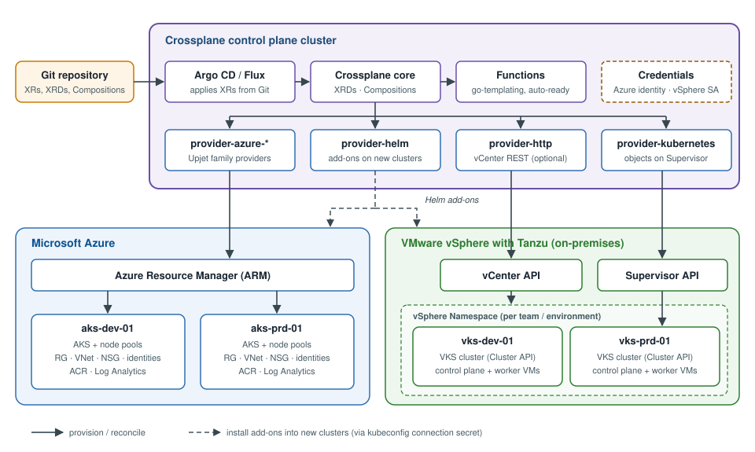
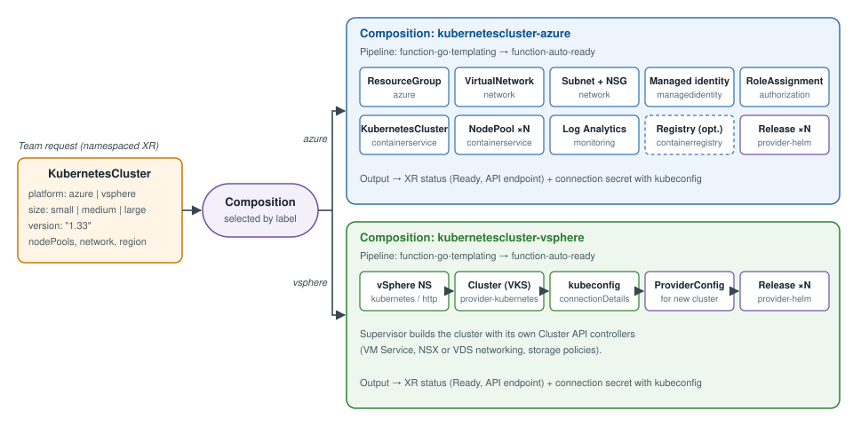

# Proposal: Multi-Platform Kubernetes Provisioning with Crossplane (Azure AKS and VMware Tanzu)

| | |
|---|---|
| **Status** | Draft |
| **Date** | 2026-11-19 |
| **Scope** | Kubernetes clusters and supporting resources on Microsoft Azure (AKS) and VMware vSphere with Tanzu (VKS), through one Crossplane platform API |
| **Related** | [Multi-Platform-Kubernetes-with-CAPI-Proposal.md](Multi-Platform-Kubernetes-with-CAPI-Proposal.md) (same scope, using Cluster API) |

---

## 1. Summary

This proposal describes how we will provide Kubernetes clusters on **two platforms**, Azure Kubernetes Service (AKS) in the cloud and **VMware vSphere with Tanzu** on premises, through **one self-service API** built with **Crossplane**.

A team asks for a cluster by committing a short `KubernetesCluster` manifest to Git. The team chooses the platform (`azure` or `vsphere`), a size and a Kubernetes version. Crossplane then creates everything that cluster needs on that platform:

- **Azure:** the resource group, virtual network, identities, role assignments, monitoring, registry and the AKS cluster itself.
- **vSphere:** the vSphere Namespace and a vSphere Kubernetes Service (VKS) cluster on the Supervisor.

In both cases, Crossplane then installs the baseline add-ons and returns a kubeconfig and status in the same format, whichever platform was chosen.

The companion Cluster API proposal ([Multi-Platform-Kubernetes-with-CAPI-Proposal.md](Multi-Platform-Kubernetes-with-CAPI-Proposal.md)) covers the same two platforms. This proposal's main benefit over it is a **single, platform-neutral API** enforced by the Kubernetes API server, and one mechanism that extends beyond clusters.

## 2. Goals and Non-Goals

### Goals

1. One declarative API (`KubernetesCluster`) that provisions a cluster on either Azure or vSphere with Tanzu.
2. Provision each cluster's supporting resources in the same request: networking, identity, registry access, monitoring and namespace placement.
3. Hide platform details behind a small set of options (size, version, node pools), so the same request shape works in both places.
4. Continuous reconciliation: if someone changes or deletes a managed resource outside Git, Crossplane restores it.
5. Install baseline add-ons (cert-manager, ingress, GitOps agent, monitoring agents) on every new cluster, whatever the platform.
6. GitOps-driven, auditable change through pull requests.
7. Make it straightforward to add more resource types later (databases, storage, DNS), since Crossplane is not limited to clusters.

### Non-Goals

- Installing or upgrading vSphere, vCenter, NSX, or enabling the Supervisor. The on-premises platform team owns these, and this proposal assumes they are already running.
- Shared Azure landing-zone resources (hub networks, private DNS zones, policy). We consume these but do not own them.
- Deploying applications to the clusters. Application GitOps takes over once a cluster is ready.
- Tanzu Kubernetes Grid with a standalone management cluster (TKGm). This proposal targets the Supervisor-based model (vSphere 8 / VMware Cloud Foundation 9 with VKS).

## 3. Background

### 3.1 Why Crossplane for a hybrid estate

Crossplane extends Kubernetes into a **universal control plane**. **Providers** add managed resources (MRs) for external APIs such as Azure ARM, other Kubernetes clusters, and HTTP endpoints. **Composite Resource Definitions (XRDs)** and **Compositions** let the platform team publish their own higher-level APIs on top of them.

That combination fits this requirement:

- **One API, two backends.** A single XRD (`KubernetesCluster`) is served by two Compositions, one per platform. Teams learn one schema.
- **Supporting resources are first-class.** On Azure, every dependency (resource group, network, identity, role assignment, registry, monitoring) is a managed resource composed alongside the cluster.
- **It reuses vSphere's own Cluster API.** The Supervisor already provisions VKS clusters with Cluster API. Crossplane does not replace this. It creates the `Cluster` object on the Supervisor through `provider-kubernetes` and lets VMware's controllers do the rest.
- **Extensible.** The same control plane can later serve `Database`, `Bucket` or `DnsZone` APIs without new tooling.

### 3.2 Crossplane compared with Cluster API

| Concern | Cluster API (CAPZ, plus Supervisor CAPI for vSphere) | **Crossplane** |
|---|---|---|
| Team-facing API across Azure and vSphere | Two different object models (CAPZ ASO resources versus Supervisor ClusterClass) | One `KubernetesCluster` XRD; platform hidden behind Compositions |
| Supporting Azure resources | Embedded ASO resources | Composed managed resources (Upjet Azure providers) |
| Non-cluster resources (databases, storage, DNS) | Out of scope | Same mechanism |
| Rolling upgrade orchestration | Built in (control plane first, then machine pools) | Delegated to AKS and to the Supervisor; Crossplane changes the version field |
| Custom abstraction | ClusterClass, per provider | XRD schema we design, validated with OpenAPI |
| Operational footprint | CAPI, CAPZ and ASO controllers | Crossplane core, functions and several providers; Azure providers can use significant memory, so install only the sub-providers needed |
| Maturity for this use | Kubernetes SIG project focused on clusters | CNCF graduated project, widely used for platform APIs |

**Summary:** CAPI gives deeper, more native cluster lifecycle management, and on vSphere it uses the Supervisor directly with fewer moving parts. Crossplane gives one validated API and one control plane for both platforms, and extends to non-cluster resources.

## 4. Proposed Architecture



### 4.1 Components

| Component | Purpose |
|---|---|
| **Crossplane control plane cluster** | A dedicated Kubernetes cluster that runs Crossplane and its providers. It holds the desired state of every managed cluster. |
| **Crossplane core (v2)** | Serves the XRDs and runs Compositions. Uses namespaced composite resources, so each team's requests live in their own namespace. |
| **Composition functions** | `function-go-templating` renders resources; `function-auto-ready` derives readiness; `function-environment-configs` looks up per-environment values. |
| **`provider-azure-*` (Upjet family)** | Azure managed resources. Only the needed sub-providers are installed: `network`, `managedidentity`, `authorization`, `containerservice`, `containerregistry`, `operationalinsights`, `keyvault`. |
| **`provider-kubernetes`** | Creates and observes objects on the vSphere **Supervisor**: the VKS `Cluster` and, where self-service is enabled, the vSphere Namespace. Also reads the generated kubeconfig. |
| **`provider-http`** (optional) | Calls the vCenter REST API for configuration the Supervisor API does not expose, such as creating vSphere Namespaces when self-service is not enabled. |
| **`provider-helm`** | Installs baseline add-ons into each new cluster using that cluster's kubeconfig. |
| **Argo CD or Flux** | Syncs XRDs, Compositions and team cluster requests from Git. |

### 4.2 Where the control plane runs

The control plane needs to reach:

- **Azure Resource Manager**, which is a public endpoint.
- The **vSphere Supervisor API** and **vCenter**, which are private and on premises.
- The **API servers of the clusters it creates**, so it can install add-ons.

| Option | Pros | Cons |
|---|---|---|
| **A. On premises, on a VKS cluster (recommended)** | Direct access to the Supervisor and vCenter; outbound HTTPS to Azure is easy to allow | Depends on vSphere availability; Azure authentication cannot use AKS-native Workload Identity |
| B. On AKS, built with Bicep | Managed control plane; native Azure Workload Identity | Needs private connectivity (ExpressRoute or VPN) and firewall rules into the Supervisor and vCenter |

**Recommendation:** Option A, provided outbound access to Azure is permitted. In both options the control plane holds no unique state: everything is in Git and can be rebuilt (Section 9.1).

If AKS clusters use **private API servers**, the control plane also needs network access to them for add-on installation. That access goes over the existing hybrid connectivity, or through the AKS Run Command or a GitOps extension instead (see Open Questions).

## 5. Platform API: `KubernetesCluster`

### 5.1 Request schema

| Field | Type | Applies to | Description |
|---|---|---|---|
| `spec.crossplane.compositionSelector.matchLabels.platform` | `azure` or `vsphere` | both | Chooses the Composition. |
| `spec.version` | string, for example `"1.33"` | both | Kubernetes minor version. Each Composition maps it to the AKS version or the VKS release (VKr). |
| `spec.size` | `small`, `medium` or `large` | both | Size of the control plane and system nodes (Section 5.2). |
| `spec.nodePools[]` | list | both | `name`, `size`, `count`, optional `autoscale: {min, max}`. |
| `spec.environment` | `dev`, `stg` or `prd` | both | Selects per-environment defaults (private API server, zones, add-on set). |
| `spec.azure.location` | string | azure | Azure region. |
| `spec.azure.vnetCidr` | CIDR | azure | Address space for the cluster's spoke VNet. |
| `spec.vsphere.namespace` | string | vsphere | Target vSphere Namespace (created if absent and self-service is enabled). |
| `spec.vsphere.storageClass` | string | vsphere | Storage policy for nodes and the default persistent volume class. |

The XRD validates platform-specific fields with CEL rules. For example, `spec.azure` is required when `platform: azure`.

### 5.2 Size mapping

| Size | Azure VM size | vSphere VM class (example) | vCPU / memory |
|---|---|---|---|
| `small` | `Standard_D2ds_v5` | `best-effort-medium` | 2 / 8 GiB |
| `medium` | `Standard_D4ds_v5` | `best-effort-large` | 4 / 16 GiB |
| `large` | `Standard_D8ds_v5` | `best-effort-2xlarge` | 8 / 32 GiB |

vSphere VM class names are defined per site and must be bound to the vSphere Namespace; the names above are placeholders. Mappings live in an `EnvironmentConfig`, so they can change without touching Compositions.

### 5.3 How a request flows



Both Compositions return the same outputs:

- `status.conditions[Ready]`
- `status.apiEndpoint`
- `status.platformVersion`
- A connection secret named `<cluster>-kubeconfig` in the team's namespace

Downstream tooling does not need to know which platform a cluster runs on.

## 6. Azure Implementation (AKS)

### 6.1 Resources composed per cluster

| Resource | Crossplane kind (Upjet Azure) | Purpose |
|---|---|---|
| Resource group | `ResourceGroup` | Lifecycle boundary for the cluster |
| Virtual network and subnets | `VirtualNetwork`, `Subnet` | Spoke network; node subnet and private-endpoint subnet |
| Network security group | `NetworkSecurityGroup`, `SubnetNetworkSecurityGroupAssociation` | Subnet traffic rules |
| VNet peering to the hub (prd/stg) | `VirtualNetworkPeering` | Connects the spoke to the landing-zone hub |
| Managed identities | `UserAssignedIdentity` (×2) | Control-plane identity and kubelet identity |
| Role assignments | `RoleAssignment` | `Network Contributor` on the subnet; `AcrPull` on the registry |
| Log Analytics workspace | `Workspace` | Container Insights and diagnostics |
| Container registry (optional; otherwise shared) | `Registry` | Images |
| AKS cluster | `KubernetesCluster` | Control plane and system pool |
| User node pools | `KubernetesClusterNodePool` (one per `nodePools[]` entry) | Workload capacity |
| Add-ons | `Release` (`provider-helm`) | Baseline charts |

### 6.2 AKS baseline configuration

- **Networking:** Azure CNI Overlay with the Cilium dataplane; outbound through the hub firewall (`userDefinedRouting`) for `stg` and `prd`.
- **Identity:** Entra ID integration with Azure RBAC; local accounts disabled; OIDC issuer and Workload Identity enabled.
- **Availability:** zones 1, 2 and 3 for `prd`; Standard tier control plane (uptime SLA) for `stg` and `prd`.
- **Upgrades:** the `patch` auto-upgrade channel with a maintenance window; minor-version upgrades through `spec.version`.
- **Security:** private API server for `prd`; Azure Policy add-on; Defender for Containers.

### 6.3 Authentication to Azure

The Azure providers authenticate through **workload identity federation**. A user-assigned managed identity, or an Entra app registration, has a federated credential that trusts the control plane cluster's service-account issuer.

On a VKS control plane (Option A), the cluster's OIDC issuer must be reachable by Entra ID. If that is not possible, the fallback is a service principal with a certificate held in an external secret store and rotated automatically. Permissions:

- `Contributor` on the target subscriptions or resource groups.
- `User Access Administrator`, limited by an ABAC condition to the roles listed in Section 6.1.

## 7. VMware Tanzu Implementation (vSphere Supervisor / VKS)

### 7.1 Assumptions

- vSphere 8 Update 3 or VMware Cloud Foundation 9, with the **Supervisor** enabled and the **vSphere Kubernetes Service (VKS)** installed.
- Networking through NSX, or VDS with a supported load balancer (Avi / NSX Advanced Load Balancer, or HAProxy), already configured by the platform team.
- VM classes, storage policies and content libraries (Kubernetes releases) are published and can be bound to namespaces.

### 7.2 Resources composed per cluster

| Resource | Created through | Purpose |
|---|---|---|
| vSphere Namespace | `provider-kubernetes` (namespace self-service template) **or** `provider-http` (vCenter `namespaces` API) **or** pre-created by vSphere admins | Tenancy boundary with resource limits, VM classes and storage policies |
| VKS `Cluster` (`cluster.x-k8s.io`) | `provider-kubernetes` `Object` on the Supervisor | The workload cluster, built by the Supervisor's own Cluster API controllers from the VKS `ClusterClass` |
| Kubeconfig | `connectionDetails` on the same `Object`, read from the `<cluster>-kubeconfig` secret the Supervisor creates | Exposed as the XR's connection secret |
| Provider configs for the new cluster | `ProviderConfig` for `provider-helm` and `provider-kubernetes` | Lets Crossplane install add-ons |
| Add-ons | `Release` (`provider-helm`) | Baseline charts, matching the Azure set where possible |

Supporting infrastructure that Azure needs as separate resources is provided by the Supervisor on vSphere:

- Load balancer and network segments: NSX or Avi.
- Node VMs: VM Service.
- Persistent volumes: the vSphere CSI driver with the bound storage policies.

For that reason the vSphere Composition is shorter.

### 7.3 Authentication to the Supervisor and vCenter

- **Supervisor:** `kubectl vsphere login` tokens expire (10 hours by default), so they are not suitable for a controller. Instead, a dedicated vSphere SSO service account is given `Edit` on each managed vSphere Namespace. A long-lived Kubernetes ServiceAccount token, scoped to those namespaces, is then generated and stored for the `provider-kubernetes` ProviderConfig. **This must be validated in Phase 1 against our vSphere version (see Risks).**
- **vCenter (only if `provider-http` is used):** a least-privilege SSO service account with the `Namespaces.Manage` privilege. The session token is obtained through the `/api/session` endpoint.

### 7.4 Platform differences we accept

| Capability | Azure (AKS) | vSphere (VKS) | How the API handles it |
|---|---|---|---|
| Cluster autoscaling | Native | Supported on newer VKS releases through the autoscaler package | `autoscale` honoured where supported; otherwise rejected by a CEL rule |
| Identity for pods to the cloud | Entra Workload Identity | Not applicable | Azure-only add-on |
| Kubernetes version availability | AKS supported versions | Kubernetes releases published to the content library | Version mapping per platform; requests for unavailable versions fail validation |
| Private API server | Option | Always internal (load balancer VIP) | `environment: prd` sets private on Azure |

## 8. Example Manifests

The API versions, Upjet field shapes and VKS class names below are illustrative. Pin them to the provider and VKS releases selected in Phase 1.

### 8.1 Composite Resource Definition (abbreviated)

```yaml
apiVersion: apiextensions.crossplane.io/v2
kind: CompositeResourceDefinition
metadata:
  name: kubernetesclusters.platform.example.org
spec:
  group: platform.example.org
  scope: Namespaced
  names:
    kind: KubernetesCluster
    plural: kubernetesclusters
  versions:
    - name: v1alpha1
      served: true
      referenceable: true
      schema:
        openAPIV3Schema:
          type: object
          properties:
            spec:
              type: object
              required: [version, size, environment]
              properties:
                version:     { type: string, pattern: '^1\.[0-9]+$' }
                size:        { type: string, enum: [small, medium, large] }
                environment: { type: string, enum: [dev, stg, prd] }
                nodePools:
                  type: array
                  items:
                    type: object
                    required: [name, size, count]
                    properties:
                      name:  { type: string }
                      size:  { type: string, enum: [small, medium, large] }
                      count: { type: integer, minimum: 1 }
                      autoscale:
                        type: object
                        properties:
                          min: { type: integer }
                          max: { type: integer }
                azure:
                  type: object
                  properties:
                    location: { type: string }
                    vnetCidr: { type: string }
                vsphere:
                  type: object
                  properties:
                    namespace:    { type: string }
                    storageClass: { type: string }
            status:
              type: object
              properties:
                apiEndpoint:     { type: string }
                platformVersion: { type: string }
```

### 8.2 Team requests

```yaml
# Azure
apiVersion: platform.example.org/v1alpha1
kind: KubernetesCluster
metadata:
  name: payments-prd
  namespace: team-payments
spec:
  crossplane:
    compositionSelector:
      matchLabels: { platform: azure }
  version: "1.33"
  size: medium
  environment: prd
  azure:
    location: eastus2
    vnetCidr: 10.40.0.0/16
  nodePools:
    - { name: apps, size: medium, count: 3, autoscale: { min: 3, max: 10 } }
---
# VMware vSphere with Tanzu
apiVersion: platform.example.org/v1alpha1
kind: KubernetesCluster
metadata:
  name: payments-onprem
  namespace: team-payments
spec:
  crossplane:
    compositionSelector:
      matchLabels: { platform: vsphere }
  version: "1.33"
  size: medium
  environment: prd
  vsphere:
    namespace: payments-prd
    storageClass: vsan-default-policy
  nodePools:
    - { name: apps, size: medium, count: 3 }
```

### 8.3 Azure Composition (excerpt)

```yaml
apiVersion: apiextensions.crossplane.io/v1
kind: Composition
metadata:
  name: kubernetescluster-azure
  labels: { platform: azure }
spec:
  compositeTypeRef:
    apiVersion: platform.example.org/v1alpha1
    kind: KubernetesCluster
  mode: Pipeline
  pipeline:
    - step: load-environment
      functionRef: { name: function-environment-configs }
      input:
        apiVersion: environmentconfigs.fn.crossplane.io/v1beta1
        kind: Input
        spec:
          environmentConfigs:
            - type: Reference
              ref: { name: platform-sizing }
    - step: render
      functionRef: { name: function-go-templating }
      input:
        apiVersion: gotemplating.fn.crossplane.io/v1beta1
        kind: GoTemplate
        source: Inline
        inline:
          template: |
            {{- $xr   := .observed.composite.resource }}
            {{- $env  := index .context "apiextensions.crossplane.io/environment" }}
            {{- $name := $xr.metadata.name }}
            ---
            apiVersion: azure.m.upbound.io/v1beta1
            kind: ResourceGroup
            metadata:
              name: rg-{{ $name }}
              annotations:
                gotemplating.fn.crossplane.io/composition-resource-name: rg
            spec:
              forProvider:
                location: {{ $xr.spec.azure.location }}
            ---
            apiVersion: containerservice.azure.m.upbound.io/v1beta2
            kind: KubernetesCluster
            metadata:
              name: {{ $name }}
              annotations:
                gotemplating.fn.crossplane.io/composition-resource-name: aks
            spec:
              forProvider:
                location: {{ $xr.spec.azure.location }}
                resourceGroupNameSelector: { matchControllerRef: true }
                dnsPrefix: {{ $name }}
                kubernetesVersion: "{{ $xr.spec.version }}"
                oidcIssuerEnabled: true
                workloadIdentityEnabled: true
                localAccountDisabled: true
                privateClusterEnabled: {{ eq $xr.spec.environment "prd" }}
                defaultNodePool:
                  name: system
                  vmSize: {{ index $env.azure.sizes $xr.spec.size }}
                  nodeCount: 3
                  zones: ["1", "2", "3"]
                  vnetSubnetIdSelector: { matchControllerRef: true, matchLabels: { role: nodes } }
                networkProfile:
                  networkPlugin: azure
                  networkPluginMode: overlay
                  networkDataPlane: cilium
                identity:
                  type: UserAssigned
                  identityIdsSelector: { matchControllerRef: true, matchLabels: { role: control-plane } }
                azureActiveDirectoryRoleBasedAccessControl:
                  azureRbacEnabled: true
              writeConnectionSecretToRef:
                name: {{ $name }}-kubeconfig
            # ... VNet, Subnet, NSG, identities, RoleAssignments,
            #     Workspace, node pools and Helm Releases follow
    - step: ready
      functionRef: { name: function-auto-ready }
```

### 8.4 vSphere Composition (excerpt of the rendered VKS cluster)

```yaml
apiVersion: kubernetes.m.crossplane.io/v1alpha1
kind: Object
metadata:
  name: payments-onprem-vks
  namespace: team-payments
spec:
  providerConfigRef:
    kind: ProviderConfig
    name: supervisor-payments-prd          # scoped to the vSphere Namespace
  forProvider:
    manifest:
      apiVersion: cluster.x-k8s.io/v1beta1
      kind: Cluster
      metadata:
        name: payments-onprem
        namespace: payments-prd             # vSphere Namespace on the Supervisor
      spec:
        clusterNetwork:
          pods:     { cidrBlocks: ["192.168.0.0/16"] }
          services: { cidrBlocks: ["10.96.0.0/12"] }
          serviceDomain: cluster.local
        topology:
          class: builtin-generic-v3.4.0      # VKS-provided ClusterClass (release-specific)
          classNamespace: vmware-system-vks-public
          version: v1.33.1---vmware.1-vkr.1  # mapped from spec.version
          controlPlane:
            replicas: 3
          workers:
            machineDeployments:
              - class: node-pool
                name: apps
                replicas: 3
          variables:
            - name: vmClass
              value: best-effort-large       # mapped from size
            - name: storageClass
              value: vsan-default-policy
  connectionDetails:
    - apiVersion: v1
      kind: Secret
      name: payments-onprem-kubeconfig       # created by the Supervisor
      namespace: payments-prd
      fieldPath: data.value
      toConnectionSecretKey: kubeconfig
  writeConnectionSecretToRef:
    name: payments-onprem-kubeconfig
```

## 9. Operating Model

### 9.1 Control plane bootstrap

1. Create the control plane cluster: a VKS cluster on premises (Option A) or an AKS cluster built with Bicep (Option B).
2. Install Crossplane v2 with Helm, pinned to a specific version.
3. Install the functions and providers as `Function` and `Provider` packages pinned by digest, and apply a `DeploymentRuntimeConfig` with resource limits.
4. Configure credentials: Azure workload identity federation, Supervisor ServiceAccount tokens per vSphere Namespace, and an optional vCenter account.
5. Install Argo CD or Flux and point it at the platform repository. From then on, everything else (XRDs, Compositions, EnvironmentConfigs, team requests) comes from Git.

Rebuild time objective: a full control plane rebuild from Git in under one hour. Existing clusters are re-adopted because managed resources are matched by external name.

### 9.2 Repository layout

```
platform-crossplane/
├── bootstrap/                  # Crossplane, providers, functions, runtime configs
├── providerconfigs/
│   ├── azure/
│   └── vsphere/                # one per vSphere Namespace / Supervisor
├── apis/
│   └── kubernetescluster/
│       ├── definition.yaml     # XRD
│       ├── composition-azure.yaml
│       ├── composition-vsphere.yaml
│       └── environment/        # EnvironmentConfigs: sizes, versions, add-ons
├── addons/                     # Shared Helm values for baseline add-ons
├── tests/                      # crossplane render fixtures and expected output
└── teams/
    ├── team-payments/
    │   ├── payments-prd.yaml
    │   └── payments-onprem.yaml
    └── team-search/
```

### 9.3 Day-2 operations

| Operation | How |
|---|---|
| Upgrade Kubernetes | A pull request changes `spec.version`. On Azure, AKS upgrades the control plane, then the node pools. On vSphere, the Supervisor rolls the VKS cluster to the new Kubernetes release. |
| Scale or add a node pool | A pull request changes `nodePools[]`. |
| Change platform defaults | Edit the Composition or EnvironmentConfig. Roll out first to `dev` with Composition revisions (`compositionUpdatePolicy: Manual`, then promote). |
| Delete a cluster | Remove the file. Production XRs use deletion protection (`Usage` objects and `deletionPolicy: Orphan` on critical resources) and require reviewer approval. |
| Test changes before merge | Run `crossplane render` in CI against fixtures in `tests/`, plus `crossplane beta validate` against the provider schemas. |

### 9.4 Observability

- Crossplane and provider metrics are scraped by Prometheus. Alerts fire on XRs that are not `Ready` for more than 30 minutes and on rising provider reconcile errors.
- `crossplane beta trace` is used for troubleshooting a single request end to end.
- XR status is shown on a platform dashboard, so teams can see their cluster state without access to the control plane.

## 10. Security Considerations

- **Least privilege per platform.** Each team namespace on the control plane can reference only its own ProviderConfigs (namespaced in Crossplane v2). The Azure identity is scoped to platform subscriptions. Supervisor tokens are scoped per vSphere Namespace.
- **No credentials in Git.** Secrets come from an external secret store (Azure Key Vault or HashiCorp Vault through External Secrets Operator).
- **Supply chain.** Provider and function packages are pinned by digest, and only from approved registries.
- **Guardrails.** XRD CEL validation, plus policy (Kyverno or Gatekeeper) on the control plane. For example, `prd` must be private, and only approved regions and vSphere Namespaces may be used.
- **Kubeconfig secrets** are written only to the requesting team's namespace and are not exposed through Argo CD.

## 11. Delivery Plan

| Phase | Deliverables | Exit criteria |
|---|---|---|
| **1. Foundation** (weeks 1–2) | Control plane cluster; Crossplane v2; providers and functions; credentials to Azure, Supervisor and vCenter validated; network paths open | Each provider reports `Healthy`; a test MR can be created and deleted on both platforms |
| **2. Azure Composition** (weeks 3–5) | XRD v1alpha1; `kubernetescluster-azure` with all supporting resources; render tests in CI | A dev AKS cluster is created and deleted from Git with no orphaned resources |
| **3. vSphere Composition** (weeks 5–7) | `kubernetescluster-vsphere`; namespace strategy settled; kubeconfig handling | A dev VKS cluster is created and deleted from Git; same status contract as Azure |
| **4. Add-ons and self-service** (weeks 8–9) | Helm baseline on both platforms; GitOps onboarding for team namespaces; documentation | A team with no platform access gets a ready cluster from one pull request in under 30 minutes |
| **5. Production readiness** (weeks 10–12) | Private networking, hub peering, policies, alerts, rebuild drill, upgrade rehearsal on both platforms | Security sign-off; control plane rebuilt from Git within the target time |
| **6. Rollout** (week 13 onward) | Onboard teams; promote XRD to `v1beta1` | Handover to platform operations |

## 12. Risks and Mitigations

| Risk | Impact | Mitigation |
|---|---|---|
| Supervisor authentication for a long-running controller (token expiry, ServiceAccount permissions in vSphere Namespaces) | vSphere provisioning breaks after token expiry | Validate in Phase 1; automate token rotation through External Secrets; escalate to VMware support if namespace-scoped ServiceAccounts are not permitted on our version |
| Upjet Azure providers' memory and CRD footprint | Control plane resource pressure | Install only the family sub-providers needed; set `DeploymentRuntimeConfig` limits; size the control plane accordingly |
| Provider package licensing and distribution changes (Upbound official packages versus `crossplane-contrib` builds) | Unexpected cost, or inability to pull pinned versions | Confirm terms before Phase 1; mirror the chosen packages into our own registry |
| Feature gaps between AKS and VKS | Teams see different behaviour per platform | Document differences (Section 7.4); reject unsupported combinations with CEL |
| Composition changes affecting every cluster at once | Fleet-wide incident | Composition revisions with manual promotion; render tests in CI; `dev` first |
| Control plane outage | No new changes (existing clusters are unaffected) | Rebuild from Git; external-name adoption; periodic rebuild drill |
| Network reachability from the control plane to private AKS API servers and the Supervisor | Add-on install or provisioning fails | Decide the hosting option early (Section 4.2); test the paths in Phase 1 |

## 13. Open Questions

1. Where will the control plane run: on premises on VKS (recommended) or on AKS? Is outbound access from on premises to Azure ARM and Entra ID allowed?
2. Which vSphere and VKS versions are in production, and is vSphere Namespace self-service enabled? This decides whether we need `provider-http`.
3. Will we use Upbound's official provider packages (subscription) or community `crossplane-contrib` builds?
4. Should private AKS add-ons be installed directly from the control plane, or handed to a GitOps agent (AKS GitOps extension) to avoid inbound network paths?
5. Should the XRD expose platform choice explicitly (as proposed), or should a placement policy pick the platform from data classification and cost?
6. Should we choose between this proposal and the Cluster API proposal, or combine them (for example, CAPI for clusters and Crossplane for other cloud resources)?

## 14. References

- Crossplane documentation: https://docs.crossplane.io
- Composition functions: https://docs.crossplane.io/latest/composition/compositions/
- Upjet Azure providers: https://marketplace.upbound.io/providers/upbound/provider-family-azure
- provider-kubernetes: https://github.com/crossplane-contrib/provider-kubernetes
- provider-helm: https://github.com/crossplane-contrib/provider-helm
- provider-http: https://github.com/crossplane-contrib/provider-http
- vSphere Kubernetes Service documentation: https://techdocs.broadcom.com (search "vSphere Kubernetes Service")
- Cluster API (used under the hood by the Supervisor): https://cluster-api.sigs.k8s.io
