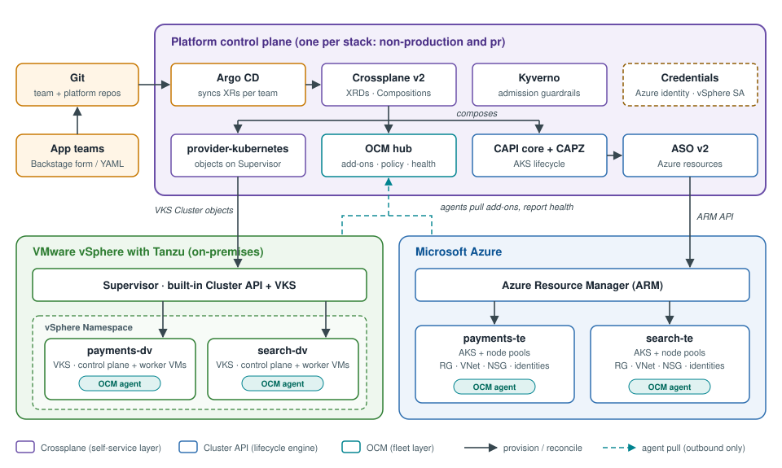

# Proposal: Self-Service Kubernetes Platform on Azure and VMware Tanzu

**Crossplane as the self-service API, Cluster API as the lifecycle engine**

| | |
|---|---|
| **Status** | Draft |
| **Date** | 2026-11-19 |
| **Scope** | Self-service Kubernetes clusters, and their supporting resources, on Microsoft Azure (AKS) and VMware vSphere with Tanzu (VKS) |
| **Background** | Builds on [Multi-Platform-Kubernetes-with-CAPI-Proposal.md](Multi-Platform-Kubernetes-with-CAPI-Proposal.md) and [Multi-Platform-Kubernetes-with-Crossplane-Proposal.md](Multi-Platform-Kubernetes-with-Crossplane-Proposal.md). This document combines them and is the recommended direction. |

---

## 1. Summary

Application teams should be able to get a production-grade Kubernetes cluster, on Azure or on premises, **without filing a ticket and without access to Azure subscriptions, vCenter or the platform's internals**.

This proposal builds a self-service platform in two layers:

- **Crossplane** provides the team-facing API. A team creates a `KubernetesCluster` object in its own namespace, through a Backstage form or a YAML file in Git. The Kubernetes API server validates the request, policies check it, and quotas limit it. Status (Ready, API endpoint, version) is reported back on the same object.
- **Cluster API (CAPI)** does the cluster lifecycle work underneath:
  - **On Azure:** Cluster API core, the Azure provider (CAPZ) and Azure Service Operator (ASO) build AKS and its supporting Azure resources.
  - **On vSphere with Tanzu:** the vSphere **Supervisor**, which is VMware's own CAPI management cluster, builds vSphere Kubernetes Service (VKS) clusters.

Both platforms therefore get CAPI's ordered upgrades and standard health conditions, and on vSphere we stay on VMware's supported path. Teams see **one API** whichever platform they choose. The same control plane can later offer more self-service APIs, such as databases, storage and DNS.

## 2. Goals and Non-Goals

### Goals

1. **Self-service:** a team can request, change and delete clusters with no platform-team involvement in the normal path.
2. **One API for two platforms:** `platform: azure` or `platform: vsphere` is a field, not a different process.
3. **Complete clusters:** networking, identity, registry access, monitoring, access groups and baseline add-ons all come with the request.
4. **Guardrails, not gates:** validation, policy and quotas enforced automatically when a request is made; human approval only where the risk requires it (production).
5. **Least privilege:** teams need no access to Azure, vCenter, the Supervisor or the control plane beyond their own namespace.
6. **Transparency:** teams see their cluster's status, version and access instructions on the object they created.
7. **Extensible:** new self-service APIs can be added on the same control plane without new tooling.

### Non-Goals

- Installing or upgrading vSphere, vCenter, NSX or the Supervisor. The VMware platform team owns these.
- Shared Azure landing-zone resources (hub networks, firewalls, private DNS zones, Azure Policy). These are owned by the landing-zone team and built with Bicep.
- Deploying applications to the new clusters. Teams use their own GitOps or CI/CD once a cluster is ready.
- Tanzu Kubernetes Grid with a standalone management cluster (TKGm), and self-managed VM clusters through CAPV in direct vCenter mode.

## 3. Design Principles

1. **The API is a product.** `KubernetesCluster` is versioned, documented and backwards compatible. Platform details stay behind it.
2. **Reuse the vendors' lifecycle engines.** We do not rebuild cluster lifecycle logic. CAPI with CAPZ handles AKS, and the Supervisor handles VKS. Crossplane decides *what* to build; CAPI decides *how* to roll it out.
3. **Git is the audit trail.** Every request and change is a commit. Direct `kubectl` changes are allowed only in `dev` namespaces.
4. **Guardrails run automatically.** Schema, policy and quota checks run in CI and again at admission. People review only what policy cannot decide.
5. **Same experience on both platforms, honest about differences.** Where AKS and VKS differ, the API either hides the difference or rejects the request with a clear message.

## 4. Options Considered

| Option | Self-service experience | Cluster lifecycle | vSphere fit | Verdict |
|---|---|---|---|---|
| A. Cluster API only, with a Helm values file per request | Pull request and CI checks; status spread across Argo CD, the management cluster and the Supervisor | Strong | Native | Good engine, weak product API |
| B. Crossplane only, with Upjet Azure providers | Strong single API | Delegated to AKS and the Supervisor; Azure providers are heavy | Through `provider-kubernetes` | Strong API; heavier and less native on Azure |
| **C. Crossplane API over Cluster API (proposed)** | **Strong single API, validated by the API server, with status on the object** | **Strong (CAPI on both platforms)** | **Native (Supervisor CAPI)** | **Recommended** |

Option C keeps the best part of each. It also removes the need for Crossplane's Azure providers, because ASO, which is installed with CAPZ, already manages Azure resources as Kubernetes objects. Crossplane v2 can compose these directly.

## 5. Architecture



### 5.1 Layers


| Layer | What it is | Owner |
|---|---|---|
| Team API | `KubernetesCluster` XRD (and future APIs) | Platform team; consumed by app teams |
| Platform logic | Crossplane Compositions, one per platform, plus environment configuration | Platform team |
| Lifecycle engine | CAPI core, CAPZ and ASO (Azure); Supervisor CAPI and VKS (vSphere) | Platform team (Azure); VMware platform team (vSphere) |
| Infrastructure | Azure subscriptions and landing zone; vSphere, NSX or Avi, storage | Landing-zone team; VMware platform team |

### 5.2 Components on the platform control plane

| Component | Purpose |
|---|---|
| **Crossplane v2** | Serves the `KubernetesCluster` API as a namespaced composite resource (XR) and runs Compositions through functions (`function-go-templating`, `function-environment-configs`, `function-auto-ready`). |
| **Cluster API core and CAPZ** | AKS lifecycle: create, upgrade in order, scale and delete. Uses the ASO-based API (`AzureASOManagedCluster`, `AzureASOManagedControlPlane`, `AzureASOManagedMachinePool`) through our `aks-standard` and `aks-private` ClusterClasses. |
| **Azure Service Operator v2** | Installed with CAPZ. Manages every Azure resource (resource group, VNet, NSG, identities, role assignments, Log Analytics, ACR). Extra resource types are enabled through CAPZ's additional-ASO-CRDs setting. |
| **provider-kubernetes** | Creates the VKS `Cluster` object on the Supervisor and reads back its kubeconfig. |
| **provider-helm** | Installs baseline add-ons into each new cluster. |
| **Kyverno** | Admission policies: allowed platforms per team, production rules, version support, deletion protection. |
| **Argo CD** | Syncs platform configuration and each team's requests from Git into the team's namespace. |
| **Backstage (portal)** | Software template that writes a `KubernetesCluster` file into the team repository and opens a pull request. It also shows cluster status. |

### 5.3 Where the control plane runs

**Recommendation: on premises, as a VKS cluster in a dedicated platform vSphere Namespace.**

- It is created directly by the Supervisor, so no bootstrap pivot is needed.
- It has direct access to the Supervisor API.
- It reaches Azure Resource Manager and Entra ID over outbound HTTPS, which is easy to allow.

The alternative, hosting on AKS, needs private connectivity into the Supervisor.

Workload clusters keep running if the control plane is lost. Its configuration is in Git and can be rebuilt (Section 11.1).

If AKS clusters have private API servers, add-on installation needs network access to them over the existing hybrid connectivity, or a hand-off to the AKS GitOps extension (Open Question 4).

## 6. Self-Service Experience

### 6.1 Personas

| Persona | Can do | Cannot do |
|---|---|---|
| **App team developer** | Request, change and delete clusters in their team namespace; see status; get cluster access through their group | Access Azure subscriptions, vCenter, the Supervisor or the control plane; read kubeconfig secrets |
| **App team lead** | Approve the team's production requests | Override platform policy |
| **Platform engineer** | Own the API, Compositions, policies and control plane; onboard teams | Hold standing admin access to team clusters (break-glass only) |
| **VMware or Azure landing-zone admin** | Own the infrastructure underneath | N/A |

### 6.2 Journey


1. **Request:** fill in the Backstage form, or commit a `KubernetesCluster` file to `clusters/` in the team repository.
2. **Review:** CI validates the file against the XRD schema, the Kyverno policies (run with `kyverno apply` in CI) and the team's remaining quota. The team approves its own `dev` and `stg` requests. `prd` needs a second approver from the team lead group.
3. **Apply:** Argo CD syncs the file into the team's namespace on the control plane. Kyverno enforces the same policies again at admission.
4. **Provision:** Crossplane runs the Composition for the chosen platform. CAPZ, or the Supervisor, builds the cluster. Target time: under 30 minutes.
5. **Use:** `status` shows `Ready`, the API endpoint and the running version. Members of the team's access group can sign in:
   - **Azure:** `az aks get-credentials` with Entra ID.
   - **vSphere:** `kubectl vsphere login` with vSphere SSO.

   Baseline add-ons are already installed.

### 6.3 What a team gets

| Item | Azure | vSphere |
|---|---|---|
| Cluster | AKS with a system pool plus the requested node pools | VKS with 1 or 3 control-plane VMs plus the requested worker pools |
| Network | Dedicated spoke VNet, subnets and NSG; peered to the hub for `stg` and `prd` | NSX or VDS segment and load balancer from the Supervisor |
| Identity and access | Entra ID integration; team group granted the AKS RBAC Cluster Admin role on the cluster | vSphere SSO group bound to the vSphere Namespace (at onboarding) |
| Images | `AcrPull` on the shared environment registry | Pull access to the on-premises registry |
| Monitoring | Container Insights to a per-cluster Log Analytics workspace | Monitoring agent add-on to the central stack |
| Add-ons | cert-manager, ingress, external-dns, monitoring agent, GitOps agent | Same set, with platform-specific values |

### 6.4 Team onboarding

A team is onboarded once, by adding a `Tenant` entry to the platform repository. A platform-only `Tenant` XR composes:

- A namespace on the control plane, labelled with the allowed platforms and cost centre.
- A RoleBinding granting the team group the `platform-consumer` role in that namespace.
- A ResourceQuota limiting the number of clusters.
- An Argo CD AppProject and Application that sync the team repository's `clusters/` folder into the namespace.
- For vSphere: a reference to the team's vSphere Namespace and its Supervisor credentials. Creating that vSphere Namespace, and binding the team's SSO group to it, is done by the VMware team or by Supervisor namespace self-service where it is enabled.

## 7. Platform API

### 7.1 `KubernetesCluster` (v1alpha1)

| Field | Type | Applies to | Description |
|---|---|---|---|
| `spec.crossplane.compositionSelector.matchLabels.platform` | `azure` or `vsphere` | both | Chooses the platform (set by the Backstage template). |
| `spec.environment` | `dev`, `stg` or `prd` | both | Drives defaults: private API server, zones, control-plane replicas, approval rules. |
| `spec.version` | string, for example `"1.33"` | both | Kubernetes minor version; must be in the supported list (Section 7.4). |
| `spec.size` | `small`, `medium` or `large` | both | Size of the control plane and system nodes. |
| `spec.nodePools[]` | list | both | `name`, `size`, `count`, optional `autoscale: {min, max}`. |
| `spec.access.groups[]` | list of group IDs | both | Entra group object IDs (Azure). On vSphere, informational: access comes from the vSphere Namespace binding. |
| `spec.deletionProtection` | bool | both | Default `true` for `prd`; deletion is denied while it is `true`. |
| `spec.azure.location` | string | azure | Azure region, from the allowed list. |
| `spec.azure.vnetCidr` | CIDR | azure | Spoke address space (validated against the IPAM allocation). |
| `spec.vsphere.storageClass` | string | vsphere | One of the storage policies bound to the team's vSphere Namespace. |

### 7.2 Status contract (identical on both platforms)

| Field | Meaning |
|---|---|
| `status.conditions[Ready]` | `True` when the cluster is reachable and the add-ons are healthy. |
| `status.conditions[Synced]` | Whether Crossplane applied the latest spec. |
| `status.apiEndpoint` | Cluster API server URL. |
| `status.kubernetesVersion` | The exact version running (AKS patch or VKS release). |
| `status.accessInstructions` | Command to sign in (`az aks get-credentials …` or `kubectl vsphere login …`). |
| `status.platformRef` | Azure resource ID, or Supervisor namespace and cluster name, for support. |

### 7.3 Size mapping

| Size | Azure VM size | vSphere VM class (example) | vCPU / memory |
|---|---|---|---|
| `small` | `Standard_D2ds_v5` | `best-effort-medium` | 2 / 8 GiB |
| `medium` | `Standard_D4ds_v5` | `best-effort-large` | 4 / 16 GiB |
| `large` | `Standard_D8ds_v5` | `best-effort-2xlarge` | 8 / 32 GiB |

vSphere VM class names are defined per site and bound per namespace; the names above are placeholders. All mappings live in an `EnvironmentConfig` (`platform-defaults`) and can change without touching the Compositions.

### 7.4 Version policy

- The platform supports the **three most recent Kubernetes minor versions available on both AKS and VKS**. The list is published in `platform-defaults` and enforced by Kyverno.
- Patch versions are applied automatically: the AKS `patch` auto-upgrade channel, and the latest VKS release for the minor version.
- When a minor version leaves support, teams get 60 days' notice on the cluster status and in Backstage. After that, the platform raises `spec.version` through an automated pull request.

### 7.5 API lifecycle

- Start at `v1alpha1`; move to `v1beta1` after rollout (Phase 6); then `v1` once the API has been stable for two quarters.
- Changes are **additive only** within a version: new optional fields with defaults. Crossplane XRDs can serve several versions, but they cannot convert between incompatible schemas. Breaking changes therefore need a new version, a documented migration and an automated pull request to each team.
- Every Composition change is released as a new Composition revision and rolled out `dev` → `stg` → `prd`.

## 8. How It Works on Each Platform

### 8.1 Azure (AKS through CAPI, CAPZ and ASO)

The Azure Composition renders these objects into the team's namespace on the control plane:

| Rendered object | Engine | Result |
|---|---|---|
| `Cluster` (`cluster.x-k8s.io`) with `topology.class: aks-standard` or `aks-private` | CAPI core and CAPZ | AKS control plane and node pools, upgraded in order |
| Resources in the ClusterClass templates | ASO | Resource group, VNet, subnets, NSG, hub peering, control-plane and kubelet identities, role assignments (`Network Contributor`, `AcrPull`), Log Analytics workspace |
| `RoleAssignment` (ASO) | ASO | Team group gets the *Azure Kubernetes Service RBAC Cluster Admin* role on the cluster |
| `ProviderConfig` and `Release` objects | provider-helm | Baseline add-ons, using the CAPI-generated kubeconfig secret |

AKS baseline:

- **Networking:** Azure CNI Overlay with the Cilium dataplane; hub firewall egress for `stg` and `prd`.
- **Identity and security:** Entra ID with Azure RBAC; local accounts disabled; OIDC issuer and Workload Identity enabled; private API server for `prd`; Azure Policy add-on; Defender for Containers.
- **Availability:** zones 1, 2 and 3; Standard tier control plane for `stg` and `prd`.

**Authentication:** CAPZ and ASO use a federated identity that trusts the control plane's service-account issuer. If Entra ID cannot reach that issuer, the fallback is a certificate-based service principal held in an external secret store and rotated automatically. Permissions:

- `Contributor` on the platform subscriptions.
- `User Access Administrator`, limited by an ABAC condition to the roles the platform assigns.

### 8.2 vSphere with Tanzu (VKS through the Supervisor)

The vSphere Composition renders:

| Rendered object | Engine | Result |
|---|---|---|
| `Object` (provider-kubernetes) wrapping a `Cluster` with `topology.class: builtin-generic-…` | Supervisor CAPI and VKS | Control-plane and worker VMs, load balancer VIP, CSI storage |
| `connectionDetails` on that `Object` | provider-kubernetes | Copies the Supervisor-generated kubeconfig into a platform-only secret |
| `ProviderConfig` and `Release` objects | provider-helm | Baseline add-ons |

**Assumptions:**

- vSphere 8 Update 3 or VMware Cloud Foundation 9, with the Supervisor and VKS installed.
- NSX, or VDS with Avi, for networking.
- VM classes, storage policies and Kubernetes releases published and bound to the team vSphere Namespaces.

**Authentication:** `kubectl vsphere login` tokens expire (10 hours by default), so they are not suitable for a controller. Instead:

1. A dedicated vSphere SSO service account is given `Edit` on each team vSphere Namespace.
2. A long-lived, namespace-scoped ServiceAccount token is created from it.
3. The token is stored through External Secrets for the `provider-kubernetes` ProviderConfig of that tenant.

**This is the first thing to validate in Phase 1.**

### 8.3 Differences between the platforms

| Capability | Azure (AKS) | vSphere (VKS) | API behaviour |
|---|---|---|---|
| Cluster autoscaling | Native | Supported on newer VKS releases through the autoscaler package | `autoscale` honoured where supported; otherwise rejected with a clear message |
| Access groups | Entra groups per cluster | SSO groups per vSphere Namespace | `access.groups` applied on Azure; on vSphere, managed at tenant onboarding |
| Pod identity to the cloud | Entra Workload Identity | Not applicable | Azure-only add-on |
| Control-plane VMs | Managed by Azure, not visible | VMs in the team vSphere Namespace (1 for `dev`, 3 for `stg` and `prd`) | Counted against the vSphere Namespace limits |
| Private API server | Option (set for `prd`) | Always internal (load balancer VIP) | Driven by `environment` |
| Capacity | Subscription quotas | vSphere Namespace CPU, memory and storage limits | Requests that would exceed limits fail with the platform's reason in status |

## 9. Guardrails and Governance

| Guardrail | Mechanism | Example |
|---|---|---|
| Valid input | XRD OpenAPI schema plus CEL rules | `azure.location` is required when the platform is `azure`; `nodePools[].count` ≥ 1 |
| Allowed platform per team | Kyverno, using namespace labels | A team without on-premises capacity cannot request `vsphere` |
| Production standards | Kyverno | `prd` requires `deletionProtection: true`, `size` ≥ `medium`, and at least 3 nodes per pool |
| Supported versions | Kyverno, reading `platform-defaults` | `version: "1.30"` is rejected after end of support |
| Cluster count | `ResourceQuota` on `count/kubernetesclusters.platform.example.org` | Default: 3 per team; raised on request |
| Infrastructure capacity | vSphere Namespace limits; Azure subscription quotas and budgets | Over-capacity requests fail fast with a status message |
| Cost visibility | Azure tags and vSphere Namespace labels from the tenant's cost centre | Monthly showback per team |
| Deletion safety | Kyverno blocks deletes while `deletionProtection: true`; Argo CD does not prune cluster requests automatically | Deleting a production cluster takes two deliberate steps |
| Who can do what | Kubernetes RBAC (`platform-consumer` ClusterRole bound per team namespace) | Teams can manage `KubernetesCluster` objects but cannot read secrets |

## 10. Example Manifests

API versions, ClusterClass names and VKS releases below are illustrative. Pin them to the releases chosen in Phase 1.

### 10.1 Team request

```yaml
apiVersion: platform.example.org/v1alpha1
kind: KubernetesCluster
metadata:
  name: payments-prd
  namespace: team-payments
spec:
  crossplane:
    compositionSelector:
      matchLabels: { platform: azure }
  environment: prd
  version: "1.33"
  size: medium
  deletionProtection: true
  access:
    groups: ["00000000-0000-0000-0000-000000000000"]   # Entra group: payments-engineers
  azure:
    location: eastus2
    vnetCidr: 10.40.0.0/16
  nodePools:
    - { name: apps, size: medium, count: 3, autoscale: { min: 3, max: 10 } }
```

The on-premises version of the same request changes only the selector and the platform block:

```yaml
spec:
  crossplane:
    compositionSelector:
      matchLabels: { platform: vsphere }
  vsphere:
    storageClass: vsan-default-policy
```

### 10.2 Composite Resource Definition (abbreviated)

```yaml
apiVersion: apiextensions.crossplane.io/v2
kind: CompositeResourceDefinition
metadata:
  name: kubernetesclusters.platform.example.org
spec:
  group: platform.example.org
  scope: Namespaced
  names: { kind: KubernetesCluster, plural: kubernetesclusters }
  versions:
    - name: v1alpha1
      served: true
      referenceable: true
      schema:
        openAPIV3Schema:
          type: object
          properties:
            spec:
              type: object
              required: [environment, version, size]
              x-kubernetes-validations:
                - rule: "!has(self.azure) || has(self.azure.location)"
                  message: "azure.location is required for Azure clusters"
              properties:
                environment: { type: string, enum: [dev, stg, prd] }
                version:     { type: string, pattern: '^1\.[0-9]+$' }
                size:        { type: string, enum: [small, medium, large] }
                deletionProtection: { type: boolean }
                access:
                  type: object
                  properties:
                    groups: { type: array, items: { type: string } }
                nodePools:
                  type: array
                  maxItems: 10
                  items:
                    type: object
                    required: [name, size, count]
                    properties:
                      name:  { type: string, pattern: '^[a-z][a-z0-9]{0,11}$' }
                      size:  { type: string, enum: [small, medium, large] }
                      count: { type: integer, minimum: 1, maximum: 100 }
                      autoscale:
                        type: object
                        properties:
                          min: { type: integer, minimum: 1 }
                          max: { type: integer, maximum: 100 }
                azure:
                  type: object
                  properties:
                    location: { type: string }
                    vnetCidr: { type: string }
                vsphere:
                  type: object
                  properties:
                    storageClass: { type: string }
            status:
              type: object
              properties:
                apiEndpoint:        { type: string }
                kubernetesVersion:  { type: string }
                accessInstructions: { type: string }
                platformRef:        { type: string }
```

### 10.3 Azure Composition: rendering a CAPI cluster (excerpt)

Crossplane v2 can compose any Kubernetes resource, so the Azure Composition creates the CAPI `Cluster` and ASO objects directly. No Crossplane Azure provider is needed.

```yaml
apiVersion: apiextensions.crossplane.io/v1
kind: Composition
metadata:
  name: kubernetescluster-azure
  labels: { platform: azure }
spec:
  compositeTypeRef:
    apiVersion: platform.example.org/v1alpha1
    kind: KubernetesCluster
  mode: Pipeline
  pipeline:
    - step: environment
      functionRef: { name: function-environment-configs }
      input:
        apiVersion: environmentconfigs.fn.crossplane.io/v1beta1
        kind: Input
        spec:
          environmentConfigs:
            - type: Reference
              ref: { name: platform-defaults }
    - step: render
      functionRef: { name: function-go-templating }
      input:
        apiVersion: gotemplating.fn.crossplane.io/v1beta1
        kind: GoTemplate
        source: Inline
        inline:
          template: |
            {{- $xr   := .observed.composite.resource }}
            {{- $env  := index .context "apiextensions.crossplane.io/environment" }}
            {{- $name := $xr.metadata.name }}
            {{- $prd  := eq $xr.spec.environment "prd" }}
            ---
            apiVersion: cluster.x-k8s.io/v1beta1
            kind: Cluster
            metadata:
              name: {{ $name }}
              annotations:
                gotemplating.fn.crossplane.io/composition-resource-name: capi-cluster
            spec:
              topology:
                class: {{ if $prd }}aks-private{{ else }}aks-standard{{ end }}
                version: {{ index $env.azure.versions $xr.spec.version }}
                variables:
                  - { name: location,         value: {{ $xr.spec.azure.location }} }
                  - { name: vnetCidr,         value: {{ $xr.spec.azure.vnetCidr }} }
                  - { name: systemPoolVmSize, value: {{ index $env.azure.sizes $xr.spec.size }} }
                  - { name: adminGroupIds,    value: {{ toJson $xr.spec.access.groups }} }
                workers:
                  machinePools:
                  {{- range $xr.spec.nodePools }}
                    - class: user-general
                      name: {{ .name }}
                      replicas: {{ .count }}
                  {{- end }}
            # ... ASO RoleAssignment for the team group, provider-helm ProviderConfig
            #     (from the <name>-kubeconfig secret written by CAPI) and Releases
    - step: status
      functionRef: { name: function-go-templating }
      # copies the CAPI Cluster's Ready condition, endpoint and version to the XR status
    - step: ready
      functionRef: { name: function-auto-ready }
```

### 10.4 vSphere Composition: rendering a VKS cluster on the Supervisor (excerpt)

```yaml
apiVersion: kubernetes.m.crossplane.io/v1alpha1
kind: Object
metadata:
  name: payments-onprem-vks
  namespace: team-payments
spec:
  providerConfigRef:
    kind: ProviderConfig
    name: supervisor-team-payments          # tenant-scoped Supervisor credentials
  forProvider:
    manifest:
      apiVersion: cluster.x-k8s.io/v1beta1
      kind: Cluster
      metadata:
        name: payments-onprem
        namespace: payments-prd             # team vSphere Namespace
      spec:
        clusterNetwork:
          pods:     { cidrBlocks: ["192.168.0.0/16"] }
          services: { cidrBlocks: ["10.96.0.0/12"] }
          serviceDomain: cluster.local
        topology:
          class: builtin-generic-v3.4.0
          classNamespace: vmware-system-vks-public
          version: v1.33.1---vmware.1-vkr.1  # from platform-defaults
          controlPlane: { replicas: 3 }
          workers:
            machineDeployments:
              - { class: node-pool, name: apps, replicas: 3 }
          variables:
            - { name: vmClass,      value: best-effort-large }
            - { name: storageClass, value: vsan-default-policy }
  connectionDetails:
    - apiVersion: v1
      kind: Secret
      name: payments-onprem-kubeconfig
      namespace: payments-prd
      fieldPath: data.value
      toConnectionSecretKey: kubeconfig
  writeConnectionSecretToRef:
    name: payments-onprem-kubeconfig        # platform-only; teams cannot read secrets
```

### 10.5 Guardrails

```yaml
# Kyverno: production clusters must be protected and adequately sized
apiVersion: kyverno.io/v1
kind: ClusterPolicy
metadata:
  name: kubernetescluster-prd-standards
spec:
  validationFailureAction: Enforce
  rules:
    - name: prd-standards
      match:
        any:
          - resources:
              kinds: ["platform.example.org/v1alpha1/KubernetesCluster"]
      preconditions:
        all:
          - key: "{{ request.object.spec.environment }}"
            operator: Equals
            value: prd
      validate:
        message: "prd clusters need deletionProtection: true and size medium or large."
        deny:
          conditions:
            any:
              - key: "{{ request.object.spec.deletionProtection || `false` }}"
                operator: NotEquals
                value: true
              - key: "{{ request.object.spec.size }}"
                operator: Equals
                value: small
---
# Quota: at most 3 clusters per team namespace
apiVersion: v1
kind: ResourceQuota
metadata:
  name: cluster-count
  namespace: team-payments
spec:
  hard:
    count/kubernetesclusters.platform.example.org: "3"
---
# What app teams may do in their namespace
apiVersion: rbac.authorization.k8s.io/v1
kind: ClusterRole
metadata:
  name: platform-consumer
rules:
  - apiGroups: ["platform.example.org"]
    resources: ["kubernetesclusters"]
    verbs: ["get", "list", "watch", "create", "update", "patch", "delete"]
  - apiGroups: [""]
    resources: ["events"]
    verbs: ["get", "list", "watch"]
```

## 11. Operating Model

### 11.1 Bootstrap and recovery

1. Create the control plane as a VKS cluster in the platform vSphere Namespace by applying a `Cluster` to the Supervisor.
2. Install, at pinned versions:
   - CAPI core, CAPZ and ASO with `clusterctl init --infrastructure azure`.
   - Crossplane v2 and its functions.
   - provider-kubernetes and provider-helm.
   - Kyverno, Argo CD and External Secrets.
3. Configure credentials: the Azure federated identity, and the Supervisor ServiceAccount tokens per tenant.
4. Point Argo CD at the platform repository. Everything else (XRDs, Compositions, ClusterClasses, policies, tenants) comes from Git.

**Recovery:** rebuild by repeating these steps. Team requests are re-applied from Git, and CAPZ and the Supervisor re-adopt existing clusters by name. Target: rebuilt within 2 hours. Running clusters are not affected during the outage; only changes are paused.

### 11.2 Repositories

```
platform/                              # owned by the platform team
├── bootstrap/                         # pinned installs: CAPI/CAPZ/ASO, Crossplane, providers, Kyverno, Argo CD
├── apis/
│   └── kubernetescluster/
│       ├── definition.yaml            # XRD
│       ├── composition-azure.yaml
│       ├── composition-vsphere.yaml
│       └── tests/                     # crossplane render fixtures and expected output
├── clusterclasses/                    # aks-standard, aks-private (ASO-based CAPZ templates)
├── environment/platform-defaults.yaml # sizes, versions, regions, add-on versions
├── policies/                          # Kyverno ClusterPolicies
├── addons/                            # Helm values per add-on and platform
└── tenants/                           # one Tenant per team (namespace, RBAC, quota, repo sync)

team-payments/                         # owned by the app team
└── clusters/
    ├── payments-prd.yaml
    └── payments-onprem.yaml
```

### 11.3 Day-2 operations

| Operation | Who | How |
|---|---|---|
| Upgrade Kubernetes minor version | Team (or an automated pull request at end of support) | Change `spec.version`. CAPZ or the Supervisor rolls the control plane, then the workers. |
| Scale or add a node pool | Team | Change `spec.nodePools`. |
| Patch upgrades and node images | Platform (automatic) | AKS auto-upgrade channel; latest VKS release per minor version. |
| Change platform defaults | Platform team | Pull request to `platform/`; a new Composition revision promoted `dev` → `stg` → `prd`. |
| Delete a cluster | Team | Set `deletionProtection: false` (approved like any change), then remove the file and sync in Argo CD. |
| Incident on a team cluster | Team first; platform for platform faults | Teams have full admin on their cluster. Platform engineers use break-glass access, which is audited. |
| Test platform changes | Platform team | CI runs `crossplane render`, `crossplane beta validate`, `kyverno apply` and `clusterctl alpha topology plan` before merge. |

### 11.4 Service levels and support

| Measure | Target |
|---|---|
| Request to `Ready` (p90) | Under 30 minutes on either platform |
| Platform API availability | 99.5% during business hours |
| Failed provisioning surfaced to the team | Within 5 minutes, with a reason in `status` |
| Support | Backstage docs and FAQ → team Slack channel → platform on-call for platform faults |

### 11.5 Observability

- Metrics from Crossplane, CAPI, CAPZ, ASO and Kyverno are scraped by Prometheus. Alerts fire on XRs not `Ready` for more than 30 minutes, on reconcile error rates, and on policy denials spiking after a release.
- `crossplane beta trace` shows a request end to end. `clusterctl describe cluster` drills into Azure clusters, and the Supervisor's `Cluster` conditions into vSphere clusters.
- The Backstage catalog shows every cluster with its owner, platform, version, health and cost centre.

## 12. Security

- **Teams hold no infrastructure credentials.** Only the control plane talks to Azure and the Supervisor, using federated identity or rotated, namespace-scoped tokens held in an external secret store.
- **Kubeconfig secrets are platform-only.** Teams sign in to their clusters with Entra ID or vSphere SSO groups, never with stored admin kubeconfigs.
- **Tenant isolation:** one namespace per team, with tenant-scoped ProviderConfigs, so a team's request can only target its own vSphere Namespace and the allowed Azure subscriptions.
- **Supply chain:** every controller, provider and function is pinned by digest and pulled from an internal mirror.
- **Policy at every layer:** XRD validation, Kyverno at admission, Azure Policy in subscriptions, and vSphere Namespace limits.
- **Audit:** Git history for intent, Kubernetes audit logs on the control plane for actions, Azure Activity Log and vCenter events for infrastructure changes.

## 13. Delivery Plan

| Phase | Deliverables | Exit criteria |
|---|---|---|
| **1. Foundation** (weeks 1–3) | Control plane on VKS; CAPI, CAPZ, ASO, Crossplane, providers, Kyverno and Argo CD installed; Azure and Supervisor credentials validated | A test VKS `Cluster` and a test ASO resource are created from the control plane; Supervisor token approach confirmed |
| **2. Azure path** (weeks 4–6) | `aks-standard` ClusterClass; XRD v1alpha1; Azure Composition; render tests in CI | A `dev` AKS cluster is requested, ready, used and deleted through the API with no orphaned resources |
| **3. vSphere path** (weeks 6–8) | vSphere Composition; kubeconfig handling; version and size mappings | A `dev` VKS cluster is requested through the same API with the same status contract |
| **4. Self-service** (weeks 9–11) | `Tenant` onboarding; RBAC, quotas and Kyverno policies; Backstage template and catalog; add-ons on both platforms; team documentation | A pilot team gets a ready cluster on either platform from one pull request, with no platform-team action |
| **5. Production readiness** (weeks 12–14) | `aks-private` ClusterClass, hub peering, `prd` policies, alerts, rebuild drill, upgrade rehearsal on both platforms | Security sign-off; control plane rebuilt within target; SLOs measured on the pilot |
| **6. General availability** (week 15 onward) | Onboard teams in waves; promote the API to `v1beta1` | Ticket-based cluster requests retired |
| **Next** | Further self-service APIs on the same control plane: `Database` (Azure through ASO), `Bucket`, `DnsRecord`, `TeamNamespace` | Prioritised by team demand |

## 14. Risks and Mitigations

| Risk | Impact | Mitigation |
|---|---|---|
| Supervisor authentication for controllers (token expiry, ServiceAccount permissions in vSphere Namespaces) | vSphere path cannot work unattended | Validate first in Phase 1; rotate through External Secrets; escalate to VMware support if namespace-scoped ServiceAccounts are not permitted |
| Two layers (Crossplane over CAPI) make debugging harder | Slower incident resolution | Status contract surfaces the underlying CAPI conditions; runbooks per layer; `crossplane beta trace` plus `clusterctl describe` |
| API design mistakes are hard to undo once teams depend on it | Painful migrations | Start as `v1alpha1` with a pilot team; additive-only changes; automated migration pull requests |
| A Composition change affects every cluster | Fleet-wide incident | Composition revisions with staged promotion; render tests; `dev` first |
| CAPZ's bundled ASO installs a limited set of CRDs | Extra Azure resources unavailable | Enable additional ASO CRDs through CAPZ configuration; test on CAPZ upgrades |
| On-premises capacity runs out as self-service increases demand | Requests fail | vSphere Namespace limits plus quotas; capacity dashboard; requests over capacity fail fast with a clear reason |
| Cost growth on Azure | Budget overrun | Per-team quotas, tags and showback; Azure budgets with alerts; `dev` clusters can be scheduled to scale to zero |
| Feature gaps between AKS and VKS | Confused teams | Documented differences (Section 8.3); clear rejection messages |
| Control plane outage | No changes possible; running clusters unaffected | Rebuild from Git; tested recovery drill |

## 15. Open Questions

1. Is outbound access from on premises to Azure Resource Manager and Entra ID approved for the control plane?
2. Which vSphere and VKS versions are in production, and is vSphere Namespace self-service enabled?
3. Does the organisation already run Backstage, or another developer portal we should integrate with instead?
4. Should private AKS add-ons be installed directly from the control plane, or handed to the AKS GitOps extension?
5. Is approval for production clusters by the team lead enough, or does a platform or security review also need to sign off?
6. What are the chargeback or showback expectations, and who owns budget alerts?
7. Do existing AKS or VKS clusters need to be brought under the platform, or is it new clusters only?
8. Which self-service API should come after `KubernetesCluster`?

## 16. References

- Crossplane documentation: https://docs.crossplane.io
- Cluster API Book: https://cluster-api.sigs.k8s.io
- Cluster API Provider Azure (CAPZ): https://capz.sigs.k8s.io
- Azure Service Operator v2: https://azure.github.io/azure-service-operator
- provider-kubernetes: https://github.com/crossplane-contrib/provider-kubernetes
- provider-helm: https://github.com/crossplane-contrib/provider-helm
- Kyverno: https://kyverno.io
- Backstage: https://backstage.io
- vSphere Kubernetes Service documentation: https://techdocs.broadcom.com (search "vSphere Kubernetes Service")
- Argo CD: https://argo-cd.readthedocs.io
