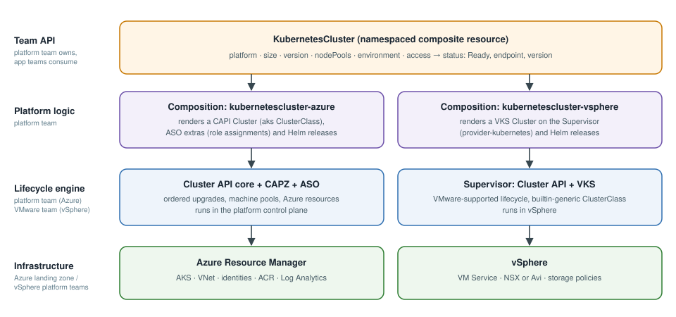
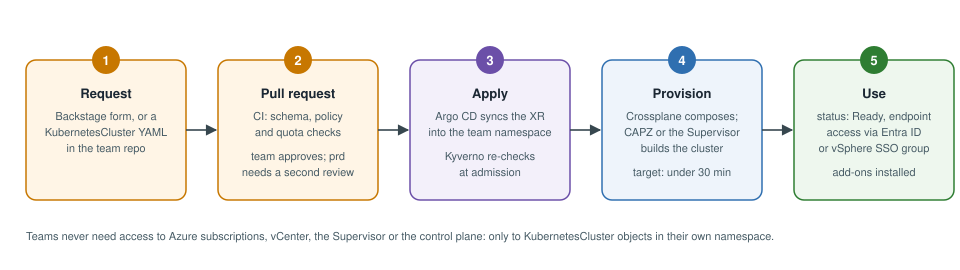

# Proposal: Self-Service Kubernetes Platform on Azure and VMware Tanzu

**Crossplane as the self-service API, Cluster API as the lifecycle engine, OCM as the fleet layer, OpenChoreo as the application platform**

| | |
|---|---|
| **Status** | Draft |
| **Date** | 2026-11-19 |
| **Scope** | Self-service Kubernetes clusters, and their supporting resources, on Microsoft Azure (AKS) and VMware vSphere with Tanzu (VKS); application delivery on those clusters through OpenChoreo |
| **Background** | Builds on [Multi-Platform-Kubernetes-with-CAPI-Proposal.md](Multi-Platform-Kubernetes-with-CAPI-Proposal.md) and [Multi-Platform-Kubernetes-with-Crossplane-Proposal.md](Multi-Platform-Kubernetes-with-Crossplane-Proposal.md). This document combines them and is the recommended direction. |

---

## 1. Summary

Application teams should be able to get a production-grade Kubernetes cluster, on Azure or on premises, **without filing a ticket and without access to Azure subscriptions, vCenter or the platform's internals**.

This proposal builds a self-service platform in layers:

- **Crossplane** provides the team-facing API. A team creates a `KubernetesCluster` object in its own namespace, through a Backstage form or a YAML file in Git. The Kubernetes API server validates the request, policies check it, and quotas limit it. Status (Ready, API endpoint, version) is reported back on the same object.
- **Cluster API (CAPI)** does the cluster lifecycle work underneath:
  - **On Azure:** Cluster API core, the Azure provider (CAPZ) and Azure Service Operator (ASO) build AKS and its supporting Azure resources.
  - **On vSphere with Tanzu:** the vSphere **Supervisor**, which is VMware's own CAPI management cluster, builds vSphere Kubernetes Service (VKS) clusters.
- **Open Cluster Management (OCM)** is the fleet layer once a cluster exists. Each new cluster registers with an OCM hub on the control plane. An agent on the cluster then pulls its baseline add-ons and in-cluster policy, and reports health back to the hub. The connection is outbound only, so private clusters need no inbound access.
- **OpenChoreo** is the application platform on top, for teams that want to deploy applications rather than run clusters. Developers work with projects, components and promotions through OpenChoreo's portal, CLI or Git. The clusters OpenChoreo deploys to (its *data planes*) are ordinary `KubernetesCluster` requests on this platform, registered with OpenChoreo automatically (Section 9).

Both platforms therefore get CAPI's ordered upgrades and standard health conditions, and on vSphere we stay on VMware's supported path. Teams see **one API** whichever platform they choose, and teams that only need somewhere to run applications never handle a cluster at all. The same control plane can later offer more self-service APIs, such as databases, storage and DNS.

## 2. Goals and Non-Goals

### Goals

1. **Self-service:** a team can request, change and delete clusters with no platform-team involvement in the normal path.
2. **One API for two platforms:** `platform: azure` or `platform: vsphere` is a field, not a different process.
3. **Complete clusters:** networking, identity, registry access, monitoring, access groups and baseline add-ons all come with the request.
4. **Guardrails, not gates:** validation, policy and quotas enforced automatically when a request is made; human approval only where the risk requires it (production).
5. **Least privilege:** teams need no access to Azure, vCenter, the Supervisor or the control plane beyond their own namespace.
6. **Transparency:** teams see their cluster's status, version and access instructions on the object they created.
7. **Extensible:** new self-service APIs can be added on the same control plane without new tooling.
8. **Applications without clusters:** teams that only want to build and deploy applications use OpenChoreo, on shared data planes that the platform provisions, upgrades and registers.

### Non-Goals

- Installing or upgrading vSphere, vCenter, NSX or the Supervisor. The VMware platform team owns these.
- Shared Azure landing-zone resources (hub networks, firewalls, private DNS zones, Azure Policy). These are owned by the landing-zone team and built with Bicep.
- Deploying applications to *dedicated team clusters*. Teams that own a whole cluster use their own GitOps or CI/CD once it is ready. (Application deployment on shared data planes is in scope, through OpenChoreo.)
- Changing OpenChoreo itself. The platform installs and configures released versions of it.
- Tanzu Kubernetes Grid with a standalone management cluster (TKGm), and self-managed VM clusters through CAPV in direct vCenter mode.

## 3. Design Principles

1. **The API is a product.** `KubernetesCluster` is versioned, documented and backwards compatible. Platform details stay behind it.
2. **Reuse the vendors' lifecycle engines.** We do not rebuild cluster lifecycle logic. CAPI with CAPZ handles AKS, and the Supervisor handles VKS. Crossplane decides *what* to build; CAPI decides *how* to roll it out; OCM keeps each built cluster configured and reports its health.
3. **Git is the audit trail.** Every request and change is a commit. Direct `kubectl` changes are allowed only in `dev` namespaces.
4. **Guardrails run automatically.** Schema, policy and quota checks run in CI and again at admission. People review only what policy cannot decide.
5. **Clusters are an implementation detail for application teams.** OpenChoreo data planes are built through the same `KubernetesCluster` API as team clusters, so they get the same upgrades, policies and add-ons. OpenChoreo owns what runs *on* them.
6. **Same experience on both platforms, honest about differences.** Where AKS and VKS differ, the API either hides the difference or rejects the request with a clear message.

## 4. Options Considered

| Option | Self-service experience | Cluster lifecycle | vSphere fit | Verdict |
|---|---|---|---|---|
| A. Cluster API only, with a Helm values file per request | Pull request and CI checks; status spread across Argo CD, the management cluster and the Supervisor | Strong | Native | Good engine, weak product API |
| B. Crossplane only, with Upjet Azure providers | Strong single API | Delegated to AKS and the Supervisor; Azure providers are heavy | Through `provider-kubernetes` | Strong API; heavier and less native on Azure |
| **C. Crossplane API over Cluster API (proposed)** | **Strong single API, validated by the API server, with status on the object** | **Strong (CAPI on both platforms)** | **Native (Supervisor CAPI)** | **Recommended** |

Option C keeps the best part of each. It also removes the need for Crossplane's Azure providers, because ASO, which is installed with CAPZ, already manages Azure resources as Kubernetes objects. Crossplane v2 can compose these directly.

## 5. Architecture


### 5.1 Layers



| Layer | What it is | Owner |
|---|---|---|
| Application platform | OpenChoreo: projects, components, environments and deployment pipelines, on data plane clusters from the layers below | Platform team; consumed by developers |
| Team API | `KubernetesCluster` XRD (and future APIs) | Platform team; consumed by app teams |
| Platform logic | Crossplane Compositions, one per platform, plus environment configuration | Platform team |
| Lifecycle engine | CAPI core, CAPZ and ASO (Azure); Supervisor CAPI and VKS (vSphere) | Platform team (Azure); VMware platform team (vSphere) |
| Fleet layer | OCM hub on the control plane, agent on every cluster: registration, add-ons, in-cluster policy, health | Platform team |
| Infrastructure | Azure subscriptions and landing zone; vSphere, NSX or Avi, storage | Landing-zone team; VMware platform team |

### 5.2 Components on the platform control plane

| Component | Purpose |
|---|---|
| **Crossplane v2** | Serves the `KubernetesCluster` API as a namespaced composite resource (XR) and runs Compositions through functions (`function-go-templating`, `function-environment-configs`, `function-auto-ready`). |
| **Cluster API core and CAPZ** | AKS lifecycle: create, upgrade in order, scale and delete. Uses the ASO-based API (`AzureASOManagedCluster`, `AzureASOManagedControlPlane`, `AzureASOManagedMachinePool`) through our `aks-standard` and `aks-private` ClusterClasses. |
| **Azure Service Operator v2** | Installed with CAPZ. Manages every Azure resource (resource group, VNet, NSG, identities, role assignments, Log Analytics, ACR). Extra resource types are enabled through CAPZ's additional-ASO-CRDs setting. |
| **provider-kubernetes** | Creates the VKS `Cluster` object on the Supervisor and reads back its kubeconfig. |
| **Open Cluster Management (OCM) hub** | Registers every cluster, delivers baseline add-ons and in-cluster policy, and reports cluster and add-on health. Agents on the clusters connect out to it (Section 8.4). |
| **Kyverno** | Admission policies: allowed platforms per team, production rules, version support, deletion protection. |
| **Argo CD** | Syncs platform configuration and each team's requests from Git into the team's namespace. |
| **Backstage (portal)** | Software template that writes a `KubernetesCluster` file into the team repository and opens a pull request. It also shows cluster status. |

### 5.3 Where the control plane runs

**Recommendation: on premises, as a VKS cluster in a dedicated platform vSphere Namespace.**

- It is created directly by the Supervisor, so no bootstrap pivot is needed.
- It has direct access to the Supervisor API.
- It reaches Azure Resource Manager and Entra ID over outbound HTTPS, which is easy to allow.

The alternative, hosting on AKS, needs private connectivity into the Supervisor.

Workload clusters keep running if the control plane is lost. Its configuration is in Git and can be rebuilt (Section 12.1).

Private AKS API servers do not need to be reachable from the control plane after a cluster is registered: the OCM agent on each cluster connects out to the hub (Section 8.4). Only the one-time import needs to reach the new cluster's API server (Open Question 4).

## 6. Self-Service Experience

### 6.1 Personas

| Persona | Can do | Cannot do |
|---|---|---|
| **App team developer** | Request, change and delete clusters in their team namespace; see status; get cluster access through their group | Access Azure subscriptions, vCenter, the Supervisor or the control plane; read kubeconfig secrets |
| **Application developer (OpenChoreo)** | Create projects and components, build, deploy and promote through OpenChoreo; see logs and metrics | Request clusters; access data plane clusters directly |
| **App team lead** | Approve the team's production requests | Override platform policy |
| **Platform engineer** | Own the API, Compositions, policies and control plane; onboard teams | Hold standing admin access to team clusters (break-glass only) |
| **VMware or Azure landing-zone admin** | Own the infrastructure underneath | N/A |

### 6.2 Journey



1. **Request:** fill in the Backstage form, or commit a `KubernetesCluster` file to `clusters/` in the team repository.
2. **Review:** CI validates the file against the XRD schema, the Kyverno policies (run with `kyverno apply` in CI) and the team's remaining quota. The team approves its own `dev` and `stg` requests. `prd` needs a second approver from the team lead group.
3. **Apply:** Argo CD syncs the file into the team's namespace on the control plane. Kyverno enforces the same policies again at admission.
4. **Provision:** Crossplane runs the Composition for the chosen platform. CAPZ, or the Supervisor, builds the cluster. Target time: under 30 minutes.
5. **Use:** `status` shows `Ready`, the API endpoint and the running version. Members of the team's access group can sign in:
   - **Azure:** `az aks get-credentials` with Entra ID.
   - **vSphere:** `kubectl vsphere login` with vSphere SSO.

   Baseline add-ons are already installed.

### 6.3 What a team gets

| Item | Azure | vSphere |
|---|---|---|
| Cluster | AKS with a system pool plus the requested node pools | VKS with 1 or 3 control-plane VMs plus the requested worker pools |
| Network | Dedicated spoke VNet, subnets and NSG; peered to the hub for `stg` and `prd` | NSX or VDS segment and load balancer from the Supervisor |
| Identity and access | Entra ID integration; team group granted the AKS RBAC Cluster Admin role on the cluster | vSphere SSO group bound to the vSphere Namespace (at onboarding) |
| Images | `AcrPull` on the shared environment registry | Pull access to the on-premises registry |
| Monitoring | Container Insights to a per-cluster Log Analytics workspace | Monitoring agent add-on to the central stack |
| Add-ons | cert-manager, ingress, external-dns, monitoring agent, GitOps agent | Same set, with platform-specific values |

### 6.4 Team onboarding

A team is onboarded once, by adding a `Tenant` entry to the platform repository. A platform-only `Tenant` XR composes:

- A namespace on the control plane, labelled with the allowed platforms and cost centre.
- A RoleBinding granting the team group the `platform-consumer` role in that namespace.
- A ResourceQuota limiting the number of clusters.
- An Argo CD AppProject and Application that sync the team repository's `clusters/` folder into the namespace.
- An OCM `ManagedClusterSet` for the team, bound into the namespace with a `ManagedClusterSetBinding`, so the team's clusters are grouped and isolated on the hub.
- Optionally, for teams that use OpenChoreo: the team's OpenChoreo namespace and role bindings, delivered to the OpenChoreo control plane through OCM.
- For vSphere: a reference to the team's vSphere Namespace and its Supervisor credentials. Creating that vSphere Namespace, and binding the team's SSO group to it, is done by the VMware team or by Supervisor namespace self-service where it is enabled.

## 7. Platform API

### 7.1 `KubernetesCluster` (v1alpha1)

| Field | Type | Applies to | Description |
|---|---|---|---|
| `spec.crossplane.compositionSelector.matchLabels.platform` | `azure` or `vsphere` | both | Chooses the platform (set by the Backstage template). |
| `spec.purpose` | `team` (default), `openchoreo-control-plane` or `openchoreo-data-plane` | both | What the cluster is for. The OpenChoreo values are allowed only in the platform tenant's namespace (Section 10). |
| `spec.environment` | `dev`, `stg` or `prd` | both | Drives defaults: private API server, zones, control-plane replicas, approval rules. |
| `spec.version` | string, for example `"1.33"` | both | Kubernetes minor version; must be in the supported list (Section 7.4). |
| `spec.size` | `small`, `medium` or `large` | both | Size of the control plane and system nodes. |
| `spec.nodePools[]` | list | both | `name`, `size`, `count`, optional `autoscale: {min, max}`. |
| `spec.access.groups[]` | list of group IDs | both | Entra group object IDs (Azure). On vSphere, informational: access comes from the vSphere Namespace binding. |
| `spec.deletionProtection` | bool | both | Default `true` for `prd`; deletion is denied while it is `true`. |
| `spec.azure.location` | string | azure | Azure region, from the allowed list. |
| `spec.azure.vnetCidr` | CIDR | azure | Spoke address space (validated against the IPAM allocation). |
| `spec.vsphere.storageClass` | string | vsphere | One of the storage policies bound to the team's vSphere Namespace. |

### 7.2 Status contract (identical on both platforms)

| Field | Meaning |
|---|---|
| `status.conditions[Ready]` | `True` when the cluster is reachable and the add-ons are healthy: the OCM `ManagedClusterConditionAvailable` condition is `True` and every baseline `ManagedClusterAddOn` is `Available`. |
| `status.conditions[Synced]` | Whether Crossplane applied the latest spec. |
| `status.apiEndpoint` | Cluster API server URL. |
| `status.kubernetesVersion` | The exact version running (AKS patch or VKS release). |
| `status.accessInstructions` | Command to sign in (`az aks get-credentials …` or `kubectl vsphere login …`). |
| `status.platformRef` | Azure resource ID, or Supervisor namespace and cluster name, for support. |

### 7.3 Size mapping

| Size | Azure VM size | vSphere VM class (example) | vCPU / memory |
|---|---|---|---|
| `small` | `Standard_D2ds_v5` | `best-effort-medium` | 2 / 8 GiB |
| `medium` | `Standard_D4ds_v5` | `best-effort-large` | 4 / 16 GiB |
| `large` | `Standard_D8ds_v5` | `best-effort-2xlarge` | 8 / 32 GiB |

vSphere VM class names are defined per site and bound per namespace; the names above are placeholders. All mappings live in an `EnvironmentConfig` (`platform-defaults`) and can change without touching the Compositions.

### 7.4 Version policy

- The platform supports the **three most recent Kubernetes minor versions available on both AKS and VKS**. The list is published in `platform-defaults` and enforced by Kyverno.
- Patch versions are applied automatically: the AKS `patch` auto-upgrade channel, and the latest VKS release for the minor version.
- When a minor version leaves support, teams get 60 days' notice on the cluster status and in Backstage. After that, the platform raises `spec.version` through an automated pull request.

### 7.5 API lifecycle

- Start at `v1alpha1`; move to `v1beta1` after rollout (Phase 6); then `v1` once the API has been stable for two quarters.
- Changes are **additive only** within a version: new optional fields with defaults. Crossplane XRDs can serve several versions, but they cannot convert between incompatible schemas. Breaking changes therefore need a new version, a documented migration and an automated pull request to each team.
- Every Composition change is released as a new Composition revision and rolled out `dev` → `stg` → `prd`.

## 8. How It Works on Each Platform

### 8.1 Azure (AKS through CAPI, CAPZ and ASO)

The Azure Composition renders these objects into the team's namespace on the control plane:

| Rendered object | Engine | Result |
|---|---|---|
| `Cluster` (`cluster.x-k8s.io`) with `topology.class: aks-standard` or `aks-private` | CAPI core and CAPZ | AKS control plane and node pools, upgraded in order |
| Resources in the ClusterClass templates | ASO | Resource group, VNet, subnets, NSG, hub peering, control-plane and kubelet identities, role assignments (`Network Contributor`, `AcrPull`), Log Analytics workspace |
| `RoleAssignment` (ASO) | ASO | Team group gets the *Azure Kubernetes Service RBAC Cluster Admin* role on the cluster |
| `ManagedCluster` and `ManagedClusterAddOn` objects | OCM | Registers the cluster with the hub; the one-time import uses the CAPI-generated `<name>-kubeconfig` secret. Baseline add-ons follow from the hub. |

AKS baseline:

- **Networking:** Azure CNI Overlay with the Cilium dataplane; hub firewall egress for `stg` and `prd`.
- **Identity and security:** Entra ID with Azure RBAC; local accounts disabled; OIDC issuer and Workload Identity enabled; private API server for `prd`; Azure Policy add-on; Defender for Containers.
- **Availability:** zones 1, 2 and 3; Standard tier control plane for `stg` and `prd`.

**Authentication:** CAPZ and ASO use a federated identity that trusts the control plane's service-account issuer. If Entra ID cannot reach that issuer, the fallback is a certificate-based service principal held in an external secret store and rotated automatically. Permissions:

- `Contributor` on the platform subscriptions.
- `User Access Administrator`, limited by an ABAC condition to the roles the platform assigns.

### 8.2 vSphere with Tanzu (VKS through the Supervisor)

The vSphere Composition renders:

| Rendered object | Engine | Result |
|---|---|---|
| `Object` (provider-kubernetes) wrapping a `Cluster` with `topology.class: builtin-generic-…` | Supervisor CAPI and VKS | Control-plane and worker VMs, load balancer VIP, CSI storage |
| `connectionDetails` on that `Object` | provider-kubernetes | Copies the Supervisor-generated kubeconfig into a platform-only secret, used only for the one-time OCM import |
| `ManagedCluster` and `ManagedClusterAddOn` objects | OCM | Registers the cluster with the hub; baseline add-ons follow from the hub |

**Assumptions:**

- vSphere 8 Update 3 or VMware Cloud Foundation 9, with the Supervisor and VKS installed.
- NSX, or VDS with Avi, for networking.
- VM classes, storage policies and Kubernetes releases published and bound to the team vSphere Namespaces.

**Authentication:** `kubectl vsphere login` tokens expire (10 hours by default), so they are not suitable for a controller. Instead:

1. A dedicated vSphere SSO service account is given `Edit` on each team vSphere Namespace.
2. A long-lived, namespace-scoped ServiceAccount token is created from it.
3. The token is stored through External Secrets for the `provider-kubernetes` ProviderConfig of that tenant.

**This is the first thing to validate in Phase 1.**

### 8.3 Differences between the platforms

| Capability | Azure (AKS) | vSphere (VKS) | API behaviour |
|---|---|---|---|
| Cluster autoscaling | Native | Supported on newer VKS releases through the autoscaler package | `autoscale` honoured where supported; otherwise rejected with a clear message |
| Access groups | Entra groups per cluster | SSO groups per vSphere Namespace | `access.groups` applied on Azure; on vSphere, managed at tenant onboarding |
| Pod identity to the cloud | Entra Workload Identity | Not applicable | Azure-only add-on |
| Control-plane VMs | Managed by Azure, not visible | VMs in the team vSphere Namespace (1 for `dev`, 3 for `stg` and `prd`) | Counted against the vSphere Namespace limits |
| Private API server | Option (set for `prd`) | Always internal (load balancer VIP) | Driven by `environment` |
| Capacity | Subscription quotas | vSphere Namespace CPU, memory and storage limits | Requests that would exceed limits fail with the platform's reason in status |

### 8.4 Fleet layer on both platforms (Open Cluster Management)


CAPI and the Supervisor stop at a running, empty cluster. Everything the platform does *inside* a cluster after that (add-ons, baseline configuration, health reporting, break-glass access) goes through OCM. It works the same way on both platforms, which is why it sits beside the two Compositions rather than inside either of them.

**How a cluster joins the fleet:**

1. The Composition renders a `ManagedCluster` next to the lifecycle objects. It is labelled with the team's cluster set, the platform and the environment.
2. When the cluster is up, the hub imports it once: it installs the OCM agent (klusterlet) using the bootstrap kubeconfig. That is CAPI's `<name>-kubeconfig` secret on Azure and the Supervisor kubeconfig on vSphere. Recent OCM releases can import CAPI-built clusters from that secret automatically; confirm this on the version pinned in Phase 1.
3. From then on the agent holds its own hub credential and connects **out** to the hub over HTTPS. The control plane no longer needs to reach the cluster's API server, and it does not keep admin kubeconfigs for add-on installs.

**What OCM does for the platform:**

| Capability | OCM mechanism | Used for |
|---|---|---|
| Registration and health | `ManagedCluster`, agent heartbeat (lease) | The `Ready` condition on `KubernetesCluster` (Section 7.2) |
| Tenant grouping | `ManagedClusterSet` per team, bound to the team namespace | Matches the `Tenant` model (Section 6.4); a team's objects only ever target its own clusters |
| Targeting | `Placement` by label (`platform`, `environment`) | Different add-on values for Azure and vSphere, or for `prd` |
| Baseline add-ons | Add-on framework (`ClusterManagementAddOn`, `ManagedClusterAddOn`) and `ManifestWork` | cert-manager, ingress, external-dns, monitoring agent, GitOps agent (Section 6.3). An add-on version change is one fleet-wide change, not a re-render of every Composition. |
| In-cluster policy | OCM Policy framework | Pod Security, required namespaces and fleet-wide Kyverno policies inside workload clusters, with compliance reported per cluster |
| Break-glass access | cluster-proxy and `ManagedServiceAccount` | Short-lived, audited platform access to team clusters (Section 6.1) |

**What OCM does not do here:** it does not provision clusters. CAPI and the Supervisor keep that job, and OCM provisioning integrations such as Hive are not used. Kyverno on the control plane still checks *requests*; OCM Policy checks what is running *inside* clusters.

**Example: objects added by the Composition**

```yaml
apiVersion: cluster.open-cluster-management.io/v1
kind: ManagedCluster
metadata:
  name: payments-prd
  labels:
    cluster.open-cluster-management.io/clusterset: team-payments
    platform: azure
    environment: prd
spec:
  hubAcceptsClient: true
---
apiVersion: addon.open-cluster-management.io/v1alpha1
kind: ManagedClusterAddOn
metadata:
  name: monitoring-agent
  namespace: payments-prd        # the cluster's namespace on the hub
spec:
  installNamespace: platform-monitoring
```

**Example: one Placement drives an add-on for all production clusters**

```yaml
apiVersion: cluster.open-cluster-management.io/v1beta1
kind: Placement
metadata:
  name: prd-clusters
  namespace: platform-addons
spec:
  clusterSets: [team-payments, team-search]   # generated from the Tenant list
  predicates:
    - requiredClusterSelector:
        labelSelector:
          matchLabels: { environment: prd }
```

## 9. Application Platform: OpenChoreo


[OpenChoreo](https://openchoreo.dev) (a CNCF Sandbox project) is a developer platform for Kubernetes: projects, components, builds, environments, promotion pipelines and observability, with a Backstage-based portal. The layers in Sections 5 to 8 answer *"give me a cluster"*. OpenChoreo answers *"run my application"*. They fit together without overlap:

| Concern | Owned by |
|---|---|
| Building, upgrading and deleting clusters | Crossplane and CAPI (Sections 7 and 8) |
| Platform baseline inside every cluster (add-ons, policy, health) | OCM (Section 8.4) |
| What applications run on a data plane, and how they are built and promoted | OpenChoreo |

### 9.1 How OpenChoreo is laid out

OpenChoreo has a control plane and several kinds of *planes*, each a Kubernetes cluster (or a namespace in a shared one):

| OpenChoreo part | What it does | Where it runs here |
|---|---|---|
| Control plane | API, controllers, developer portal, and the cluster gateway that plane agents connect to | Its own cluster: a `KubernetesCluster` with `purpose: openchoreo-control-plane`, on VKS in the platform vSphere Namespace |
| Workflow plane | Builds (CI workflows) | Same cluster as the control plane to start; split out if build load needs it |
| Observability plane | Logs, metrics, traces and alerts for applications | Same cluster as the control plane to start |
| Data planes | Run the applications; one per environment, or shared | `KubernetesCluster` requests with `purpose: openchoreo-data-plane`, on either platform |

Every plane runs an OpenChoreo **cluster agent** that connects *out* to the control plane's cluster gateway over a WebSocket, secured with mutual TLS. This is the same outbound pattern as OCM, so data planes on private AKS need no inbound access for either one.

OpenChoreo is not placed on the platform control plane. Keeping it separate means a problem in the application platform cannot affect cluster lifecycle, and the other way round.

### 9.2 How a data plane is created and registered

1. The platform team adds a `KubernetesCluster` with `purpose: openchoreo-data-plane` to the platform tenant's repository, for example `dp-prd` on private AKS.
2. The Composition builds the cluster exactly as in Section 8, and labels its OCM `ManagedCluster` with `openchoreo.dev/plane: data`.
3. An OCM Placement on that label installs the OpenChoreo data plane prerequisites and the `openchoreo-data-plane` Helm chart as an OCM add-on. Its values point the cluster agent at the control plane's cluster gateway, and set `planeID` to the cluster name. The agent's client certificate is issued from a CA that the platform shares with the control plane through External Secrets.
4. The Composition also renders an OCM `ManifestWork` addressed to the OpenChoreo control plane cluster. It creates the matching `ClusterDataPlane`, and feeds the agent's connection status back.
5. The `KubernetesCluster` reports `Ready` only when the OCM checks in Section 7.2 pass **and** the OpenChoreo agent is connected.
6. The platform team points an OpenChoreo `Environment` at the new `ClusterDataPlane`, and adds it to a `DeploymentPipeline`. These live in the platform repository.

Data planes skip two baseline add-ons from Section 6.3: the team GitOps agent (OpenChoreo deploys the applications) and the separate ingress controller (the OpenChoreo data plane chart brings its own Gateway API gateway). The rest of the baseline (monitoring agent, cert-manager, external-dns, in-cluster policy) still applies.

### 9.3 Environments across platforms

An OpenChoreo `DeploymentPipeline` promotes the same component through environments, and each environment can sit on a different platform. For example:

| Environment | Data plane | Platform |
|---|---|---|
| `development` | `dp-dev` | VKS, on premises |
| `staging` | `dp-stg` | AKS |
| `production` | `dp-prd` | Private AKS |

Developers see one promotion path. Whether an environment runs on premises or in Azure is a platform decision, and moving an environment to a new data plane does not change any component.

### 9.4 Portal

OpenChoreo ships a Backstage-based portal, and recent releases let it be left out at install time. Use one portal, not two:

- **If the organisation has no Backstage yet:** use OpenChoreo's portal, and add the `KubernetesCluster` software template and the OCM plugin to it (Sections 6.2 and 12.5).
- **If it already runs Backstage:** install OpenChoreo with its portal left out, and add OpenChoreo's plugins to the existing Backstage.

This replaces Open Question 3 with a narrower choice (Section 16).

### 9.5 Identity and access

- OpenChoreo signs users in through an external identity provider; configure it with Entra ID, using the same groups as `spec.access.groups`.
- Application developers get OpenChoreo roles in their team's OpenChoreo namespace. They get no access to data plane clusters, and no `KubernetesCluster` rights unless they also own a team cluster.
- Platform engineers reach data planes through the same audited break-glass path as any other cluster (OCM cluster-proxy).

### 9.6 Example manifests

```yaml
# Platform tenant: a production data plane on private AKS
apiVersion: platform.example.org/v1alpha1
kind: KubernetesCluster
metadata:
  name: dp-prd
  namespace: platform
spec:
  crossplane:
    compositionSelector:
      matchLabels: { platform: azure }
  purpose: openchoreo-data-plane
  environment: prd
  version: "1.33"
  size: large
  deletionProtection: true
  azure: { location: eastus2, vnetCidr: 10.60.0.0/16 }
  nodePools:
    - { name: apps, size: large, count: 3, autoscale: { min: 3, max: 20 } }
---
# Rendered by the Composition: registers the data plane with OpenChoreo
apiVersion: work.open-cluster-management.io/v1
kind: ManifestWork
metadata:
  name: dataplane-dp-prd
  namespace: openchoreo-cp            # OCM namespace of the OpenChoreo control plane cluster
spec:
  workload:
    manifests:
      - apiVersion: openchoreo.dev/v1alpha1
        kind: ClusterDataPlane
        metadata:
          name: dp-prd
        spec:
          planeID: dp-prd
          clusterAgent:
            clientCA:
              secretKeyRef: { name: cluster-agent-ca, namespace: openchoreo-control-plane, key: ca.crt }
          observabilityPlaneRef: { kind: ClusterObservabilityPlane, name: default }
  manifestConfigs:
    - resourceIdentifier: { group: openchoreo.dev, resource: clusterdataplanes, name: dp-prd }
      feedbackRules:
        - type: JSONPaths
          jsonPaths:
            - { name: agentConnected, path: .status.agentConnection.connected }
---
# Platform repository: the environment that uses it
apiVersion: openchoreo.dev/v1alpha1
kind: Environment
metadata:
  name: production
  namespace: default
spec:
  dataPlaneRef: { kind: ClusterDataPlane, name: dp-prd }
  isProduction: true
```

## 10. Guardrails and Governance

| Guardrail | Mechanism | Example |
|---|---|---|
| Valid input | XRD OpenAPI schema plus CEL rules | `azure.location` is required when the platform is `azure`; `nodePools[].count` ≥ 1 |
| Allowed platform per team | Kyverno, using namespace labels | A team without on-premises capacity cannot request `vsphere` |
| OpenChoreo clusters | Kyverno | Only the platform tenant's namespace may set `purpose` to an OpenChoreo value |
| Production standards | Kyverno | `prd` requires `deletionProtection: true`, `size` ≥ `medium`, and at least 3 nodes per pool |
| Supported versions | Kyverno, reading `platform-defaults` | `version: "1.30"` is rejected after end of support |
| Cluster count | `ResourceQuota` on `count/kubernetesclusters.platform.example.org` | Default: 3 per team; raised on request |
| Infrastructure capacity | vSphere Namespace limits; Azure subscription quotas and budgets | Over-capacity requests fail fast with a status message |
| Cost visibility | Azure tags and vSphere Namespace labels from the tenant's cost centre | Monthly showback per team |
| In-cluster baseline | OCM Policy, placed on every cluster | Pod Security `restricted` on team namespaces; a non-compliant cluster is reported in Backstage |
| Deletion safety | Kyverno blocks deletes while `deletionProtection: true`; Argo CD does not prune cluster requests automatically | Deleting a production cluster takes two deliberate steps |
| Who can do what | Kubernetes RBAC (`platform-consumer` ClusterRole bound per team namespace) | Teams can manage `KubernetesCluster` objects but cannot read secrets |

## 11. Example Manifests

API versions, ClusterClass names and VKS releases below are illustrative. Pin them to the releases chosen in Phase 1.

### 11.1 Team request

```yaml
apiVersion: platform.example.org/v1alpha1
kind: KubernetesCluster
metadata:
  name: payments-prd
  namespace: team-payments
spec:
  crossplane:
    compositionSelector:
      matchLabels: { platform: azure }
  environment: prd
  version: "1.33"
  size: medium
  deletionProtection: true
  access:
    groups: ["00000000-0000-0000-0000-000000000000"]   # Entra group: payments-engineers
  azure:
    location: eastus2
    vnetCidr: 10.40.0.0/16
  nodePools:
    - { name: apps, size: medium, count: 3, autoscale: { min: 3, max: 10 } }
```

The on-premises version of the same request changes only the selector and the platform block:

```yaml
spec:
  crossplane:
    compositionSelector:
      matchLabels: { platform: vsphere }
  vsphere:
    storageClass: vsan-default-policy
```

### 11.2 Composite Resource Definition (abbreviated)

```yaml
apiVersion: apiextensions.crossplane.io/v2
kind: CompositeResourceDefinition
metadata:
  name: kubernetesclusters.platform.example.org
spec:
  group: platform.example.org
  scope: Namespaced
  names: { kind: KubernetesCluster, plural: kubernetesclusters }
  versions:
    - name: v1alpha1
      served: true
      referenceable: true
      schema:
        openAPIV3Schema:
          type: object
          properties:
            spec:
              type: object
              required: [environment, version, size]
              x-kubernetes-validations:
                - rule: "!has(self.azure) || has(self.azure.location)"
                  message: "azure.location is required for Azure clusters"
              properties:
                purpose:     { type: string, enum: [team, openchoreo-control-plane, openchoreo-data-plane], default: team }
                environment: { type: string, enum: [dev, stg, prd] }
                version:     { type: string, pattern: '^1\.[0-9]+$' }
                size:        { type: string, enum: [small, medium, large] }
                deletionProtection: { type: boolean }
                access:
                  type: object
                  properties:
                    groups: { type: array, items: { type: string } }
                nodePools:
                  type: array
                  maxItems: 10
                  items:
                    type: object
                    required: [name, size, count]
                    properties:
                      name:  { type: string, pattern: '^[a-z][a-z0-9]{0,11}$' }
                      size:  { type: string, enum: [small, medium, large] }
                      count: { type: integer, minimum: 1, maximum: 100 }
                      autoscale:
                        type: object
                        properties:
                          min: { type: integer, minimum: 1 }
                          max: { type: integer, maximum: 100 }
                azure:
                  type: object
                  properties:
                    location: { type: string }
                    vnetCidr: { type: string }
                vsphere:
                  type: object
                  properties:
                    storageClass: { type: string }
            status:
              type: object
              properties:
                apiEndpoint:        { type: string }
                kubernetesVersion:  { type: string }
                accessInstructions: { type: string }
                platformRef:        { type: string }
```

### 11.3 Azure Composition: rendering a CAPI cluster (excerpt)

Crossplane v2 can compose any Kubernetes resource, so the Azure Composition creates the CAPI `Cluster` and ASO objects directly. No Crossplane Azure provider is needed.

```yaml
apiVersion: apiextensions.crossplane.io/v1
kind: Composition
metadata:
  name: kubernetescluster-azure
  labels: { platform: azure }
spec:
  compositeTypeRef:
    apiVersion: platform.example.org/v1alpha1
    kind: KubernetesCluster
  mode: Pipeline
  pipeline:
    - step: environment
      functionRef: { name: function-environment-configs }
      input:
        apiVersion: environmentconfigs.fn.crossplane.io/v1beta1
        kind: Input
        spec:
          environmentConfigs:
            - type: Reference
              ref: { name: platform-defaults }
    - step: render
      functionRef: { name: function-go-templating }
      input:
        apiVersion: gotemplating.fn.crossplane.io/v1beta1
        kind: GoTemplate
        source: Inline
        inline:
          template: |
            {{- $xr   := .observed.composite.resource }}
            {{- $env  := index .context "apiextensions.crossplane.io/environment" }}
            {{- $name := $xr.metadata.name }}
            {{- $prd  := eq $xr.spec.environment "prd" }}
            ---
            apiVersion: cluster.x-k8s.io/v1beta1
            kind: Cluster
            metadata:
              name: {{ $name }}
              annotations:
                gotemplating.fn.crossplane.io/composition-resource-name: capi-cluster
            spec:
              topology:
                class: {{ if $prd }}aks-private{{ else }}aks-standard{{ end }}
                version: {{ index $env.azure.versions $xr.spec.version }}
                variables:
                  - { name: location,         value: {{ $xr.spec.azure.location }} }
                  - { name: vnetCidr,         value: {{ $xr.spec.azure.vnetCidr }} }
                  - { name: systemPoolVmSize, value: {{ index $env.azure.sizes $xr.spec.size }} }
                  - { name: adminGroupIds,    value: {{ toJson $xr.spec.access.groups }} }
                workers:
                  machinePools:
                  {{- range $xr.spec.nodePools }}
                    - class: user-general
                      name: {{ .name }}
                      replicas: {{ .count }}
                  {{- end }}
            # ... ASO RoleAssignment for the team group, and the OCM ManagedCluster
            #     and ManagedClusterAddOns (Section 8.4)
    - step: status
      functionRef: { name: function-go-templating }
      # copies the CAPI Cluster's Ready condition, endpoint and version to the XR status
    - step: ready
      functionRef: { name: function-auto-ready }
```

### 11.4 vSphere Composition: rendering a VKS cluster on the Supervisor (excerpt)

```yaml
apiVersion: kubernetes.m.crossplane.io/v1alpha1
kind: Object
metadata:
  name: payments-onprem-vks
  namespace: team-payments
spec:
  providerConfigRef:
    kind: ProviderConfig
    name: supervisor-team-payments          # tenant-scoped Supervisor credentials
  forProvider:
    manifest:
      apiVersion: cluster.x-k8s.io/v1beta1
      kind: Cluster
      metadata:
        name: payments-onprem
        namespace: payments-prd             # team vSphere Namespace
      spec:
        clusterNetwork:
          pods:     { cidrBlocks: ["192.168.0.0/16"] }
          services: { cidrBlocks: ["10.96.0.0/12"] }
          serviceDomain: cluster.local
        topology:
          class: builtin-generic-v3.4.0
          classNamespace: vmware-system-vks-public
          version: v1.33.1---vmware.1-vkr.1  # from platform-defaults
          controlPlane: { replicas: 3 }
          workers:
            machineDeployments:
              - { class: node-pool, name: apps, replicas: 3 }
          variables:
            - { name: vmClass,      value: best-effort-large }
            - { name: storageClass, value: vsan-default-policy }
  connectionDetails:
    - apiVersion: v1
      kind: Secret
      name: payments-onprem-kubeconfig
      namespace: payments-prd
      fieldPath: data.value
      toConnectionSecretKey: kubeconfig
  writeConnectionSecretToRef:
    name: payments-onprem-kubeconfig        # platform-only; teams cannot read secrets
```

### 11.5 Guardrails

```yaml
# Kyverno: production clusters must be protected and adequately sized
apiVersion: kyverno.io/v1
kind: ClusterPolicy
metadata:
  name: kubernetescluster-prd-standards
spec:
  validationFailureAction: Enforce
  rules:
    - name: prd-standards
      match:
        any:
          - resources:
              kinds: ["platform.example.org/v1alpha1/KubernetesCluster"]
      preconditions:
        all:
          - key: "{{ request.object.spec.environment }}"
            operator: Equals
            value: prd
      validate:
        message: "prd clusters need deletionProtection: true and size medium or large."
        deny:
          conditions:
            any:
              - key: "{{ request.object.spec.deletionProtection || `false` }}"
                operator: NotEquals
                value: true
              - key: "{{ request.object.spec.size }}"
                operator: Equals
                value: small
---
# Quota: at most 3 clusters per team namespace
apiVersion: v1
kind: ResourceQuota
metadata:
  name: cluster-count
  namespace: team-payments
spec:
  hard:
    count/kubernetesclusters.platform.example.org: "3"
---
# What app teams may do in their namespace
apiVersion: rbac.authorization.k8s.io/v1
kind: ClusterRole
metadata:
  name: platform-consumer
rules:
  - apiGroups: ["platform.example.org"]
    resources: ["kubernetesclusters"]
    verbs: ["get", "list", "watch", "create", "update", "patch", "delete"]
  - apiGroups: [""]
    resources: ["events"]
    verbs: ["get", "list", "watch"]
```

## 12. Operating Model

### 12.1 Bootstrap and recovery

1. Create the control plane as a VKS cluster in the platform vSphere Namespace by applying a `Cluster` to the Supervisor.
2. Install, at pinned versions:
   - CAPI core, CAPZ and ASO with `clusterctl init --infrastructure azure`.
   - Crossplane v2 and its functions.
   - provider-kubernetes.
   - The OCM hub (cluster manager) with the add-on manager, Policy framework and cluster-proxy.
   - Kyverno, Argo CD and External Secrets.
3. Configure credentials: the Azure federated identity, and the Supervisor ServiceAccount tokens per tenant.
4. Point Argo CD at the platform repository. Everything else (XRDs, Compositions, ClusterClasses, policies, tenants) comes from Git.
5. The platform tenant's `KubernetesCluster` objects then create the OpenChoreo control plane cluster and its data planes. OpenChoreo's own configuration (environments, deployment pipelines, component types) is synced from `openchoreo/` in the platform repository.

**Recovery:** rebuild by repeating these steps. Team requests are re-applied from Git, and CAPZ and the Supervisor re-adopt existing clusters by name. OCM agents keep running on the clusters while the hub is down; after a rebuild, clusters are re-imported (or re-accepted, if the hub's registration credentials are restored from backup). Target: rebuilt within 2 hours. Running clusters are not affected during the outage; only changes are paused.

### 12.2 Repositories

```
platform/                              # owned by the platform team
├── bootstrap/                         # pinned installs: CAPI/CAPZ/ASO, Crossplane, providers, OCM hub, Kyverno, Argo CD
├── apis/
│   └── kubernetescluster/
│       ├── definition.yaml            # XRD
│       ├── composition-azure.yaml
│       ├── composition-vsphere.yaml
│       └── tests/                     # crossplane render fixtures and expected output
├── clusterclasses/                    # aks-standard, aks-private (ASO-based CAPZ templates)
├── environment/platform-defaults.yaml # sizes, versions, regions, add-on versions
├── policies/                          # Kyverno ClusterPolicies
├── addons/                            # OCM add-on definitions, Placements and values per platform
├── fleet-policies/                    # OCM Policies applied inside workload clusters
├── tenants/                           # one Tenant per team (namespace, RBAC, quota, repo sync)
├── platform-clusters/                 # the platform tenant's KubernetesClusters: OpenChoreo control plane and data planes
└── openchoreo/                        # Environments, DeploymentPipelines, ComponentTypes, Traits

team-payments/                         # owned by the app team
└── clusters/
    ├── payments-prd.yaml
    └── payments-onprem.yaml
```

### 12.3 Day-2 operations

| Operation | Who | How |
|---|---|---|
| Upgrade Kubernetes minor version | Team (or an automated pull request at end of support) | Change `spec.version`. CAPZ or the Supervisor rolls the control plane, then the workers. |
| Scale or add a node pool | Team | Change `spec.nodePools`. |
| Patch upgrades and node images | Platform (automatic) | AKS auto-upgrade channel; latest VKS release per minor version. |
| Change platform defaults | Platform team | Pull request to `platform/`; a new Composition revision promoted `dev` → `stg` → `prd`. |
| Delete a cluster | Team | Set `deletionProtection: false` (approved like any change), then remove the file and sync in Argo CD. |
| Add or move an OpenChoreo environment | Platform team | Add a `KubernetesCluster` with `purpose: openchoreo-data-plane`; point the `Environment` at the new `ClusterDataPlane`. |
| Upgrade OpenChoreo | Platform team | Upgrade the control plane chart, then the data plane add-on through Placements `dev` → `stg` → `prd`, following OpenChoreo's upgrade notes. |
| Upgrade a baseline add-on | Platform team | Change the add-on version in `addons/`; roll out with Placements `dev` → `stg` → `prd`. |
| Incident on a team cluster | Team first; platform for platform faults | Teams have full admin on their cluster. Platform engineers use break-glass access through OCM cluster-proxy, which is audited. |
| Test platform changes | Platform team | CI runs `crossplane render`, `crossplane beta validate`, `kyverno apply` and `clusterctl alpha topology plan` before merge. |

### 12.4 Service levels and support

| Measure | Target |
|---|---|
| Request to `Ready` (p90) | Under 30 minutes on either platform |
| Platform API availability | 99.5% during business hours |
| Failed provisioning surfaced to the team | Within 5 minutes, with a reason in `status` |
| Support | Backstage docs and FAQ → team Slack channel → platform on-call for platform faults |

### 12.5 Observability

- Metrics from Crossplane, CAPI, CAPZ, ASO, OCM and Kyverno are scraped by Prometheus. Alerts also fire when an OCM agent stops sending heartbeats or an add-on is degraded. Alerts fire on XRs not `Ready` for more than 30 minutes, on reconcile error rates, and on policy denials spiking after a release.
- `crossplane beta trace` shows a request end to end. `clusterctl describe cluster` drills into Azure clusters, and the Supervisor's `Cluster` conditions into vSphere clusters.
- Application logs, metrics and alerts are in OpenChoreo's observability plane. Platform metrics stay in the central stack. The OpenChoreo control plane's own metrics are scraped like any other platform component.
- The Backstage catalog shows every cluster with its owner, platform, version, health and cost centre. The Backstage OCM plugin can read health and policy compliance from the hub.

## 13. Security

- **Teams hold no infrastructure credentials.** Only the control plane talks to Azure and the Supervisor, using federated identity or rotated, namespace-scoped tokens held in an external secret store.
- **Kubeconfig secrets are platform-only, and used once.** The bootstrap kubeconfig is used only for the OCM import; after that, the agent on each cluster connects out with its own scoped hub credential. Teams sign in to their clusters with Entra ID or vSphere SSO groups, never with stored admin kubeconfigs.
- **Tenant isolation:** one namespace per team, with tenant-scoped ProviderConfigs, so a team's request can only target its own vSphere Namespace and the allowed Azure subscriptions.
- **Supply chain:** every controller, provider and function is pinned by digest and pulled from an internal mirror.
- **Application developers never touch clusters.** OpenChoreo users act through OpenChoreo's API and roles; OpenChoreo's agents hold the in-cluster rights, with mutual TLS to the control plane.
- **Policy at every layer:** XRD validation, Kyverno at admission, Azure Policy in subscriptions, and vSphere Namespace limits.
- **Audit:** Git history for intent, Kubernetes audit logs on the control plane for actions, Azure Activity Log and vCenter events for infrastructure changes.

## 14. Delivery Plan

| Phase | Deliverables | Exit criteria |
|---|---|---|
| **1. Foundation** (weeks 1–3) | Control plane on VKS; CAPI, CAPZ, ASO, Crossplane, providers, OCM hub, Kyverno and Argo CD installed; Azure and Supervisor credentials validated | A test VKS `Cluster` and a test ASO resource are created from the control plane; Supervisor token approach confirmed; a test VKS cluster and a test AKS cluster are imported into OCM and report `Available` |
| **2. Azure path** (weeks 4–6) | `aks-standard` ClusterClass; XRD v1alpha1; Azure Composition; render tests in CI | A `dev` AKS cluster is requested, ready, used and deleted through the API with no orphaned resources |
| **3. vSphere path** (weeks 6–8) | vSphere Composition; kubeconfig handling; version and size mappings | A `dev` VKS cluster is requested through the same API with the same status contract |
| **4. Self-service** (weeks 9–11) | `Tenant` onboarding (including the team's `ManagedClusterSet`); RBAC, quotas and Kyverno policies; Backstage template and catalog; baseline add-ons and in-cluster policies through OCM on both platforms; team documentation | A pilot team gets a ready cluster on either platform from one pull request, with no platform-team action |
| **5. Production readiness** (weeks 12–14) | `aks-private` ClusterClass, hub peering, `prd` policies, alerts, rebuild drill (including OCM re-import), upgrade rehearsal on both platforms | Security sign-off; control plane rebuilt within target; SLOs measured on the pilot |
| **6. Application platform** (weeks 15–18) | OpenChoreo control plane cluster; data plane add-on and `ClusterDataPlane` registration through OCM; `development`, `staging` and `production` environments across VKS and AKS; portal decision applied (Section 9.4); Entra ID sign-in | A pilot team builds a component and promotes it from `development` on VKS to `production` on AKS with no cluster access |
| **7. General availability** (week 19 onward) | Onboard teams in waves, to team clusters or OpenChoreo; promote the API to `v1beta1` | Ticket-based cluster and deployment requests retired |
| **Next** | Further self-service APIs on the same control plane: `Database` (Azure through ASO), `Bucket`, `DnsRecord`, `TeamNamespace` | Prioritised by team demand |

## 15. Risks and Mitigations

| Risk | Impact | Mitigation |
|---|---|---|
| Supervisor authentication for controllers (token expiry, ServiceAccount permissions in vSphere Namespaces) | vSphere path cannot work unattended | Validate first in Phase 1; rotate through External Secrets; escalate to VMware support if namespace-scoped ServiceAccounts are not permitted |
| Two layers (Crossplane over CAPI) make debugging harder | Slower incident resolution | Status contract surfaces the underlying CAPI conditions; runbooks per layer; `crossplane beta trace` plus `clusterctl describe` |
| API design mistakes are hard to undo once teams depend on it | Painful migrations | Start as `v1alpha1` with a pilot team; additive-only changes; automated migration pull requests |
| A Composition change affects every cluster | Fleet-wide incident | Composition revisions with staged promotion; render tests; `dev` first |
| CAPZ's bundled ASO installs a limited set of CRDs | Extra Azure resources unavailable | Enable additional ASO CRDs through CAPZ configuration; test on CAPZ upgrades |
| On-premises capacity runs out as self-service increases demand | Requests fail | vSphere Namespace limits plus quotas; capacity dashboard; requests over capacity fail fast with a clear reason |
| Cost growth on Azure | Budget overrun | Per-team quotas, tags and showback; Azure budgets with alerts; `dev` clusters can be scheduled to scale to zero |
| Feature gaps between AKS and VKS | Confused teams | Documented differences (Section 8.3); clear rejection messages |
| Control plane outage | No changes possible; running clusters unaffected | Rebuild from Git; tested recovery drill |
| OCM agent on every cluster | Extra footprint per cluster; one more component to upgrade | Pin agent versions with the hub; upgrade with the hub through the same `dev` → `stg` → `prd` promotion |
| Two agents on each data plane (OCM and OpenChoreo) | Overlap and confusion during incidents | Clear split: OCM for platform baseline, OpenChoreo for applications (Section 9); separate namespaces and runbooks |
| OpenChoreo APIs are `v1alpha1` and change between releases | Upgrade work; breaking changes for developers | Pin releases; read upgrade notes; rehearse upgrades on `dev` data planes first; keep OpenChoreo configuration in Git |
| OpenChoreo control plane outage | No new deployments or promotions; running applications unaffected | Rebuild from Git through `KubernetesCluster` and the `openchoreo/` folder; include it in the recovery drill |
| Two tools could deliver add-ons (OCM and Argo CD) | Drift and unclear ownership | OCM owns platform baseline add-ons; teams' own GitOps agent owns their applications |
| OCM import of Supervisor-built clusters | vSphere add-ons blocked | Validate the import in Phase 1 with the Supervisor kubeconfig; fall back to a manual import step in the Composition |

## 16. Open Questions

1. Is outbound access from on premises to Azure Resource Manager and Entra ID approved for the control plane?
2. Which vSphere and VKS versions are in production, and is vSphere Namespace self-service enabled?
3. Does the organisation already run Backstage? If not, OpenChoreo's portal becomes the single portal; if so, OpenChoreo is installed without its portal and its plugins are added to the existing one (Section 9.4).
4. ~~Should private AKS add-ons be installed directly from the control plane, or handed to the AKS GitOps extension?~~ **Proposed:** neither. The OCM agent pulls add-ons from the hub (Section 8.4). The remaining question is network access to the private API server for the one-time import, either over hybrid connectivity or with an `az aks command invoke` step.
5. Is approval for production clusters by the team lead enough, or does a platform or security review also need to sign off?
6. What are the chargeback or showback expectations, and who owns budget alerts?
7. Do existing AKS or VKS clusters need to be brought under the platform, or is it new clusters only?
8. Which self-service API should come after `KubernetesCluster`? Databases are a candidate to expose inside OpenChoreo, with Crossplane fulfilling them.
9. Which environments should run on which platform, and should data planes be shared by all teams or split by business unit?
10. Which teams start on OpenChoreo, and which keep dedicated team clusters?

## 17. References

- Crossplane documentation: https://docs.crossplane.io
- Cluster API Book: https://cluster-api.sigs.k8s.io
- Cluster API Provider Azure (CAPZ): https://capz.sigs.k8s.io
- Azure Service Operator v2: https://azure.github.io/azure-service-operator
- provider-kubernetes: https://github.com/crossplane-contrib/provider-kubernetes
- Open Cluster Management: https://open-cluster-management.io
- OpenChoreo: https://openchoreo.dev
- Kyverno: https://kyverno.io
- Backstage: https://backstage.io
- vSphere Kubernetes Service documentation: https://techdocs.broadcom.com (search "vSphere Kubernetes Service")
- Argo CD: https://argo-cd.readthedocs.io
