# SSP-0001: Self-Service Application Platform on Open Cluster Management

## Release Signoff Checklist

- [ ] Enhancement is `implementable`
- [ ] Design details are appropriately documented from clear requirements
- [ ] Test plan is defined
- [ ] Graduation criteria for maturity levels
- [ ] User-facing documentation is created

## Table of Contents

- [Summary](#summary)
- [Motivation](#motivation)
  - [Goals](#goals)
  - [Non-Goals](#non-goals)
  - [Constraints](#constraints)
- [Proposal](#proposal)
  - [Personas](#personas)
  - [User Stories](#user-stories)
  - [Requirements Coverage](#requirements-coverage)
  - [Notes, Constraints and Caveats](#notes-constraints-and-caveats)
  - [Risks and Mitigations](#risks-and-mitigations)
- [Design Details](#design-details)
  - [Architecture](#architecture)
  - [Implementation Language](#implementation-language)
  - [Cluster Provisioning](#cluster-provisioning)
  - [Hub Namespace Model](#hub-namespace-model)
  - [API](#api)
  - [From ReleaseBinding to ManifestWork](#from-releasebinding-to-manifestwork)
  - [Shared Clusters](#shared-clusters)
  - [Builds](#builds)
  - [Endpoints and Dependencies](#endpoints-and-dependencies)
  - [Managed Resources](#managed-resources)
  - [Git, Flux and Promotion](#git-flux-and-promotion)
  - [Production Approval](#production-approval)
  - [Identity and Secrets](#identity-and-secrets)
  - [Observability, Alerts and Incidents](#observability-alerts-and-incidents)
  - [Access Control](#access-control)
  - [User Interfaces](#user-interfaces)
  - [OpenChoreo Capability Map](#openchoreo-capability-map)
  - [Test Plan](#test-plan)
  - [Graduation Criteria](#graduation-criteria)
  - [Upgrade and Downgrade Strategy](#upgrade-and-downgrade-strategy)
  - [Version Skew Strategy](#version-skew-strategy)
- [Implementation History](#implementation-history)
- [Drawbacks](#drawbacks)
- [Alternatives](#alternatives)
- [Open Questions](#open-questions)
- [Infrastructure Needed](#infrastructure-needed)

## Summary

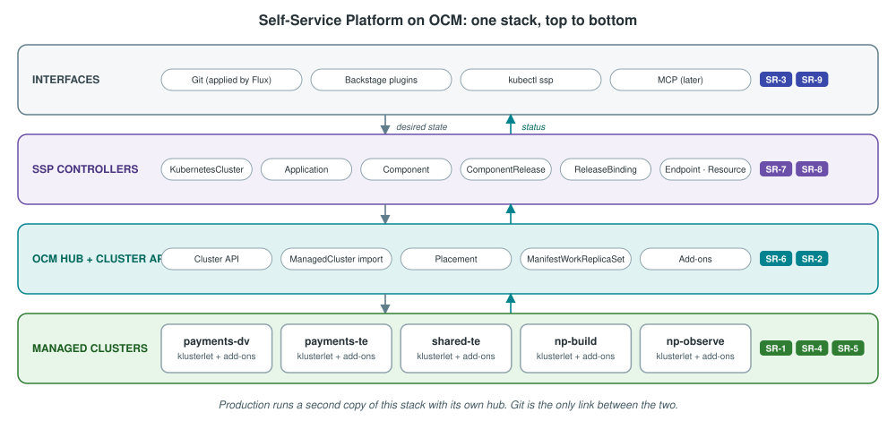

This enhancement proposes the **Self-Service Platform (SSP)**: an internal developer platform with the capabilities of [OpenChoreo](../../Research/OpenChoreo-Use-Cases.md), built natively on [Open Cluster Management](https://open-cluster-management.io) (OCM).

SSP's first component is **cluster provisioning**. A team asks for a cluster in Git; SSP creates it with Cluster API and registers it with OCM. It starts with local clusters (the Cluster API Docker provider, on a laptop or in CI) and adds AKS and VKS clusters later.

OpenChoreo has its own control plane, cluster gateway and cluster agent. SSP drops these and uses OCM's own parts instead:

- **The control plane is an OCM hub.** SSP controllers and Cluster API run on the hub.
- **Clusters are `ManagedCluster`s.** Each cluster has its own namespace on the hub.
- **Delivery uses OCM work.** SSP turns a release into a `Placement` and a `ManifestWorkReplicaSet`. OCM's work agent applies the result on each selected cluster.
- **Health comes back as status feedback** from each `ManifestWork`.
- **Platform add-ons** (identity, telemetry, policy) are OCM add-ons.

On top of the clusters, SSP gives each persona the familiar OpenChoreo abstractions: component types, traits, components, workloads, immutable releases, per-environment bindings, endpoints, managed resources, builds and alerts.

Flux applies all desired state from Git to the hubs. Production runs on its own hub and its own clusters. The only link between non-production and production is Git, and every production deployment needs approval from the Operator role.

SSP is written in Java, and it uses OCM as released, with no changes to OCM (see [Constraints](#constraints)).

## Motivation

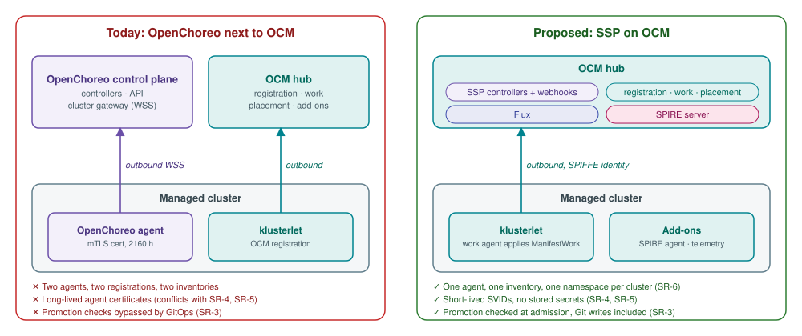

The platform [requirements](../../Proposal/Requirements.md) ask for per-team clusters for each environment, a fully isolated production stack, Git as the only link between environments, SPIFFE identity, no stored secrets, OCM's architecture, several applications per cluster with their own control plane namespaces, and operator approval for production.

OpenChoreo offers most of the developer experience we want, but it does not meet several of these requirements as it stands:

- **It has its own fleet layer.** OpenChoreo connects data planes through its own cluster gateway and agent. Running it next to OCM means two agents, two registration models and two sources of cluster truth on every cluster.
- **Its identity uses long-lived certificates.** Agents use mutual TLS with certificates issued for months, which conflicts with SR-4 and SR-5.
- **Its promotion rules live in its API.** Writes from GitOps bypass them by design, so in a Git-only model (SR-3) the rules are not enforced.
- **It has no production approval step** that maps to the Operator role (SR-9).

Building on OCM gives one agent, one inventory and one delivery path, with each cluster in its own hub namespace (SR-6). It also gives us OCM's per-namespace tenancy, its executor-based write limits and its rollout strategies.

### Goals

1. **Provision clusters on request.** A team requests a cluster in Git; SSP creates it with Cluster API, registers it with OCM, places the platform add-ons, and later scales, upgrades and deletes it. Local clusters (Cluster API Docker provider) come first; AKS (CAPZ) and VKS (vSphere Supervisor) follow (SR-1).
2. Offer the OpenChoreo developer experience: component types, traits, releases, environment bindings, endpoints, resources and builds. Run it as controllers on an OCM hub.
3. Deliver every application manifest through OCM `ManifestWork`, with no other agent on managed clusters.
4. Give each application its own hub namespace, even when it shares a cluster with other applications or teams (SR-7, SR-8).
5. Run two isolated stacks, non-production (`dv`, `te`) and production (`pr`), each with its own hub, build cluster, observability cluster and SPIFFE trust domain (SR-2).
6. Make Git, applied by Flux, the only source of desired state on every hub. Make Git the only way to promote to production (SR-3).
7. Enforce promotion paths at admission time, so they also apply to writes from GitOps.
8. Require Operator approval for every production deployment and every production cluster change (SR-9).
9. Use SPIFFE identities for every platform component. Store no secrets and no long-lived certificates (SR-4, SR-5).
10. Serve four personas: Platform Engineers, Application Teams, SREs and Operators.
11. Provide a portal through Backstage plugins from the first release, alongside Git and a `kubectl` plugin.

### Non-Goals

- **Creating the hubs.** Each stack's hub cluster is created once, outside SSP, because it runs SSP and Cluster API. SSP provisions every other cluster.
- **Cloud prerequisites.** Subscriptions, networks, hybrid connectivity and vSphere Namespaces are prepared by the platform team, as in the [reference design](../../Proposal/Reference-Deployment-Design.md).
- **Changing OCM.** SSP uses OCM as it is and makes no changes to it. SPIFFE-based identity for OCM's own agents (SR-4, SR-5) is expected from a new OCM release; SSP adopts that release when it is available.
- **Running OpenChoreo itself.** SSP borrows OpenChoreo's ideas, API shapes and template test cases. It does not run the OpenChoreo control plane or reuse its Go code.
- **Multi-hub federation.** Each stack has one hub. The `MultipleHubs` feature is used only for hub failover, if at all.

### Constraints

Two decisions are fixed for this enhancement. The design and the [implementation plan](../../Plan/Implementation-Plan.md) follow them.

| ID | Constraint | What it means for the design |
|---|---|---|
| **C-1** | **No changes to OCM.** SSP uses OCM as released. | SSP talks to OCM only through its Kubernetes APIs. It makes no code changes, forks or upstream contributions to OCM. SPIFFE identity for OCM's own agents (part of SR-4 and SR-5) comes from a new OCM release, which SSP adopts when it ships. Until then, agents use one-hour CSR certificates (see [Identity and Secrets](#identity-and-secrets)). |
| **C-2** | **SSP is written in Java.** | Controllers, webhooks, the template engine, the observer API and `kubectl ssp` are Java 25 on Quarkus with the Java Operator SDK and the Fabric8 client. Only the Backstage plugins are TypeScript, as Backstage requires. See [Implementation Language](#implementation-language). |

## Proposal

### Personas

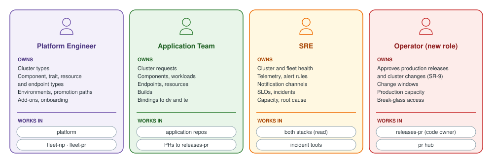

| Persona | Owns | Works in |
|---|---|---|
| **Platform Engineer** | The golden paths: cluster types, component types, traits, resource types, endpoint types, application types, build templates, environments, add-ons and onboarding | The `platform` repository and the `fleet-np` and `fleet-pr` repositories |
| **Application Team** | Their clusters (requested through Git) and their applications: components, workloads, endpoints, resources, builds, and bindings to `dv` and `te` | Their application repositories, and pull requests to `releases-pr` |
| **SRE** | Reliability: cluster and fleet health, telemetry, alert rules and channels, SLOs, incident response, capacity advice, root cause analysis | Both stacks. Read access in production, plus the incident tools. |
| **Operator** | The production environment: approving every production deployment and production cluster change, change windows, production capacity, break-glass access | `releases-pr` (code owners) and the `pr` hub |

The **Operator** is a new role (SR-9), held by the team that manages production. Operators approve releases; they do not write application code. SREs and Operators may be the same people, but the roles are kept separate so that approval rights can be granted on their own.

### User Stories

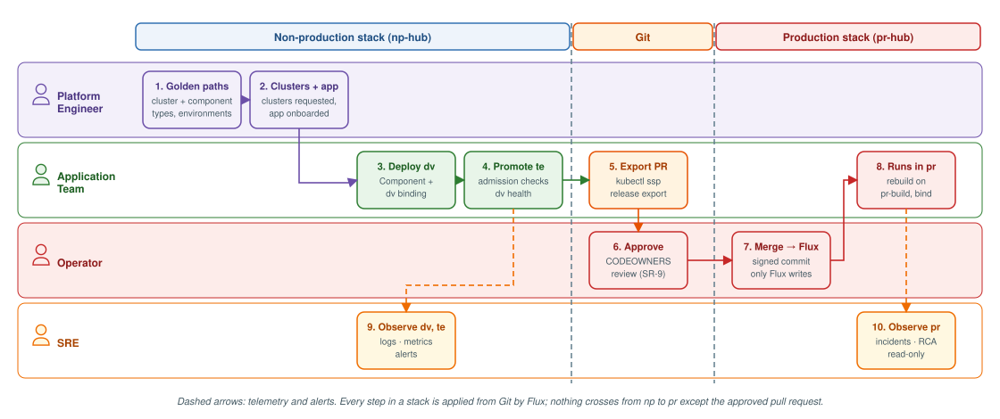

Story IDs refer to the OpenChoreo use cases in [OpenChoreo-Use-Cases.md](../../Research/OpenChoreo-Use-Cases.md) (D = developer, P = platform, S = SRE and operations).

#### Platform Engineer

- **PE-0 (clusters):** I publish `ClusterType`s such as `local-small`, `aks-standard` and `vks-medium`: the provider, the Cluster API `ClusterClass`, allowed Kubernetes versions, sizes, allowed environments and the add-ons every cluster gets.
- **PE-1 (P1, P2, P3, P9):** As a platform engineer, I publish a `ClusterComponentType` "web-service" with a parameter schema, CEL validation rules, resource templates and embedded traits. Every component of that type gets our standards without the team writing them.
- **PE-2 (P4):** I publish a `ClusterResourceType` "postgres" that renders an Azure Service Operator or Crossplane claim. Teams can then request a database with a few lines of YAML.
- **PE-3 (P5):** I publish an `ApplicationType` that shapes each application's namespace on every cluster: default-deny network policy, quota, limit range, Pod Security level and baseline RBAC.
- **PE-4 (P10, P11):** I define the environments `dv`, `te` and `pr`, and the clusters each one may use, by cluster set and labels. I define the promotion path `dv → te → pr`.
- **PE-5 (P13, SR-7, SR-8):** I onboard an application with a pull request to `fleet-np`. SSP creates the application's hub namespace, binds the right cluster sets to it and grants the owning team access.
- **PE-6 (P12):** I mark clusters as build and observability clusters with labels. SSP places build runs and alert rules there.
- **PE-7:** I release new versions of the golden paths by tagging `platform`. Each stack moves to the new tag when its own fleet repository is updated, starting with non-production.

#### Application Team

- **AT-0 (clusters):** I request a `KubernetesCluster` of type `local-small` for `dv` with a pull request (or the Backstage "Request a cluster" template). After the merge, SSP creates it, registers it with OCM and adds it to my team's cluster set. I scale or upgrade it by changing the same file.
- **AT-1 (D1, D4, D6):** I add a `Component` and a `Workload` naming an image, plus a `ReleaseBinding` for `dv`. After a merge, my service runs in `dv`.
- **AT-2 (D2):** I point my component at a build template. A push to `main` builds an image and updates the `Workload` with the new digest.
- **AT-3 (D8, D16):** I attach the autoscaling and alert traits my type allows, and override replicas and environment variables per environment on the `ReleaseBinding`.
- **AT-4 (D10, D12):** I declare an `Endpoint` with `project` or `external` visibility, and a dependency on another component's endpoint. SSP injects the resolved URL into my workload.
- **AT-5 (D13):** I request a `Resource` of type "postgres". My workload's binding waits until the database is ready, and the my workload connects with its own identity, without a stored secret.
- **AT-6 (D15):** I promote a release from `dv` to `te` by adding a `te` binding to the same `ComponentRelease`. Admission rejects the binding if the release is not already healthy in `dv`.
- **AT-7 (D15, SR-3, SR-9):** I promote to production by running `kubectl ssp release export`, which writes the release to a pull request on `releases-pr`. An Operator approves it and production runs it.
- **AT-8 (D17, D18):** I undeploy a binding without deleting it, and run a second release line for a canary.
- **AT-9 (D21, D22):** I see the rendered resources of my binding, their health per cluster, my logs and my build logs.

#### SRE

- **SRE-0 (clusters):** I see every cluster's provisioning phase, Kubernetes version, node health and add-on health in one place, from `KubernetesCluster` status.
- **SRE-1 (S1):** I query logs, metrics and traces for a component in an environment, across every cluster it runs on.
- **SRE-2 (S2):** I configure notification channels per environment. Alert rules from the teams' alert trait reach the observability cluster without anyone handling a credential.
- **SRE-3 (S3, S4):** When an alert fires, an incident opens, and a read-only analysis agent collects evidence from the hub, the `ManifestWork` status and the telemetry.
- **SRE-4 (S5, S6):** I see cost, right-sizing advice and DORA metrics per application.
- **SRE-5:** I see which clusters are unhealthy, which add-ons are degraded and which `ManifestWork`s are failing, from the hub.

#### Operator

- **OP-0 (clusters):** A production cluster request or upgrade is a pull request to `fleet-pr`. It needs my approval, like a production release.
- **OP-1 (SR-9):** I review a production release pull request. It shows the source commit, the `te` evidence (build provenance, tests, health), the target clusters and the change window. Nothing reaches production until I approve.
- **OP-2:** I set production change windows. Merged releases outside a window wait until the window opens.
- **OP-3:** I roll back production by approving a revert pull request. The previous release is still in Git, so this takes one review.
- **OP-4:** I use time-boxed break-glass access to a production cluster through OCM's `cluster-proxy` and `managed-serviceaccount` add-ons. Every session is audited.
- **OP-5 (S7):** I see the production audit trail: who approved which release, when Flux applied it, and when each cluster reported it available.

### Requirements Coverage

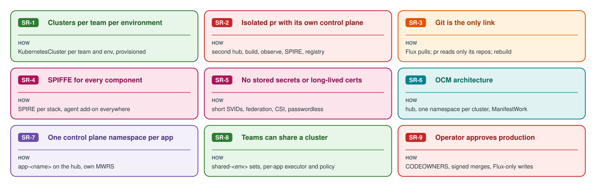

| Requirement | How SSP meets it |
|---|---|
| **SR-1** Clusters per team per environment | Teams request a `KubernetesCluster` per environment; SSP provisions it and adds it to the team's cluster set (`team-<name>`), labelled `ssp.io/environment=dv\|te\|pr`. Environments select clusters by that label. |
| **SR-2** Isolated `pr` with its own control plane | Production has its own hub, build cluster, observability cluster, Flux, SPIRE trust domain, registry and Git repository. There is no network path between the stacks. |
| **SR-3** Git is the only link | Flux applies all desired state to each hub. Production reads only `releases-pr`. No artifact, credential or API call crosses between stacks; production rebuilds images from the commit. |
| **SR-4** SPIFFE for every component | A SPIRE server per stack and a SPIRE agent add-on on every cluster. Platform components authenticate with SPIFFE IDs (see [Identity and Secrets](#identity-and-secrets)). |
| **SR-5** No stored secrets or long-lived certificates | SVIDs are short-lived and rotated in memory. Cloud access uses workload identity federation. Application secrets are mounted from Key Vault by CSI, not stored as Kubernetes Secrets. Remaining gaps are listed in [Open Questions](#open-questions). |
| **SR-6** OCM architecture | A hub with managed clusters, and one hub namespace per cluster. Delivery uses `ManifestWork`. Platform agents are OCM add-ons. |
| **SR-7** Several applications per cluster, one control plane namespace each | Each application has its own hub namespace, with its own `Placement`s and `ManifestWorkReplicaSet`s, whatever cluster it runs on. |
| **SR-8** Teams can share a cluster | Shared clusters sit in a `shared-<env>` cluster set. Any application may be bound to it. Separation comes from per-application namespaces, executors and namespace policy. |
| **SR-9** Operator approval for production | `releases-pr` requires Operator review through code owners. Flux in production applies only signed merge commits, and only Flux may write to the production hub. |

### Notes, Constraints and Caveats

- **OpenChoreo's APIs are `v1alpha1`.** SSP copies their shape, not their versions, and owns its own API group (`ssp.io`, a placeholder) and version.
- **SSP is in Java, OpenChoreo is in Go.** OpenChoreo's template engine (`internal/template`) cannot be reused directly. SSP implements the same template syntax (`${…}` expressions, `includeWhen`, `forEach`, traits that create and patch) in Java on `cel-java`, and runs OpenChoreo's template test cases as conformance fixtures. See [Open Questions](#open-questions).
- **Status feedback has limits.** `ManifestWork` status feedback returns chosen fields (well-known status or JSON paths), not whole objects. SSP asks for what it shows; deeper inspection goes through `cluster-proxy`.
- **`ManifestWorkReplicaSet` needs the `ManifestWorkReplicaSet` feature gate** on the hub.

### Risks and Mitigations

| Risk | Mitigation |
|---|---|
| **We build and maintain a platform** instead of adopting one. | Keep the API small. Reuse OCM for every fleet concern and OpenChoreo's designs for the developer model. Ship in phases, each useful on its own. |
| **OCM's agents do not use SPIFFE identity yet.** | SR-4 and SR-5 for OCM's agents are met by a new OCM release. Until SSP adopts it, the CSR driver runs with one-hour client certificates, tracked as the one known SR-4 and SR-5 gap. |
| **Cluster API kubeconfig Secrets.** Cluster API writes an admin kubeconfig Secret per cluster on the hub, which OCM's importer reads (conflicts with SR-5). | Only Cluster API, the importer and SSP can read them; certificates are short-lived and rotated by Cluster API; listed as [Open Question 9](#open-questions). |
| **Cloud access for testing.** AKS and VKS provisioning needs real subscriptions and a Supervisor. | Develop on local clusters first; run cloud provisioning tests nightly, not on every pull request. |
| **Template authors can render anything onto clusters.** | Executors limit what each application's work can create. Templates live in `platform` and are reviewed like code. CEL cost limits stay on. |
| **A shared cluster weakens isolation** between teams. | Each application gets its own namespace, executor, quota, default-deny network policy and restricted Pod Security. Sensitive workloads use team clusters. |
| **Production approval slows delivery.** | Release pull requests carry their evidence, so a review is quick. Change windows are explicit. Low-risk types can later be pre-approved by policy, if Operators agree. |
| **Java memory and start-up.** JVM controllers use more memory than Go ones. | Quarkus with tuned heaps for controllers; GraalVM native images for `kubectl ssp` and, if measurements justify it, the controllers. Measured in the alpha scale test. |
| **CEL differences.** `cel-java` and the Go CEL library that OpenChoreo uses may differ in extension functions and cost tracking. | Run OpenChoreo's template tests as conformance fixtures; implement missing functions; enforce evaluation limits and a render timeout. |
| **Hub size.** A hub holds one `ManifestWork` per component per cluster. | OCM hubs handle thousands of `ManifestWork`s. Bundle all of a component's manifests into one `ManifestWork`. Measure in alpha. |

## Design Details

### Architecture

Each stack is a separate copy of the same layout:

| Cluster | Role | Runs |
|---|---|---|
| `<stack>-hub` | OCM hub, SSP control plane and cluster management | OCM `cluster-manager` (registration with `ClusterImporter`, work, placement, add-on manager, `ManifestWorkReplicaSet`), Cluster API with its providers (Docker locally, CAPZ for AKS), SSP controllers and webhooks, Flux, SPIRE server and its OIDC discovery provider. Created once, outside SSP. |
| `<stack>-build` | Builds (provisioned by SSP) | Argo Workflows and the build cache. Builds arrive as `ManifestWork`. |
| `<stack>-observe` | Observability (provisioned by SSP) | OpenTelemetry gateway, Prometheus (or Mimir), OpenSearch, Alertmanager, the SSP observer API |
| `<team>-<env>` | Team clusters, provisioned by SSP (SR-1) | Applications, gateway, OCM add-ons |
| `shared-<env>` | Shared clusters, provisioned by SSP (SR-8) | Applications from several teams, gateway, OCM add-ons |

Every managed cluster runs the same OCM agents and add-ons:

- `klusterlet`: the registration and work agents.
- `spire-agent`: the SPIFFE identity add-on.
- `telemetry`: OpenTelemetry collectors that send data to `<stack>-observe`.
- `policy`: Kyverno or the OCM policy framework, for the baseline.
- `cluster-proxy` and `managed-serviceaccount`: production break-glass and inspection.
- `gateway`: Gateway API CRDs and kgateway.

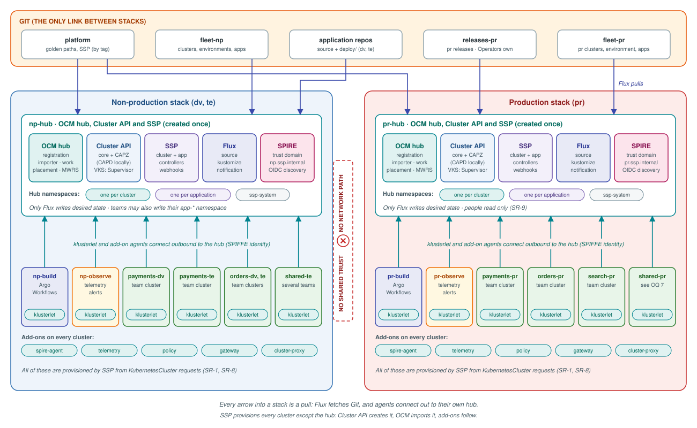

Every arrow into a stack is a pull: Flux fetches Git, and klusterlets connect out to their hub. Nothing connects from one stack to the other.

### Implementation Language

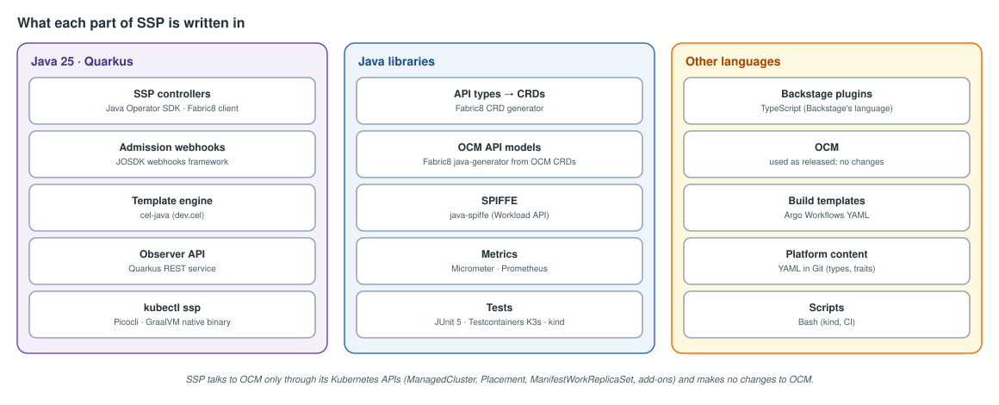

SSP is written in **Java**.

| Part | Technology |
|---|---|
| Language and runtime | Java 25 (LTS), Quarkus, Maven |
| Controllers | Java Operator SDK (Quarkus extension), Fabric8 Kubernetes client |
| API types and CRDs | Java classes; CRDs generated at build time by the Fabric8 CRD generator, with CEL validation rules and printer columns as annotations |
| OCM types | Java models generated by the Fabric8 `java-generator` from OCM's published CRDs (`ManagedCluster`, `ManagedClusterSet`, `Placement`, `ManifestWorkReplicaSet`, add-on kinds) |
| Admission webhooks | Java Operator SDK webhooks framework, served by Quarkus |
| Template engine | A Java engine on `cel-java` (`dev.cel`) with OpenChoreo's template syntax |
| Observer API | Quarkus REST service |
| `kubectl ssp` | Picocli, built as a GraalVM native binary so it starts fast and needs no JVM |
| SPIFFE | `java-spiffe`: SVIDs from the SPIRE agent's Workload API |
| Metrics | Micrometer with a Prometheus endpoint |
| Tests | JUnit 5, AssertJ and Awaitility; Testcontainers K3s for integration tests; kind for end-to-end tests |

One part is not in Java: the **Backstage plugins** are TypeScript, as Backstage requires.

SSP needs no OCM library. It reads and writes OCM's Kubernetes APIs through generated Java models, like any other client.

### Cluster Provisioning

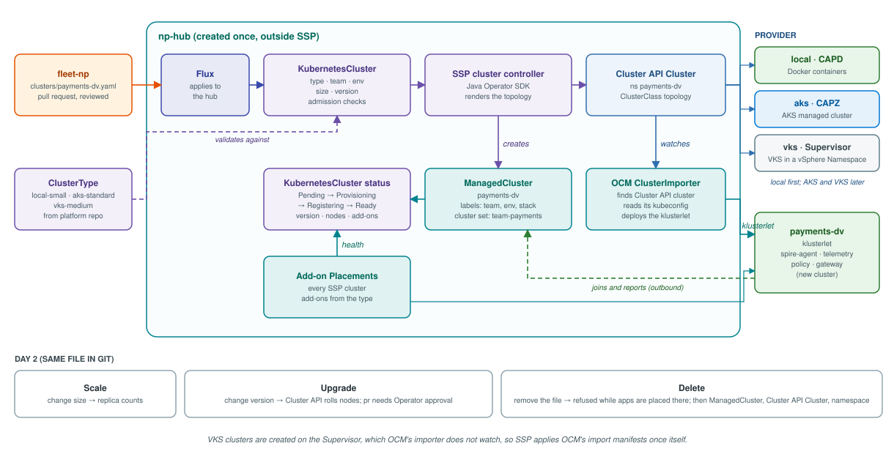

Cluster provisioning is SSP's first component. Everything else runs on the clusters it creates.

**Kinds**

| Kind | Scope | Written by | Purpose |
|---|---|---|---|
| `ClusterType` | Cluster | Platform Engineer (`platform`) | Provider (`local`, `aks`, `vks`), Cluster API `ClusterClass`, allowed Kubernetes versions, sizes, allowed environments and stacks, required add-ons |
| `KubernetesCluster` | Cluster | Application Team or Platform Engineer, through a pull request to `fleet-np` or `fleet-pr` | One cluster: type, owning team (or `shared`), environment, size, Kubernetes version |

```yaml
apiVersion: ssp.io/v1alpha1
kind: ClusterType
metadata:
  name: local-small
spec:
  provider: local                 # local | aks | vks
  clusterClass: ssp-docker        # Cluster API ClusterClass on the hub
  kubernetesVersions: ["v1.34"]   # minor versions; the type pins the patch
  sizes:
    small:  { controlPlane: 1, workers: 1 }
    medium: { controlPlane: 1, workers: 3 }
  environments: [dv, te]
  addOns: [spire-agent, telemetry, policy, gateway]
---
apiVersion: ssp.io/v1alpha1
kind: KubernetesCluster
metadata:
  name: payments-dv
spec:
  type: local-small
  team: payments                  # or "shared" for a shared cluster
  environment: dv
  size: small
  version: v1.34
```

**From request to Ready**

1. **Request.** A pull request adds a `KubernetesCluster` to `fleet-np` (or `fleet-pr`, which needs Operator approval). Flux applies it to the hub.
2. **Validate.** The admission webhook checks the type exists, the environment and stack are allowed for the type, the version is allowed, and the team exists.
3. **Create.** SSP's cluster controller creates a namespace named after the cluster and a Cluster API `Cluster` in it, using the type's `ClusterClass` topology (version, control plane and worker counts). The provider creates the machines: Docker containers locally, AKS through CAPZ.
4. **Register.** SSP creates the `ManagedCluster` with the same name, labelled with team, environment, stack and cluster set (`team-<name>`, `shared-<env>` or `platform-<stack>`, created on first use). OCM's `ClusterImporter` feature finds the matching Cluster API cluster (`<name>/<name>`), deploys the klusterlet with the cluster's kubeconfig, and the cluster joins. No change to OCM is needed (C-1), but two settings are: SSP creates a Role per cluster that lets OCM's importer read that cluster's kubeconfig Secret (and nothing else), and the importer uses its `render-auto` renderer, so no per-cluster bootstrap credential is stored (SR-5).
5. **Add-ons.** Platform `Placement`s select every SSP cluster and install the type's add-ons.
6. **Ready.** The `KubernetesCluster` becomes `Ready` when Cluster API reports the control plane and workers ready, the `ManagedCluster` is `Available`, and the required add-ons are healthy. Phases: `Pending` → `Provisioning` → `Registering` → `Ready`.

**Providers**

| Provider | When | How SSP creates the cluster | How it joins OCM |
|---|---|---|---|
| `local` | From the start: laptops, CI, the first weeks of the plan | Cluster API Docker provider (CAPD) on the hub | OCM `ClusterImporter` |
| `aks` | After the application platform works locally | CAPZ on the hub (AKS managed control plane), with workload identity and the OIDC issuer enabled; private API servers reached over the hybrid connection | OCM `ClusterImporter` |
| `vks` | With AKS | A Cluster API `Cluster` on the vSphere Supervisor, in the team's vSphere Namespace | SSP imports it once: it creates the `ManagedCluster` and applies OCM's import manifests with the Supervisor-issued kubeconfig, because the importer only sees Cluster API clusters on the hub |

**Day 2**

- **Scale:** change `size`; SSP updates the topology's replica counts.
- **Upgrade:** change `version` to another allowed version; Cluster API rolls the control plane, then the workers. In production this is an Operator-approved pull request.
- **Delete:** remove the file. SSP refuses while any application `Placement` still selects the cluster. It then removes the `ManagedCluster` while the cluster still runs (OCM only finishes once the cluster's agent has removed its work), deletes the Cluster API `Cluster`, cleans up anything left in OCM, and removes the namespace. If the cluster cannot leave OCM within five minutes, SSP deletes the machines anyway and releases the work no agent can acknowledge.

### Hub Namespace Model

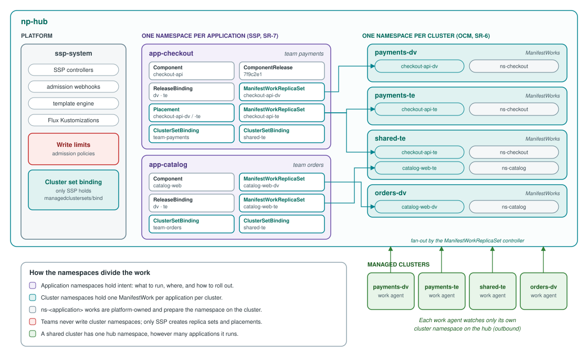

The hub has three kinds of namespaces:

| Namespace | Created by | Holds | Who can write |
|---|---|---|---|
| `<cluster-name>` (one per cluster) | OCM registration | `ManagedCluster` lease, `ManifestWork`s, `ManagedClusterAddOn`s | OCM and SSP controllers only |
| `app-<application>` (one per application) | SSP, from an `Application` | `Component`, `Workload`, `ComponentRelease`, `ReleaseBinding`, `Endpoint`, `Resource`, `BuildRun`, plus the `Placement`s and `ManifestWorkReplicaSet`s SSP creates | Flux (all stacks). In non-production, the owning team may also write directly. |
| `ssp-system` | Flux | SSP controllers, platform-wide configuration | Flux and platform engineers |

The first kind is OCM's own model: one namespace per cluster (SR-6). The second is SSP's tenancy unit: one namespace per application (SR-7), whether the application runs on its team's clusters or on a shared cluster.

Applications never write to cluster namespaces. They express intent in their own namespace, and OCM's `ManifestWorkReplicaSet` controller fans the result out into the cluster namespaces.

### API

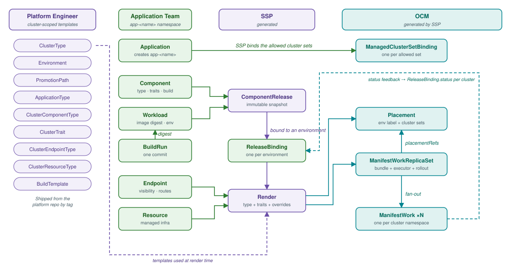

All SSP kinds are in the `ssp.io/v1alpha1` group (a placeholder name). Where an OpenChoreo kind exists, SSP keeps its name and shape so that the [use cases](../../Research/OpenChoreo-Use-Cases.md) carry over.

| Kind | Scope | Written by | Purpose | OpenChoreo equivalent |
|---|---|---|---|---|
| `ClusterType` | Cluster | Platform Engineer | Provider, `ClusterClass`, versions, sizes, environments, add-ons (see [Cluster Provisioning](#cluster-provisioning)) | None: new in SSP |
| `KubernetesCluster` | Cluster | Application Team or Platform Engineer (Git) | One cluster: type, team, environment, size, version | `DataPlane` (registration only) |
| `Application` | Cluster | Platform Engineer (Git) | Onboards an application: owning team, type, allowed cluster sets. Creates `app-<name>`. | `Project` |
| `ApplicationType` | Cluster | Platform Engineer | Renders each application's namespace on each cluster: quota, limit range, network policy, Pod Security, RBAC | `ProjectType` |
| `Environment` | Cluster | Platform Engineer | Name, stack, production flag, cluster selector, gateway | `Environment` |
| `PromotionPath` | Cluster | Platform Engineer | Allowed moves between environments | `DeploymentPipeline` |
| `ClusterComponentType` | Cluster | Platform Engineer | Parameter schema, CEL rules, resource templates, allowed traits and endpoint types | `ClusterComponentType` |
| `ClusterTrait` | Cluster | Platform Engineer | Optional behaviour that adds or patches resources | `ClusterTrait` |
| `ClusterEndpointType` | Cluster | Platform Engineer | How each endpoint visibility is rendered | `EndpointType` |
| `ClusterResourceType` | Cluster | Platform Engineer | Templates for managed infrastructure, readiness checks, outputs | `ClusterResourceType` |
| `BuildTemplate` | Cluster | Platform Engineer | An Argo Workflow template and its parameters | `ClusterWorkflow` |
| `Component` | `app-*` | Application Team | Type, parameters, traits, build template | `Component` |
| `Workload` | `app-*` | Application Team or the build | Image digest, environment, files, endpoints, dependencies | `Workload` |
| `ComponentRelease` | `app-*` | SSP (immutable) | Frozen type, traits, workload and source commit | `ComponentRelease` |
| `ReleaseBinding` | `app-*` | Application Team (non-production), Flux from `releases-pr` (production) | Binds a release to an environment, with overrides and state | `ReleaseBinding` |
| `Endpoint` | `app-*` | Application Team | Visibility, routes, weighted backends | `Endpoint` |
| `Resource` | `app-*` | Application Team | Requests managed infrastructure | `Resource` |
| `BuildRun` | `app-*` | SSP or the Application Team | One build at one commit | `WorkflowRun` |

Every template kind (`ClusterComponentType`, `ClusterTrait` and so on) is cluster-scoped and shipped from the `platform` repository. Namespaced variants are a non-goal for alpha.

**Example: an application and a component**

```yaml
apiVersion: ssp.io/v1alpha1
kind: Application
metadata:
  name: checkout
spec:
  owner:
    team: payments
    groups: ["sg-payments-dev"]          # Entra ID group
  type: standard                          # ApplicationType
  clusterSets: ["team-payments", "shared-te"]
---
apiVersion: ssp.io/v1alpha1
kind: Component
metadata:
  name: checkout-api
  namespace: app-checkout
spec:
  type: web-service                       # ClusterComponentType
  parameters:
    port: 8080
  traits:
    - name: autoscaler
      parameters: { minReplicas: 2, maxReplicas: 6 }
    - name: alert-rules
  build:
    template: dockerfile
    repository: https://git.example.com/payments/checkout
    path: services/api
```

**Example: a binding**

```yaml
apiVersion: ssp.io/v1alpha1
kind: ReleaseBinding
metadata:
  name: checkout-api-te
  namespace: app-checkout
spec:
  environment: te
  release: checkout-api-7f9c2e1           # ComponentRelease
  overrides:
    parameters: { replicas: 3 }
    env:
      - name: LOG_LEVEL
        value: info
  rollout:
    type: Progressive                     # OCM RolloutStrategy
    progressive: { maxConcurrency: 1 }
  state: Active                           # or Undeploy
```

### From ReleaseBinding to ManifestWork

When a `ReleaseBinding` changes, the SSP release controller does the following.

1. **Validate.**
   - The release exists and is immutable.
   - The environment is reachable by the `PromotionPath`. This is checked by an admission webhook, so it applies to Flux too.
   - The release passed in the source environment.
2. **Render.** Evaluate the component type, traits and overrides against the release. The result is one manifest bundle per binding, all inside the application's namespace on the cluster (`<application>`), plus status feedback rules.
3. **Select clusters.** Create or update a `Placement` named `<component>-<environment>` in `app-<application>`:
   - Its cluster sets are the application's bound sets.
   - Its predicate is `ssp.io/environment=<environment>` plus any environment selector.
   - Its decision strategy follows the binding's rollout.
4. **Deliver.** Create or update a `ManifestWorkReplicaSet` named `<component>-<environment>` in `app-<application>`:
   - `manifestWorkTemplate` holds the rendered bundle.
   - The executor is the ServiceAccount `ssp-app-<application>` in the application's namespace on the cluster.
   - Status feedback rules ask for the Deployment's availability and the routes' acceptance.
   - The placement reference carries the rollout strategy.
5. **Fan out.** OCM's `ManifestWorkReplicaSet` controller creates a `ManifestWork` in each selected cluster's namespace (SR-6). Each cluster's work agent pulls its work and applies it as the executor.
6. **Report.** SSP reads the replica set's summary and each `ManifestWork`'s feedback, and writes them to `ReleaseBinding.status`: per cluster, applied, available and degraded, with the resolved endpoint URLs.

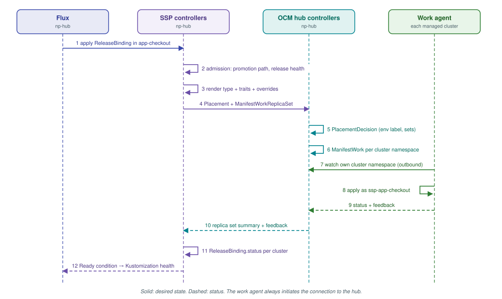

**Write limits on the cluster.** Each application's namespace on each cluster is prepared by a separate, platform-owned `ManifestWork` (`ns-<application>`), rendered from its `ApplicationType`. It creates the namespace, the `ssp-app-<application>` ServiceAccount and a Role in that namespace only. Because application work runs as that ServiceAccount, a bad template cannot write outside the application's namespace, even on a shared cluster.

**Write limits on the hub.** A `ValidatingAdmissionPolicy` on the hub enforces two rules:

- Only SSP controllers may create `ManifestWorkReplicaSet`s and `Placement`s in `app-*` namespaces.
- The executor of each `ManifestWorkReplicaSet` must be `ssp-app-<application>` for its own namespace.

**Binding clusters to applications.** Binding a cluster set into a namespace requires `managedclustersets/bind` permission, which only SSP holds. SSP creates a `ManagedClusterSetBinding` in `app-<application>` for each set listed in the `Application`. A team therefore cannot place work on clusters it was not given.

### Shared Clusters

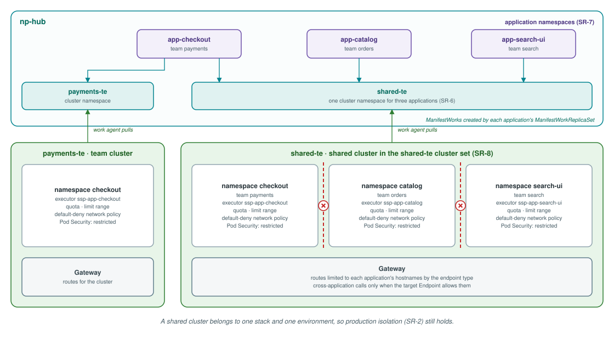

A shared cluster is an ordinary `ManagedCluster` in the `shared-<env>` cluster set (SR-8). On the hub, it still has exactly one namespace (SR-6). Each application that runs on it keeps its own `app-*` namespace with its own `Placement` and `ManifestWorkReplicaSet` (SR-7). On the cluster, each application gets its own namespace, executor, quota and network policy from its `ApplicationType`.

| Concern | Team cluster | Shared cluster |
|---|---|---|
| Cluster set | `team-<name>` | `shared-<env>` |
| Hub namespaces | One per cluster, one per application | One per cluster, one per application |
| Namespaces on the cluster | One per application | One per application, from several teams |
| Isolation | Cluster boundary | Namespace, executor, quota, default-deny network policy, restricted Pod Security |
| Gateway | Per cluster | Per cluster. Routes are limited to each application's hostnames by the endpoint type. |
| Suitable for | Production by default, regulated workloads | Small services, `dv` and `te`, cost-sensitive workloads |

A shared cluster belongs to one stack and one environment, so SR-2 still holds.

### Builds

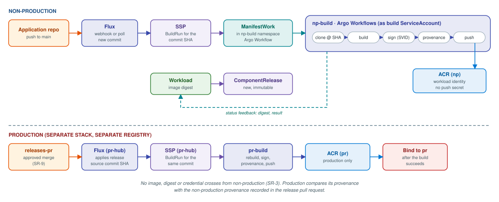

Builds run on `<stack>-build`, selected by the label `ssp.io/plane=build`.

1. A push to an application repository triggers a build. Either Flux's `notification-controller` receives a webhook, or a `GitRepository` poll sees the new commit. SSP then creates a `BuildRun` for the commit.
2. SSP renders the `BuildTemplate` into an Argo `Workflow`. It delivers the workflow as a `ManifestWork` in the build cluster's namespace, executed by a dedicated build ServiceAccount.
3. The workflow clones the repository at that commit, builds, signs (keyless, with the SPIFFE identity of the build workload), writes provenance and pushes to the stack's registry.
4. Status feedback returns the image digest and result to the hub. SSP writes the digest to the `Workload`, and a new `ComponentRelease` follows.

In production, `pr-build` rebuilds the same commit from `releases-pr`. No image or digest crosses from non-production (SR-3). Production compares its provenance with the non-production provenance in the release pull request as a reproducibility check.

### Endpoints and Dependencies

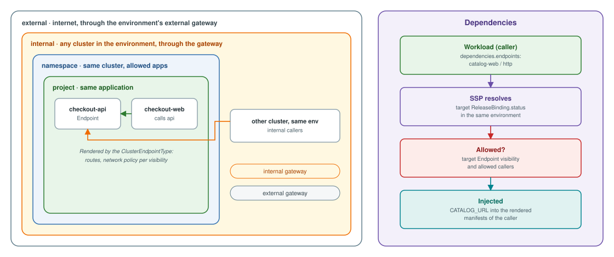

These follow OpenChoreo's model.

- **Endpoints.** An `Endpoint` names workload ports, a visibility (`project`, `namespace`, `internal`, `external`) and optional weighted backends. Its `ClusterEndpointType` renders Gateway API routes and network policy for each visibility.
- **Dependencies.** A dependency names another component's endpoint. SSP resolves it from the target's `ReleaseBinding.status` in the same environment and injects the URL into the caller's rendered manifests. A dependency on another application requires the target's `Endpoint` to allow it.
- **Visibility across clusters.** `project` and `namespace` visibility apply within a cluster. `internal` reaches across clusters of the same environment through the gateway. `external` is published through the environment's external gateway.

### Managed Resources

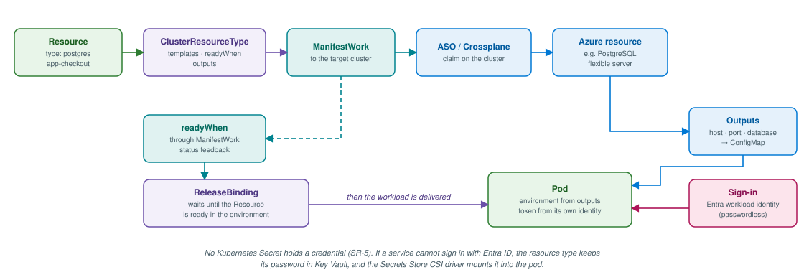

A `Resource` is rendered by its `ClusterResourceType` like a component, delivered by `ManifestWork` and checked by `readyWhen` rules through status feedback.

- **Cloud resources** render a claim for Azure Service Operator or Crossplane on the target cluster. Those controllers run on the platform clusters from the existing proposal.
- **Outputs** that are not secret, such as host, port and database name, are published to a ConfigMap in the application's namespace.
- **Sign-in is passwordless** where the service supports it: the workload uses its own Entra workload identity, for example for Azure Database for PostgreSQL. Where a service needs a password, the resource type keeps it in Key Vault and the Secrets Store CSI driver mounts it, so it never becomes a Kubernetes Secret (SR-5).
- **Ordering.** A `ReleaseBinding` that depends on a `Resource` waits until the resource is ready in the same environment.

### Git, Flux and Promotion

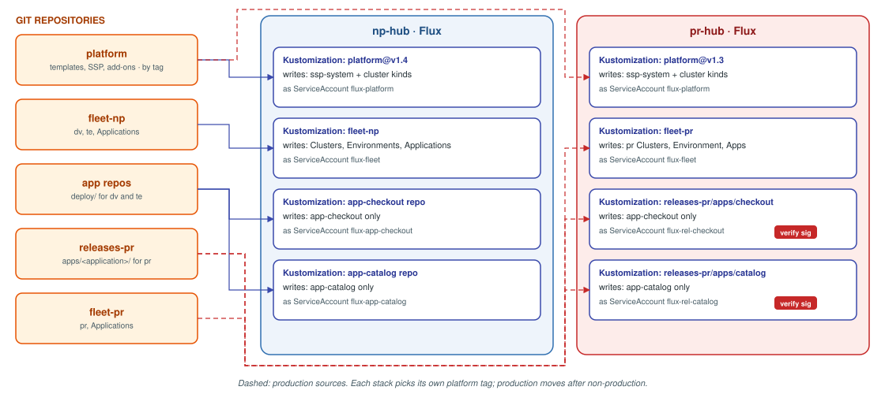

Flux runs on each hub and is the only writer of desired state there.

| Repository | Read by | Contents | Owners |
|---|---|---|---|
| `platform` | Both hubs (by tag) | Cluster types and their `ClusterClass`es, template kinds, `ApplicationType`s, `BuildTemplate`s, add-on definitions, SSP itself | Platform Engineers |
| `fleet-np` | `np-hub` | `KubernetesCluster` requests, environments `dv` and `te`, promotion paths, `Application`s, cluster sets, the `platform` tag in use | Platform Engineers |
| `fleet-pr` | `pr-hub` | Production `KubernetesCluster` requests, environment `pr`, `Application`s, cluster sets, the `platform` tag in use | Platform Engineers and Operators |
| `<application>` | `np-hub` | Source code, plus `deploy/` with `Component`s, `Endpoint`s, `Resource`s and `ReleaseBinding`s for `dv` and `te` | The Application Team |
| `releases-pr` | `pr-hub` | `apps/<application>/`: exported `ComponentRelease`s, `ReleaseBinding`s, endpoints and resources for `pr` | Operators (code owners) |

Each hub has one Flux `GitRepository` and one `Kustomization` per repository and application:

- **Service accounts.** Each `Kustomization` runs as a service account limited to the namespaces it may write. An application repository can only write `app-<application>`.
- **Commit signatures.** Production `GitRepository` objects check commit signatures (`spec.verify`).
- **Health.** `Kustomization` health checks wait for SSP's `Ready` conditions.

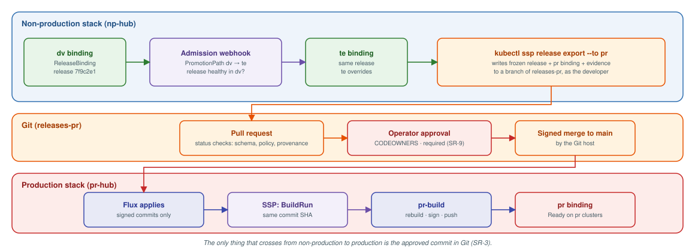

**Promotion inside non-production (`dv` to `te`):**

1. The team adds a `te` binding for the release in their repository.
2. Flux applies it.
3. The SSP admission webhook allows it only if the release is healthy in `dv`, according to the `PromotionPath`.

**Promotion to production (`te` to `pr`), the only cross-stack step:**

1. `kubectl ssp release export checkout-api-7f9c2e1 --to pr` writes the frozen release, the `pr` binding and its evidence into a branch of `releases-pr`, and opens a pull request. The evidence covers the source commit, `te` health, test results and provenance. The command runs as the developer, using their own Git login, so no platform bot holds a Git credential.
2. Status checks in the Git host run against the pull request. Code owners require Operator approval (SR-9).
3. After merge, `pr-hub`'s Flux applies the release. SSP starts a rebuild on `pr-build` from the recorded commit, and binds the release to `pr` once the build succeeds.

### Production Approval

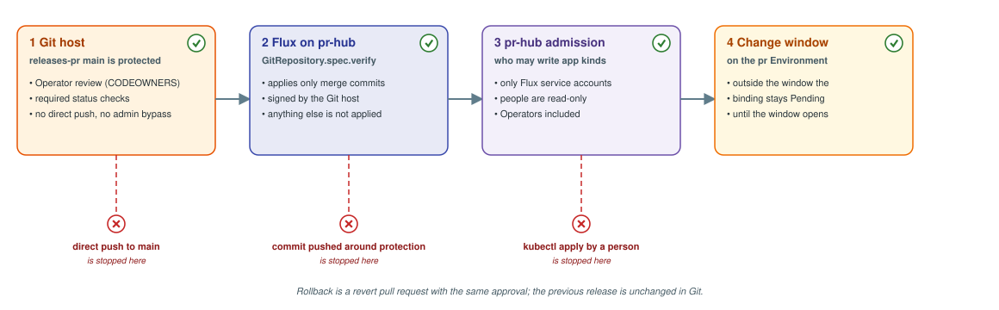

SR-9 is enforced at three points, so that no single setting can be bypassed:

| Layer | Control |
|---|---|
| **Git host** | `releases-pr` protects `main`: required Operator review through `CODEOWNERS` for `apps/**`, required status checks, no direct pushes and no admin bypass. |
| **Flux** | `pr-hub` applies only merge commits signed by the Git host's merge key (`GitRepository.spec.verify`). A commit pushed around branch protection is not applied. |
| **Hub admission** | On `pr-hub`, only the Flux service accounts may create or change `ReleaseBinding`s, `ComponentRelease`s, `Endpoint`s and `Resource`s. People, Operators included, have read-only access. |

Change windows are a field on the `pr` `Environment`. A binding merged outside a window is accepted but stays `Pending` until the window opens. Operators can see the pending bindings and their reason.

Rollback is a revert pull request with the same approval. Because the previous release is unchanged in Git, rollback re-renders a known state.

### Identity and Secrets

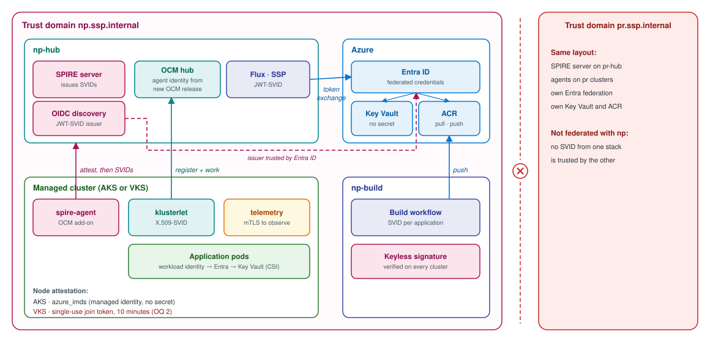

**SPIFFE (SR-4).** Each stack runs a SPIRE server on its hub, with its own trust domain: `np.ssp.internal` and `pr.ssp.internal`. The trust domains do not federate, so neither stack trusts the other.

The SPIRE agent is an OCM add-on, deployed to every managed cluster by `Placement`.

| Workload | SPIFFE ID |
|---|---|
| SSP controllers | `spiffe://<td>/ns/ssp-system/sa/ssp-controller` |
| Flux controllers | `spiffe://<td>/ns/flux-system/sa/<controller>` |
| Klusterlet (each cluster) | `spiffe://<td>/cluster/<name>/klusterlet` |
| Add-on agents | `spiffe://<td>/cluster/<name>/addon/<addon>` |
| Build workflows | `spiffe://<td>/cluster/<stack>-build/build/<application>` |
| Telemetry collectors | `spiffe://<td>/cluster/<name>/telemetry` |

**Uses:**

- **Registration and work transport.** SPIFFE identity for OCM's own agents (klusterlet and add-on agents) comes from a new OCM release, not from SSP. SSP makes no change to OCM; it adopts that release when it is available, with each stack's SPIRE as the identity source. Until then, the CSR driver runs with `--client-cert-expiration-seconds=3600`.
- **Azure access.** SPIRE's OIDC discovery provider is registered as an Entra ID federated credential issuer. Flux (Key Vault, ACR), the build (ACR push) and the resource controllers exchange JWT-SVIDs for Entra tokens.
- **Telemetry and observer.** Collectors send telemetry to `<stack>-observe` over mTLS with SVIDs.
- **Image signing.** Builds sign keyless with their SVID. Admission on each cluster verifies signatures against the stack's trust bundle.

**No stored secrets (SR-5):**

| Former secret | Replacement |
|---|---|
| Klusterlet bootstrap kubeconfig and hub client certificate | SPIFFE identity from the new OCM release; one-hour CSR certificates until SSP adopts it |
| Flux Git credentials | Git host workload identity federation where the host supports it (see [Open Questions](#open-questions)) |
| Registry push and pull credentials | Workload identity federation to ACR. AKS kubelets use managed identity. |
| Cloud credentials for resource controllers | Workload identity federation |
| Application secrets | Key Vault, mounted by the Secrets Store CSI driver, never synced to Kubernetes Secrets |
| Notification channel credentials (SMTP, webhooks) | Key Vault with workload identity, read at send time |
| Cluster agent certificates (OpenChoreo) | Not needed: there is no separate agent |

**Bootstrapping trust.** A new cluster must prove itself to SPIRE once:

- **AKS** clusters use the Azure managed identity node attestor (`azure_imds`). No secret is involved.
- **VKS** clusters receive a single-use join token, valid for ten minutes, that SSP's cluster controller injects at creation. This is the only bootstrap credential in the design, and it is listed in [Open Questions](#open-questions).

### Observability, Alerts and Incidents

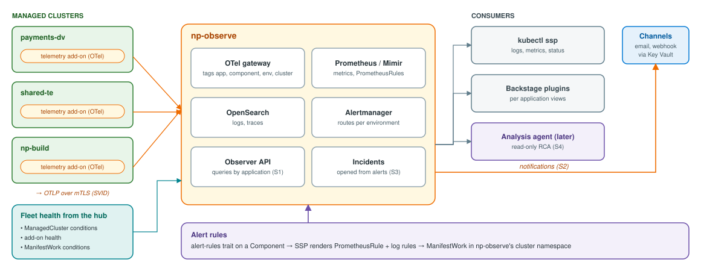

- **Collection.** The `telemetry` add-on runs OpenTelemetry collectors on every cluster. They tag data with the application, component, environment and cluster from the namespace labels SSP sets, and send it to `<stack>-observe`.
- **Querying.** An SSP observer API on `<stack>-observe` answers queries by application, component and environment (S1). The `kubectl` plugin and the portal use it.
- **Alerts.** The `alert-rules` trait renders `PrometheusRule`s and log alert rules. SSP delivers them to the observability cluster by `ManifestWork` (S2).
- **Notification channels** are per environment. SREs define them in the fleet repositories.
- **Incidents** open from alerts and are stored by the observer (S3). A read-only analysis agent (S4) is a later phase. In production it gets read access only, and it runs against an LLM endpoint that the Operators have approved.
- **Fleet health.** OCM's own signals cover fleet health (SRE-5): `ManagedCluster` conditions, `ManagedClusterAddOn` health and `ManifestWork` conditions. They are exported as metrics from the hub.
- **Audit.** Each hub keeps the Kubernetes audit log, plus the Flux event history and the Git history. Together these answer "who approved, who applied, when did it become available" (OP-5).

### Access Control

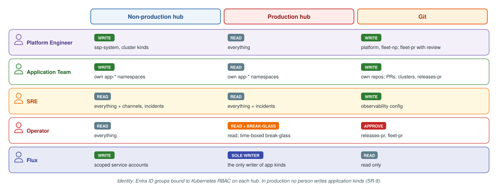

Access is Kubernetes RBAC on each hub, bound to Entra ID groups. The hubs use structured authentication with Entra ID.

| Persona | Non-production hub | Production hub | Git |
|---|---|---|---|
| Platform Engineer | Write `ssp-system` and cluster-scoped SSP kinds. Read everything. | Read everything | Write `platform` and `fleet-np`. Write `fleet-pr` with Operator review. |
| Application Team | Write their `app-*` namespaces. Read their cluster namespaces' `ManifestWork` status through SSP. | Read their `app-*` namespaces | Write their repositories. Open pull requests to `releases-pr`, and cluster requests to `fleet-np` and `fleet-pr`. |
| SRE | Read everything. Write notification channels and incident records. | Read everything. Write incident records. | Write the observability sections of the fleet repositories |
| Operator | Read everything | Read everything. Time-boxed break-glass through `managed-serviceaccount`. | Approve `releases-pr` and `fleet-pr` |
| Flux | Write as scoped service accounts | The only writer of application kinds | Read only |

In non-production, teams may write their `app-*` namespace directly, for fast iteration. Flux restores Git's state on the next sync unless the change is also committed. In production, only Flux writes.

### User Interfaces

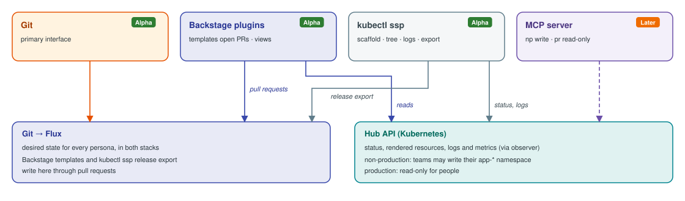

| Interface | Phase | Notes |
|---|---|---|
| **Git** | Alpha | The primary interface for every persona |
| **`kubectl ssp` plugin** | Alpha | `scaffold`, `tree`, `status`, `logs`, `release export`, `promote` (non-production only), `build run` |
| **Backstage plugins** | Alpha | Software templates that open pull requests, plus catalog views of applications, bindings and per-cluster health, read from the hub |
| **MCP server** | GA or later | Read-only tools in production. Write tools in non-production, under the caller's own identity. |

### OpenChoreo Capability Map

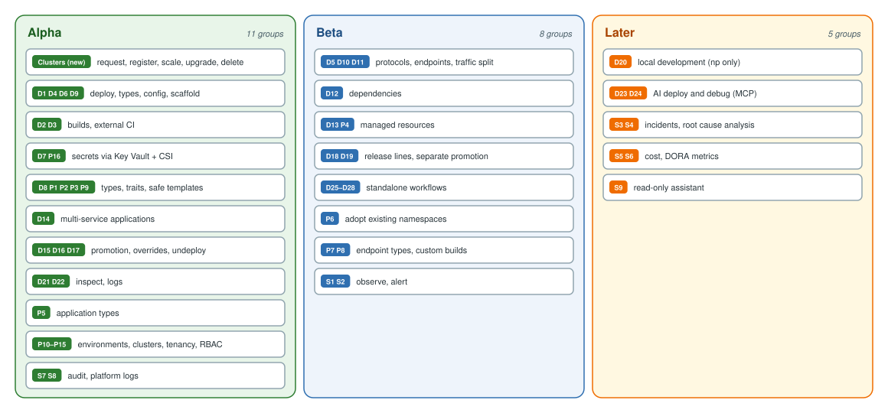

How each group of OpenChoreo use cases is provided by SSP, and when.

| OpenChoreo use cases | SSP mechanism | Phase |
|---|---|---|
| Cluster provisioning (not in OpenChoreo; listed first because everything runs on it) | `ClusterType`, `KubernetesCluster`, Cluster API (Docker provider locally, then CAPZ and the vSphere Supervisor), OCM `ClusterImporter` | Alpha: local first, then AKS and VKS |
| D1, D4, D6, D9 (deploy, types, configuration, scaffold) | `Component`, `Workload`, `ClusterComponentType`, `kubectl ssp scaffold` | Alpha |
| D2 (build from source) | `BuildTemplate`, `BuildRun`, Argo Workflows on `<stack>-build` by `ManifestWork` | Alpha |
| D3 (external CI) | The CI updates `Workload` in Git | Alpha |
| D5, D10, D11 (protocols, endpoints, traffic split) | `Endpoint`, `ClusterEndpointType`, Gateway API | Beta |
| D7, P16 (secrets) | Key Vault with the Secrets Store CSI driver (SR-5) | Alpha |
| D8, P2, P3 (traits) | `ClusterTrait`, embedded traits | Alpha |
| D12 (dependencies) | Resolved from `ReleaseBinding.status` | Beta |
| D13, P4 (managed resources) | `Resource`, `ClusterResourceType`, ASO or Crossplane claims | Beta |
| D14 (multi-service applications) | `Application` with several components | Alpha |
| D15, D16, D17 (promotion, overrides, undeploy) | `ReleaseBinding`, `PromotionPath` enforced at admission, `releases-pr` for production | Alpha |
| D18 (release lines) | Several releases bound to one environment, weighted by `Endpoint` | Beta |
| D19 (separate resource and endpoint promotion) | Separate exports to `releases-pr` | Beta |
| D20 (local development) | Non-production only, through `cluster-proxy` | Later |
| D21, D22 (inspect, logs) | `kubectl ssp tree`, `logs`, `ManifestWork` feedback | Alpha |
| D23, D24 (AI deploy and debug) | MCP server, non-production write, production read | Later |
| D25 to D28 (standalone workflows) | `BuildTemplate` runs without a component | Beta |
| P1, P9 (types, safe templates) | CEL engine with cost limits | Alpha |
| P5, P6 (project types, adopt namespaces) | `ApplicationType`. Adoption mode only reads an existing namespace. | Alpha, adoption in Beta |
| P7 (endpoint exposure) | `ClusterEndpointType` | Beta |
| P8 (custom builds) | Custom `BuildTemplate`s | Beta |
| P10, P11, P12, P13 (environments, clusters, planes, tenancy) | `Environment`, OCM `ManagedClusterSet`, `Placement`, labelled build and observe clusters, `app-*` namespaces | Alpha |
| P14, P15 (access, identity provider) | Kubernetes RBAC with Entra ID groups | Alpha |
| S1, S2 (observe, alert) | `telemetry` add-on, observer API, `alert-rules` trait | Beta |
| S3, S4 (incidents, RCA) | Observer incidents, read-only analysis agent | Later |
| S5, S6 (cost, DORA) | Observer queries over Flux and SSP events | Later |
| S7, S8 (audit, platform logs) | Hub audit log, Flux events, Git history, platform namespaces' logs | Alpha |
| S9 (chat assistant) | MCP server, read-only | Later |

### Test Plan

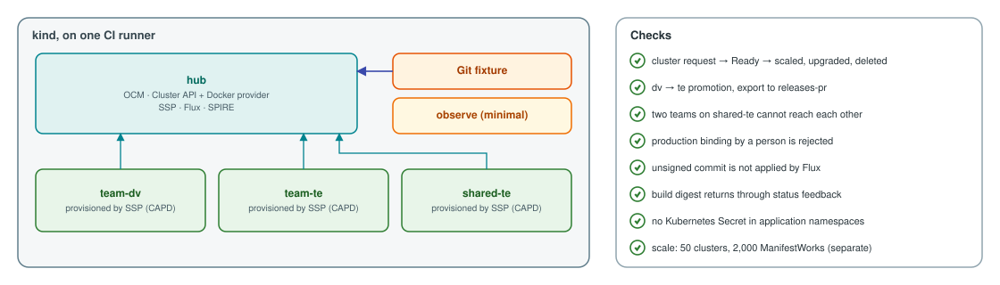

**Unit tests** (JUnit 5):

- Template rendering, including CEL cost limits.
- Admission rules for promotion paths, executors and production writers.
- Status aggregation from `ManifestWork` feedback.

**Integration tests** (JUnit 5 with Testcontainers K3s, with OCM's hub CRDs installed):

- `ReleaseBinding` produces the expected `Placement` and `ManifestWorkReplicaSet`.
- Cluster set bindings limit placement.
- Deleting a binding cleans up its work.

**End-to-end tests** (JUnit 5 and the Fabric8 client against kind: one hub running Cluster API with the Docker provider; SSP provisions three managed clusters, one of them shared):

- A `KubernetesCluster` in Git becomes `Ready`: provisioned, imported into OCM, add-ons healthy. It is then scaled, upgraded and deleted with nothing left behind.

- A component deploys to `dv`, is promoted to `te` and is exported to a `releases-pr` fixture.
- Two applications from different teams share a cluster and cannot reach each other's namespaces or API objects.
- A production binding written by a person is rejected. An unsigned commit is not applied by Flux.
- A build on the build cluster reports its digest through status feedback.
- No Kubernetes Secret exists in `app-*` namespaces or application namespaces on clusters, checked after every test (SR-5).

**Cloud tests** (nightly): an AKS and a VKS cluster are requested, become `Ready` and are deleted.

**Scale tests:** one hub, 50 clusters and 2,000 `ManifestWork`s. Measure the time from merge to available, and hub resource use.

### Graduation Criteria

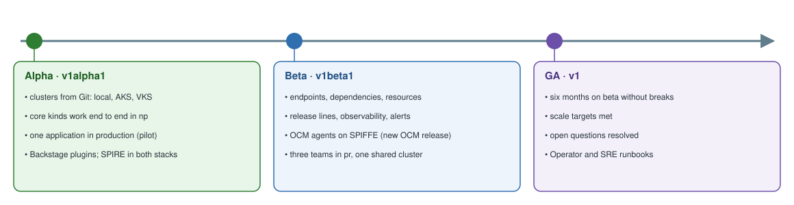

**Alpha (`v1alpha1`):**

- Cluster provisioning: local, AKS and VKS clusters requested from Git, registered with OCM, scaled, upgraded and deleted.
- `Application`, `ApplicationType`, `Environment`, `PromotionPath`, `ClusterComponentType`, `ClusterTrait`, `Component`, `Workload`, `ComponentRelease`, `ReleaseBinding`, `BuildTemplate` and `BuildRun` work end to end in non-production.
- Production export, approval and rebuild work in a pilot with one application.
- The Backstage plugins create applications and components from templates, and show bindings and per-cluster health.
- SPIRE runs in both stacks. The CSR driver runs with one-hour certificates.

**Beta (`v1beta1`):**

- Endpoints, dependencies, resources, release lines, observability and alerts are in place, with portal views for each.
- OCM's agents use SPIFFE identity, if the OCM release that provides it is out; otherwise the gap is recorded.
- Three teams in production, including one shared cluster.
- Conversion webhooks from `v1alpha1`.

**GA (`v1`):**

- Six months on beta with no breaking change.
- Scale test targets met.
- The open questions below are resolved.
- Runbooks exist for Operators and SREs.

### Upgrade and Downgrade Strategy

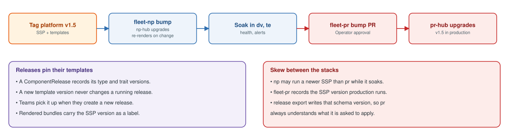

- **Releases by tag.** SSP is released from `platform` by tag. Non-production moves first. Production moves when `fleet-pr` is updated, with Operator approval.
- **Re-rendering.** A new SSP version re-renders bindings only when the output changes. Rendered bundles carry the SSP version as a label, so a rollback re-renders with the old version.
- **Release pins.** A `ComponentRelease` pins its type and trait versions, so a template change never changes a running release until the team creates a new one.

### Version Skew Strategy

- **SSP and OCM.** SSP declares the minimum OCM hub version it needs (for `ManifestWorkReplicaSet`, executors and feedback), and moves to the OCM release with SPIFFE agent identity once it is available. Managed clusters follow OCM's own skew rules between the klusterlet and the hub.
- **The two stacks** may run different SSP versions, because non-production upgrades first. `fleet-pr` records the SSP version production runs, and `kubectl ssp release export` writes the release in that schema version. Production therefore always understands what it is asked to apply, and rejects any schema it does not know.

## Implementation History

- 2026-11-21: Provisional proposal.

## Drawbacks

- **We build our own platform layer** instead of adopting OpenChoreo, so we own its controllers, API and upgrades.
- **We give up OpenChoreo's ready-made parts:** the API server with its authorization model, `occ` and the AI agents. These are rebuilt on Kubernetes RBAC, or come back in later phases. The portal is rebuilt as Backstage plugins from the first release.
- **Production approval adds a human step** to every production change.

## Alternatives

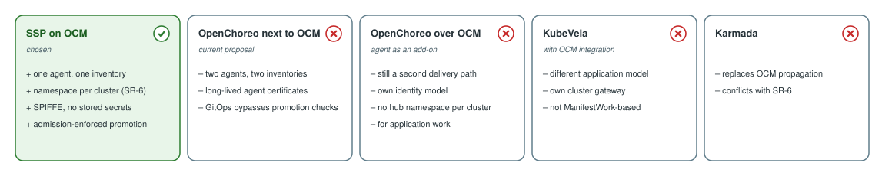

| Alternative | Why not chosen |
|---|---|
| **Run OpenChoreo next to OCM** (the current proposal) | Two agents and two cluster inventories. OpenChoreo's agent certificates conflict with SR-4 and SR-5. Promotion checks are bypassed by GitOps. |
| **Run OpenChoreo with OCM as its transport** (an OCM add-on carrying OpenChoreo's cluster agent) | Keeps OpenChoreo's experience, but it is still a second delivery path with its own identity, and it does not give a hub namespace per cluster for application work. |
| **KubeVela with its OCM integration** | KubeVela's application model is different from OpenChoreo's, and its multi-cluster mode uses its own cluster gateway rather than `ManifestWork`. |
| **Karmada** | Its propagation model replaces OCM's, which conflicts with SR-6. |
| **Argo CD** instead of Flux | Not chosen by the requirements for this design. Flux's per-`Kustomization` service accounts, commit verification and pull-only model fit hub-side GitOps well. |
| **Crossplane for cluster requests** (the existing proposal) | A second platform API next to SSP's. SSP's Java controllers render Cluster API directly and register clusters with OCM in the same reconcile. |
| **Register existing clusters only** | Leaves SR-1's per-team clusters to a separate process; teams could not request clusters themselves. |
| **Write SSP in Go** with kubebuilder | Closer to OCM and OpenChoreo, and OpenChoreo's template engine could be copied in. Not chosen: SSP is built in Java. |
| **Flux on every managed cluster** instead of `ManifestWork` | Every cluster would need Git access and credentials, delivery would bypass the hub's namespace model (SR-6), and status would not come back to one place. |

## Open Questions

1. **Git host authentication without stored secrets (SR-5).** Flux supports keyless authentication to some Git hosts, for example Azure DevOps with Entra workload identity. GitHub App authentication needs a stored private key. Which Git host do we use, and is a key in Key Vault acceptable if the host has no federation?
2. **The VKS bootstrap token.** Is a single-use, ten-minute SPIRE join token at cluster creation acceptable under SR-5, or do we need a TPM- or vSphere-based attestor?
3. **Template engine in Java.** Is `cel-java` (`dev.cel`) enough for OpenChoreo's template syntax, extension functions and cost limits, or do we need extra functions or another CEL library? How exactly must SSP templates match OpenChoreo's, so that OpenChoreo types can be reused?
4. **Image pulls on VKS.** VKS has no managed identity for kubelets. Do we use the Kubernetes service-account-token credential provider with Entra federation, or a registry inside each stack?
5. **Production rebuild.** Is rebuilding from the commit in production required, or may production pull a signed image from a production registry that a separate, approved copy job fills?
6. **Platform changes in production.** Does SR-9 cover `fleet-pr` and `platform` tag changes as well as application releases? This design assumes it does.
7. **Shared clusters in production.** Are shared clusters allowed in `pr`, or only in `dv` and `te`?
8. **API group name.** `ssp.io` is a placeholder.
9. **Cluster API kubeconfig Secrets (SR-5).** Cluster API stores an admin kubeconfig Secret per cluster on the hub, and OCM's importer reads it. Is that acceptable with tight access and short-lived certificates, or must the admin credential be removed after import?
10. **Who approves cluster requests in non-production?** Platform engineer review on every `fleet-np` request, or automatic merge within limits (types, sizes, count per team)?

## Infrastructure Needed

- An `ssp` source repository (Java, Maven) for the controllers, webhooks, observer API and `kubectl` plugin, and a `ssp-backstage` repository (TypeScript) for the Backstage plugins, plus a container registry for their images.
- CI runners with Docker for Testcontainers and kind, and GraalVM for native builds.
- The `platform`, `fleet-np`, `fleet-pr` and `releases-pr` repositories, with branch protection and code owners.
- A kind-based end-to-end test environment: an OCM hub with Cluster API and the Docker provider, which provisions the managed clusters.
- An Azure test subscription and a vSphere Supervisor namespace for the nightly cloud provisioning tests.
